# Hare Krushna Grocery ERP — screen by screen

> This guide describes the screens of schema 36 (revised Phase 8). From schema 33, a lot's quantity changes only through its own sale, return, purchase, damage, vendor-return, internal-use or reviewed-count document, and stock can no longer go negative. Schema 36 removes the old movement ledger and count sheets; every document still shows its own quantities, and the backup taken just before that upgrade keeps the ledger and is never deleted automatically. Sales History shows Completed, Partially refunded, Refunded and Void. A resellable return goes back to the original lot only if that lot is unchanged since the sale; otherwise it creates a new return lot, and a damaged or expired return goes to Damages. From schema 34, the calendar year (January–December) and the fiscal year (April–March) lock separately: entries dated in a year can still change through the seventh day after it ends and are locked from the eighth (8 January and 8 April). A locked year's profit and loss is saved once, with a checksum, and always shows exactly those saved figures. Posted expenses, damages and salary payments are never rewritten: **Edit** or **Void** records a correction. From schema 35 the Stock screen and the Money out expiry tab are gone: every lot, expiry, damage and count action lives in **Products**, and **Vendors** has its own page. Further approved changes are listed in the [revised implementation plan](../../revised-implementation-plan.md).

[ગુજરાતી માર્ગદર્શિકા](gujarati.md) · [Guide index](README.md)

Screenshots show example records. Fields marked **Save**, **Post**, **Confirm**, or **Restore** change stored data; a filter or **Refresh** changes only the view. A row must usually be selected before its action becomes available.

## 1. Start, login, and navigation

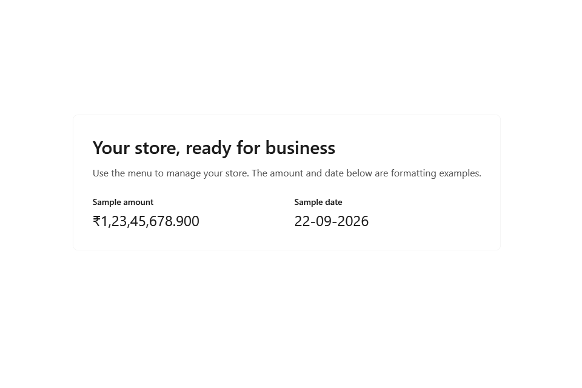

On a fresh installation, the eight step [setup wizard](screenshots/onboarding-1-language.en.png) runs before login. **Back** returns to the previous step and **Next** validates the current step.

| Step and screenshot | Fields and effect |
|---|---|
| [1. Language](screenshots/onboarding-1-language.en.png) | English or Gujarati sets the interface language. It can also be switched later from the shell. |
| [2. Store](screenshots/onboarding-2.en.png) | Store name, address, phone, GSTIN, state, and tax mode identify the business and affect receipts and tax calculations. |
| [3. Owner](screenshots/onboarding-3.en.png) | Username, password, and confirmation create the owner login. |
| [4. Data and backups](screenshots/onboarding-4.en.png) | Data folder locates the database; backup folder and USB reminder set backup storage and prompts. |
| [5. Printers](screenshots/onboarding-5.en.png) | Receipt printer, width, and raster/text mode affect receipts. Label printer and size affect barcode labels. A4 printer affects report output. Each **Print test** checks the selected device. |
| [6. Barcodes](screenshots/onboarding-6.en.png) | Lot and product prefixes, plus the scale rule, tell the scanner how to interpret in store and weighted barcodes. |
| [7. Gujarati keyboard](screenshots/onboarding-7.en.png) | Shows keyboard availability and setup guidance for Gujarati text entry. |
| [8. Start](screenshots/onboarding-8.en.png) | Start empty or choose the import path for opening stock. **Next** finishes setup. |

At [login](screenshots/login.en.png), enter the owner credentials. The [shell](screenshots/shell.en.png) navigation lists Dashboard, Billing (POS), Products, Purchases, Vendors, Sales history, Money out, Assets, Reports and Settings. The one-line top bar shows the store, scanner and printer status, backup status, update check, **Lock**, and the `EN`/`ગુ` language switches. The Products item shows a badge only while expired or expiring stock needs action. [Lock screen](screenshots/session-lock.en.png) asks for the password to resume the session. Once after the schema 36 upgrade, when at least a tenth of the database is unused space, sign-in offers to compact the database (see Settings).

**Workflow:** Complete setup → log in → check device and backup status → choose a navigation item. Use **Lock** when leaving the till.

## 2. Working with lists

Products, Purchases, Vendors, Sales history, Money out and Assets share one layout: a title row with the page actions, one filter row, the table and a footer with the row count and **Previous**/**Next**.

- **Rows per page fit the window.** A page shows as many rows as the table can hold without scrolling; resizing the window changes the page size. A search on Products shows at most eight results.
- **Filters run as you type or choose.** **More filters** opens a second row. When the window is narrow, the less used filters move into that row; the button then shows how many hidden filters are set, for example **More filters · 2**. **Clear filters** restores the defaults. Each page remembers its filters until the program closes.
- **Selecting rows** replaces the filter row with a blue selection bar: the exact count, **Clear selection** and the page's **Bulk actions ▾**. Ticking the header box selects this page; when more pages exist, **Select all matching results** widens the selection to every row matching the filters, and the bar then lists those filters.
- **Every bulk action is reviewed first** ([review](screenshots/bulk-review.en.png)). The rows are checked again in the database and the window shows how many are eligible and skipped, with the reason for each skip, and the quantity and value affected. The action button, such as **Apply (42)**, changes the eligible rows in small parts. Each part is saved on its own, so a till sale is never held up for long. **Stop after this part** pauses; **Resume** continues with the rest. The [result](screenshots/bulk-result.en.png) shows changed, skipped, changed-since-review and not-processed counts, and **Save result list…** writes every row's outcome to a CSV file.
- Forms mark required fields with a red *, show each problem under its field and list all problems at the top when **Save** or **Post** fails. Entered values are kept ([example](screenshots/vendor-form-errors.en.png)).

## 3. Dashboard

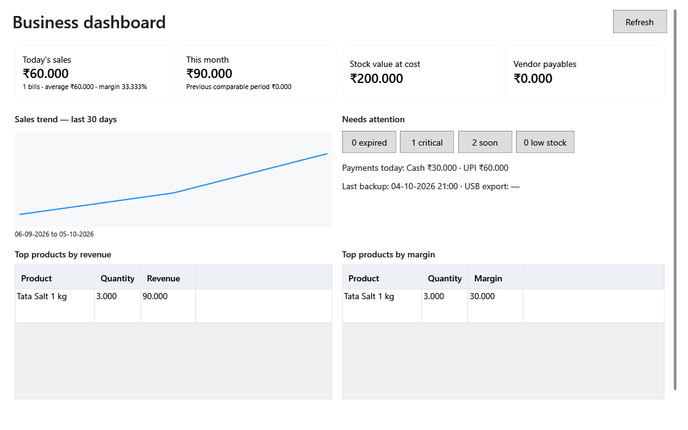

**Today sales** and **Month sales** tiles open the corresponding sales report. **Stock value** opens the current unsold stock report; **Payables** opens vendor balances. The trend chart opens sales for the selected period. **Expired** opens Products filtered to expired stock, **Critical** and **Soon** open it filtered to expiring stock, and **Low stock** opens the low-stock report. Payment split leads to reporting and backup status to Settings. The two product tables rank revenue and margin; double click a product to inspect it. **Refresh** recalculates the display. A [narrow view](screenshots/dashboard.narrow.en.png) shows how the same information reflows.

**Workflow:** Review the four totals → open any attention badge → resolve its records in the destination screen → return and refresh.

## 4. Products, lots and stock

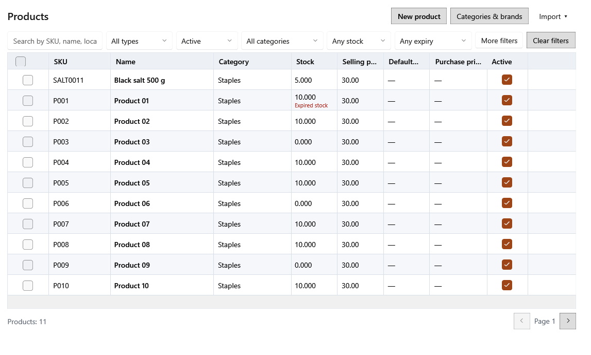

Search by SKU, barcode, name, Gujarati name, alias or brand. An exact SKU or barcode is listed first, and words of any length can be combined ("basmati 5 kg"). The filter row offers **All types**/Saleable/Internal use, Active/Archived/Any status, category, **Has stock**/**Low stock**, and expired or expiring stock; **More filters** adds brand, vendor, **No barcode**, **Missing local name** and **Loose product**. **Import ▾** imports products from Excel, imports opening stock or saves the opening-stock template. **Categories & brands** manages the [catalog masters](screenshots/category-tree.en.png). **New product** (Ctrl+N) opens the [product form](screenshots/product-editor.en.png).

Double-click a product or press Enter to open its [panel](screenshots/product-panel.en.png) beside the table. The header shows the SKU, category, type, stock on hand and the FEFO selling price. **Basics** is the product form; **Save** stores changes and **Revert** discards them. **Lots** opens the product's [lots](screenshots/product-lots.en.png); it is built only when chosen. Its actions (**Add direct lot**, **Edit price and expiry**, **Record damage**, **Consume for internal use** and **Print labels**) sit on the tab row beside **Basics** and **Lots**, so the table keeps that height; when the panel is narrow, as in [Gujarati](screenshots/product-lots.gu.png), the last ones move under **More ▾**. **Close** or Esc closes the panel; unsaved changes are confirmed first.

| Area or dialog | Fields and effect |
|---|---|
| [Product form](screenshots/product-editor.en.png) | **Identity**: SKU, name, Gujarati name, aliases and barcodes (one per line, the first is primary). **Classification**: category, brand, unit and **Product type** — internal-use items stay out of billing and profit and loss. **Tax and prices**: HSN, GST rate, selling price, MRP and whether prices include tax. **Stock rules**: reorder level, expiry tracking and alert days, loose/PLU. A new product can add its first lot in the same save. |
| [Lots tab](screenshots/product-lots.en.png) · [Gujarati](screenshots/product-lots.gu.png) | Each lot shows lot code, batch, expiry with its status (Fresh, Soon, Critical, Expired), on hand, price, MRP, unit cost, source (Purchase, Direct entry, Customer return) and received date. Filter by batch or lot code, status (all, available, empty, blocked) and expiry; **More filters** adds source, an expiry date range and a price range. |
| [Add direct lot](screenshots/direct-lot.en.png) | Quantity, unit cost, price, MRP, batch, expiry, received date and a reason add stock without a purchase. The cost reaches profit and loss only when the stock is sold. |
| [Edit price and expiry](screenshots/lot-price.en.png) | Changes a lot's selling price, MRP and expiry for future sales; completed bills keep their prices. |
| [Record damage](screenshots/damage-form.en.png) | Quantity (up to the available stock), recovered amount, reason, damage date and notes. The preview shows the loss and the date it counts in profit and loss. The quantity leaves stock and appears in Money out → Damages. |
| Consume for internal use | For internal-use products only: quantity and reason record shop use with no profit-and-loss effect. |
| **Bulk actions ▾** (products) | **Remove selected**, **Restore selected**, **Set category…**, **Set GST rate…**, **Set product type…**, **Print labels for selected**, **Generate barcodes for selected**, **Reconcile selected stock** and **Write off expired stock…**. A product with stock is archived, not deleted; the type of a product with stock cannot change. |
| **Bulk actions ▾** (lots) | **Block selected**, **Unblock selected**, **[Mark selected lots damaged](screenshots/bulk-damage.en.png)** (up to 50 lots, a quantity per lot) and **Delete selected empty lots** (only lots at zero with no open bill). |
| [Reconcile selected stock](screenshots/direct-count-review.en.png) | Enter the counted quantity for each lot of the selected products (pages of 50 lots) with a reason and damage category. A shortage becomes damage; a surplus becomes a new direct lot. |
| [Write off expired stock](screenshots/bulk-review.en.png) | Reviews every expired lot with stock of the selected products, with quantity and cost, and records each in full as Expired damage. |
| [Excel import](screenshots/product-import.en.png) · [opening stock preview](screenshots/opening-stock-preview.en.png) | **Download template** gives the columns; **Browse** loads a file; select valid preview rows and **Import valid**. The opening stock preview lists SKU, quantity, cost, price and row errors; **Import reviewed** posts valid opening lots. |
| [Product label](screenshots/product-label.en.png) · [label batch](screenshots/label-batch.en.png) | Choose the printer, template and copies; **Print** sends the labels. |
| [Unknown barcode](screenshots/unknown-barcode.en.png) · [attach existing](screenshots/unknown-barcode-attach.en.png) · [quick add](screenshots/quick-product.en.png) | A scan with no match can create a product (SKU, name, category, unit, selling price, optional MRP, GST and HSN) or attach the barcode to an existing one. |

**Workflow:** Maintain masters → add or import products → open a product to check its lots → add direct lots, correct price or expiry, record damage → filter **Expired stock** and write it off → count shelves with **Reconcile selected stock**.

## 5. Purchases and vendors

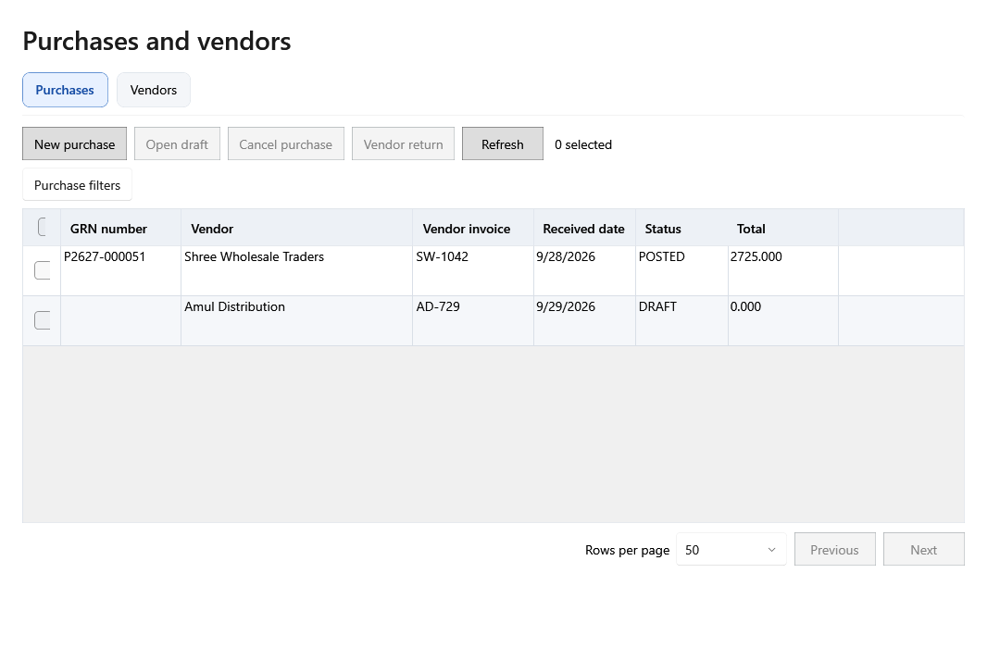

Find a purchase by GRN or vendor bill number (any part of the beginning, in any case), vendor, status and received dates; [**More filters**](screenshots/purchases-filters.en.png) adds line type, product and **Stock left to return**. **Open** shows a draft for editing or a posted purchase's [invoice](screenshots/purchase-entry.en.png). **Vendor return** records a partial return of a posted purchase; **Return history** lists its returns. **Void purchase** is available only while no stock from the purchase has been used; its tooltip explains why it is disabled. **New purchase** (Ctrl+N) opens the entry form; after **Post** the toolbar shows the new GRN number. **Bulk actions ▾ → Void selected purchases** reviews and voids eligible purchases five at a time.

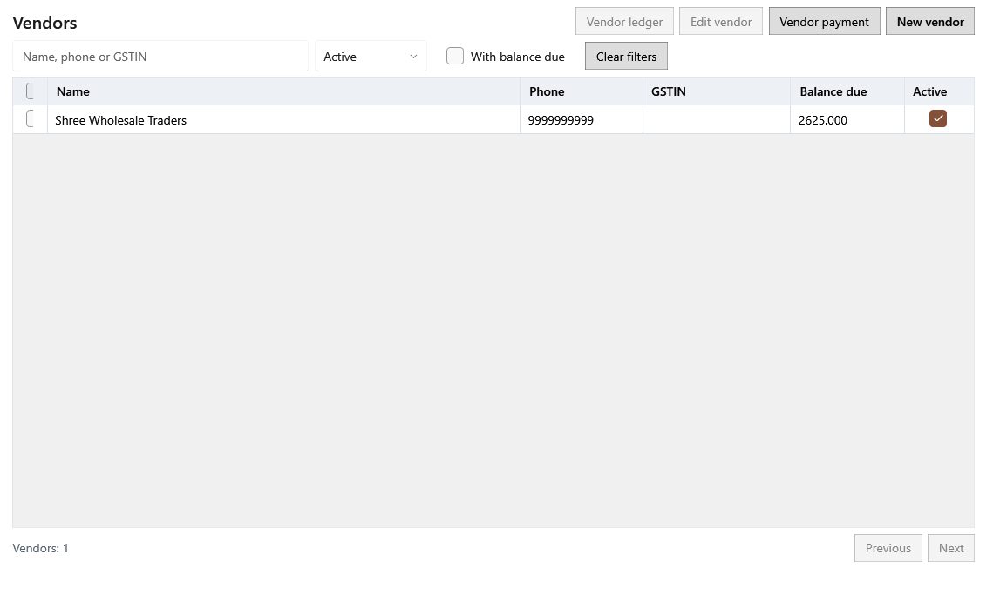

**Vendors** lists name, phone, GSTIN, balance due and active state; search by name, phone or GSTIN, filter Active/Inactive and **With balance due**. **Vendor ledger**, **Edit vendor**, **Vendor payment** and **New vendor** open their dialogs; **Bulk actions ▾** activates or deactivates selected vendors.

| Dialog | Fields and effect |
|---|---|
| [New purchase](screenshots/purchase-entry.en.png) · [warnings](screenshots/purchase-entry-warnings.en.png) | Vendor, invoice number/date and received date identify the GRN. Each line's **Type** is Product (a saleable lot), Internal use (a lot outside profit and loss) or Expense (a category, no lot); only the fields for that type are used. Quantity, free quantity, rate, discount, GST, batch, expiry, MRP and price determine the lot, cost and tax. Ctrl+D copies the cell above (never the line type or product); Ctrl+S saves the draft. **Notes and charges**, the supplier bill total and the bill difference help reconcile. **Post** creates the lots and the vendor balance. |
| [Vendor editor](screenshots/vendor-editor.en.png) · [bottom](screenshots/vendor-editor-bottom.en.png) | Name, contact, phones, email, address, GSTIN (15 characters), PAN (10), pincode (6), UPI/bank, payment terms and opening balance. |
| [Vendor payment](screenshots/vendor-payment.en.png) | Vendor and an optional bill allocate the payment; date, amount, mode, reference and notes reduce the payable balance. |
| [Vendor ledger](screenshots/vendor-history.en.png) | Purchases, payments, returns, the running ledger and the lots supplied. |
| [Vendor return](screenshots/vendor-return.en.png) | Date, credit note and reason; per lot the received, already returned and available quantity and the return quantity and credit. **Post return** removes the stock and credits the vendor. |

**Workflow:** Create the vendor → enter the purchase, check each line and the supplier total → save a draft if needed → post → pay or return from the vendor's records.

## 6. Money out: damages, expenses and payroll

The tabs **Damages**, **Expenses**, **Employees** and **Posted payments** form the page header; the active tab's actions sit at the right of the same line. Each tab has its own filters and a narrow details panel for the selected record.

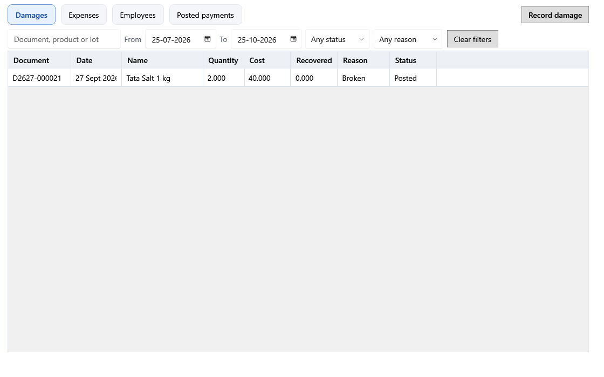

**Damages** filters by document, product or lot, dates, status (Posted, Corrected, Void) and reason. **Record damage** opens the [damage form](screenshots/damage-form.en.png) with a lot search. Selecting a damage opens its panel: the panel states how an edit is dated — "both annual periods are open" means the change counts on the original date; "… is finalized" means the original stays and a correction is dated today. **Edit** opens the [correction dialog](screenshots/damage-correction.en.png); **Void** corrects the quantity to zero. A quantity change returns or removes stock in today's lot balance; if the damaged lot was deleted at zero, restored units start a new lot. **History** lists the original and every correction. Damage of internal-use stock has no profit-and-loss effect.

**Expenses** filters by paid to, reference or notes, dates, category and status (Posted, Corrected, Void, Purchase). **New expense** opens the [expense form](screenshots/expense-form.en.png): date, category, amount, mode, paid to, reference and notes, with a notice of the date the expense counts on. **Repeat last month** prepares a [draft](screenshots/repeat-expenses.en.png) for chosen categories; review it before saving. **Expense categories** opens the [category list](screenshots/expense-categories.en.png). **Edit** in the details panel opens the [correction form](screenshots/expense-correction.en.png) with a required reason; **Void** zeroes the expense through a correction. Expenses created by a purchase's Expense line show Purchase and change only by voiding that purchase. **Open assets** moves to Assets.

**Employees** filters by name, role or phone and Working/Relieved. **New employee** and **Edit** open the [employee form](screenshots/employee-form.en.png); changing the monthly salary asks **Salary from** (YYYY-MM): the new amount applies from that month, never earlier than the first month whose calendar and fiscal years are both open, and payments already posted stay as paid.

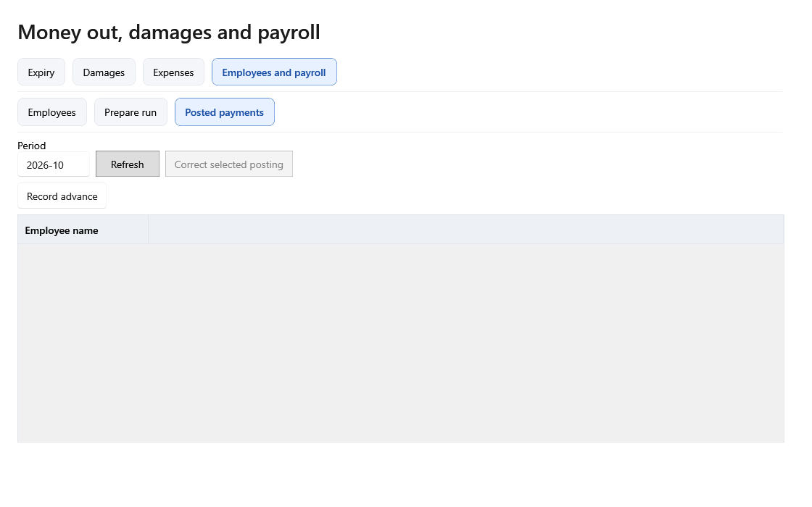

**Posted payments** filters by month range, employee and status. **Prepare run** opens the [salary run](screenshots/salary-run.en.png): period, pay date and mode; **Prepare lines** fills salary, leave deduction, overtime and bonus for each working employee; **Post salary** records the payments, which count in the month worked. **Record advance** opens the [advance form](screenshots/advance-form.en.png). **Edit** in the details panel opens the [correction dialog](screenshots/salary-correction.en.png); **Void** zeroes a payment entered by mistake.

**Workflow:** Record damage as it happens → log expenses → maintain employees → prepare and post salary → correct posted values only through Edit or Void with a reason.

## 7. Assets

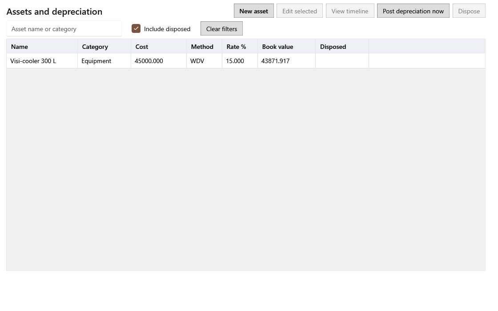

Search assets and tick **Include disposed** to list retired ones. **New asset** and **Edit selected** open the [asset form](screenshots/asset-form.en.png): name, category, purchase and in-use dates, cost, WDV/SLM method, rate, salvage value, vendor and notes. **View timeline** shows the dated terms and each month's opening value, depreciation and closing value; a month posted after its year locked shows the date it was charged. **Post depreciation now** posts due months. A month of a locked year that was never posted is still posted, but its charge counts today.

When editing a saved asset, a change to method, rate or salvage shows **Effective from** (the first open month by default) and a [preview](screenshots/asset-terms.en.png) of the months that recalculate, with depreciation and book value before and after; saving recalculates only those open months. Cost and in-use date can change only while every posted month is open; after a locked year's depreciation is posted they are fixed and **Save** stays disabled. **Dispose** opens the [disposal form](screenshots/asset-disposal.en.png): the disposal date and proceeds; the gain or loss is measured against the book value saved at disposal.

**Workflow:** Add asset → review its schedule → post due depreciation → edit when permitted → dispose when retired.

## 8. Billing and held bills

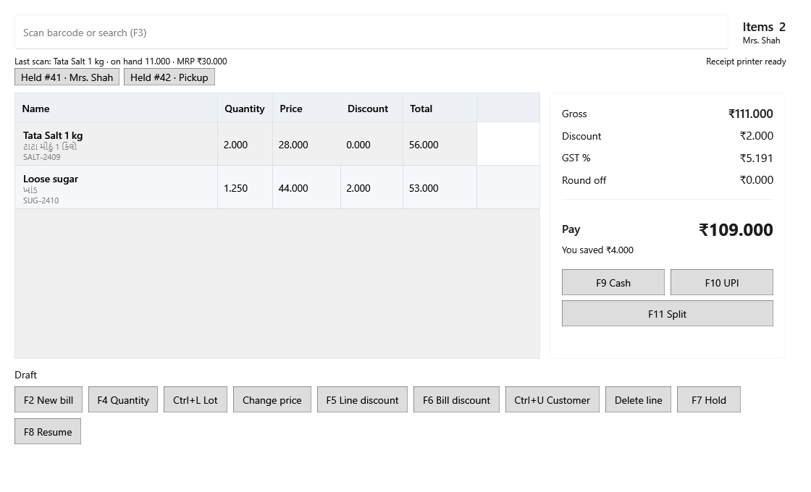

Scan or search in the top box (`F3`). The line table shows product, quantity, unit price, line discount and total. The right panel recalculates gross, discount, GST, round off and amount to pay. **Cash**, **UPI**, or **Split** completes payment. The bottom commands start a new bill, change quantity, choose lot, override price, apply line or bill discount, set customer, delete a line, hold, and resume.

| Dialog | Fields and effect |
|---|---|
| [Quantity](screenshots/quantity.en.png) · [lot picker](screenshots/lot-picker.en.png) | Quantity changes the selected line and stock demand; lot selection chooses which batch is sold. |
| [Discount](screenshots/discount-percent.en.png) | Enter a value and choose amount or percent; the preview shows the resulting discount before **Save** applies it to the chosen line or bill. |
| [Customer](screenshots/customer.en.png) | Search an existing customer or create one with name, phone and GSTIN. **Use customer** attaches it to the bill; **Walk in** proceeds without a saved customer. |
| [Hold](screenshots/hold-bill.en.png) · [saved bills](screenshots/saved-bills.en.png) · [held review](screenshots/held-review.en.png) | Give an unfinished bill a label. Search held bills by ID or label, then **Open bill**. Review compares previous/current price, MRP, on hand quantity and status before **Accept and resume**. |
| [Split payment](screenshots/payment.en.png) | Cash, UPI and card amounts must cover the payable total; references document digital/card components. **Confirm payment** posts the sale. |

**Workflow:** Scan/search product → verify quantity, batch, price and discount → attach customer if needed → check payable total → take payment → give the receipt. Use Hold/Resume for interrupted transactions. See [sale receipt preview](screenshots/sale-receipt.en.png).

## 9. Sales History and day end

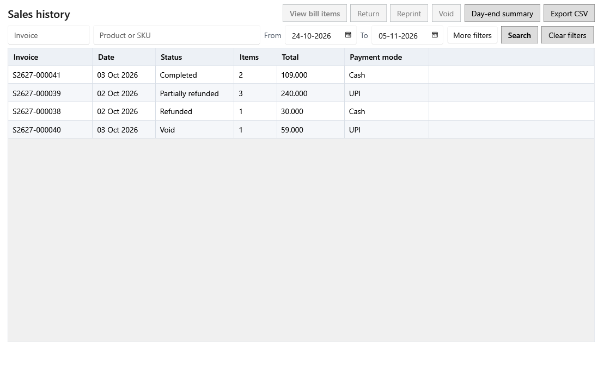

Invoice number, product or SKU, From/To dates and status filter invoices; **More filters** adds customer, payment mode and an amount range. **Search** (Enter) applies them. **Export CSV** saves every matching invoice with the filters on the first line and totals on the last. Select an invoice to inspect its items, [returns](screenshots/sales-detail-1.en.png) and activity. **Reprint** queues the saved receipt, **Void** opens the [reason dialog](screenshots/void.en.png), and **Return** opens the [return dialog](screenshots/return.en.png), which shows lot, expiry, sold, already returned and remaining quantity with the refund and where the stock goes. A legacy line missing details opens a [review form](screenshots/return-recreation.en.png): every detail the old sale did not save says so under its field, and an unsaved **Track expiry** or **Fractional quantity** stays empty until you choose Yes or No. [Day end](screenshots/day-end.en.png) summarizes sales, refunds, tax and payment modes for the business date.

**Workflow:** Filter and select invoice → inspect items and payments → reprint, void, or return with a reason as appropriate → review day end. See [return receipt preview](screenshots/return-receipt.gu.png).

## 10. Reports

**Report** chooses the dataset; **Period** or From/To sets the date range; only the filters that apply to the chosen report are shown. **Refresh** runs the query. The table shows a bounded number of rows; **Export Excel** and **Print A4** use those rows (A4 prints the first 100) and say when they are partial, while **Export full CSV** streams every row with progress and **Cancel**. Every export states the report, period and applied filters, and the CSV ends with totals for every row. The [profit and loss view](screenshots/reports-pnl.en.png) ([narrow layout](screenshots/reports-pnl.narrow.en.png)) chooses **Month**, **Calendar year**, **Fiscal year** or **Custom range**, then the period; a saved year is marked "· Finalized" in the list. The badge above the table reads **Open** with the last date its entries may change, or **Finalized** with the year, edit cutoff, version and checksum. Head totals come first; select **Expenses** to expand its categories, and **Show months** adds a column per month. **Actions ▾ → Export P&L CSV** writes exactly the displayed version, so a finalized year's file is identical every time. The [hourly view](screenshots/reports-hourly.en.png) shows time distribution.

**Current unsold stock** reads current lot quantity and cost. **Include expired stock** adds or leaves out lots expired as of the business date, and the line under the table always states the expired lots, quantity and cost value. **Purchased vs used reconciliation** lists lots newest first (or one product's lots) with received, sold, returned, damaged, internal-use, vendor-returned and corrected quantities, the expected and available stock, and any difference. **Differences only** lists the lots that the weekly full check found different, rechecked now.

**Workflow:** Choose report → set period and applicable filters → refresh → inspect totals → export or print. Wide A4 output can span [band 1](screenshots/report-a4-band1.en.png) and [band 2](screenshots/report-a4-band2.en.png).

## 11. Settings, backup, and restore

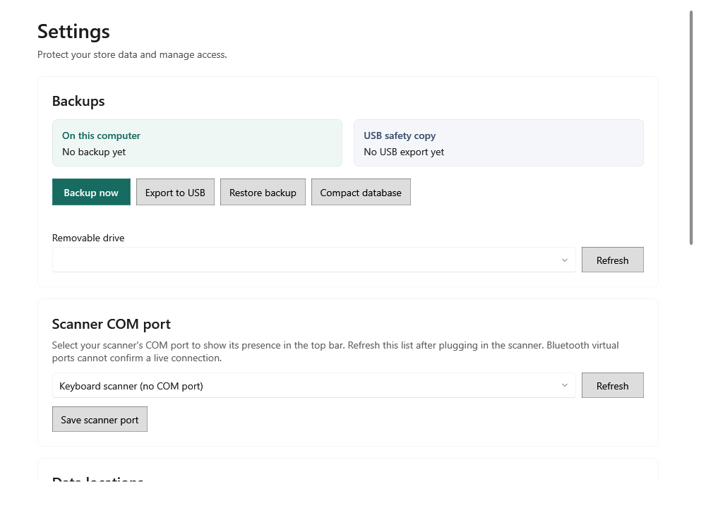

**Local backup** and **USB copy** cards show backup health. **Backup now** creates a local copy. Choose a removable drive, **Refresh** it, then **Export to USB** to copy the backup. **Scanner port** chooses the serial scanner connection; **Save scanner port** applies it. [Settings bottom](screenshots/settings-bottom.en.png) shows the data and backup folders; **Move data** relocates the working data. Current, new and confirmed passwords change the owner password.

[Restore](screenshots/restore.en.png) compares current data with selected backup data. Typing the required confirmation unlocks **Restore**. Restore replaces the active database with the backup, so check the displayed source and dates before continuing. The backup taken just before the stock ledger was removed is listed as **Before stock ledger removal … kept permanently**; automatic cleanup never deletes it, and a compaction's own backup is listed as **Before compacting the database**.

**Compact database** shows how much of the database is unused space. It needs free disk space for a compact copy and its backup, and says how much when there is not enough. After confirmation the app closes; at the next sign-in, before the main window opens, it copies the database without the unused space, checks that the copy holds every record and the same totals, saves the copy as a verified backup and then switches to it, with [progress](screenshots/compaction.en.png). **Cancel** works until the switch; until then the original stays untouched, and the original is deleted only after the compact database has opened at the next start. Compact when the shop is closed.

**Workflow:** Back up locally → export to USB regularly → verify device status → change paths/credentials as needed. For recovery, select a known backup, compare summaries, type the confirmation, and restore. After a large cleanup such as the schema 36 upgrade, compact the database once.
