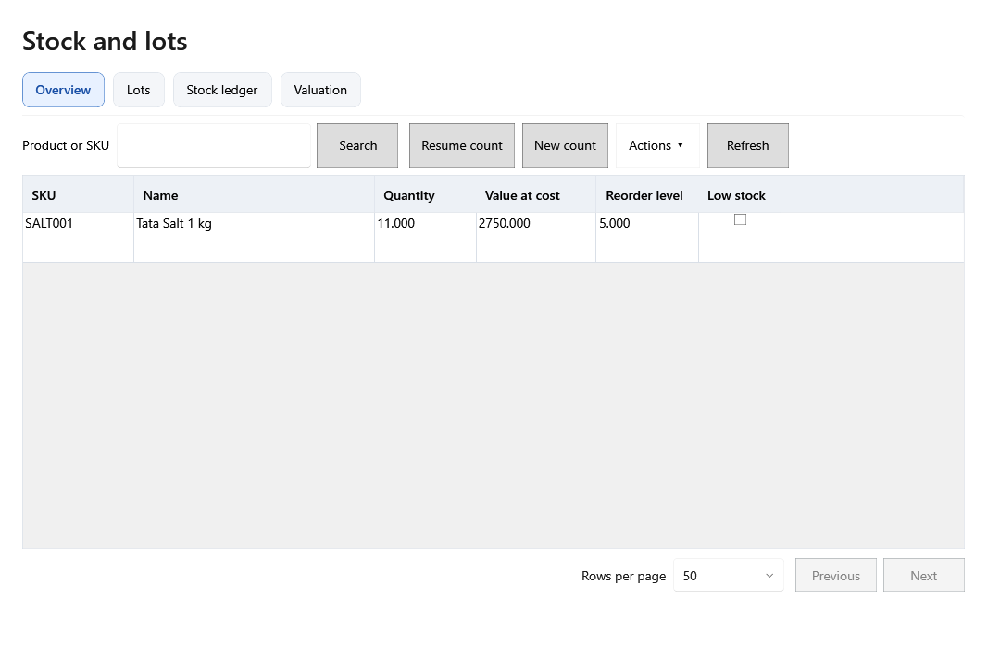
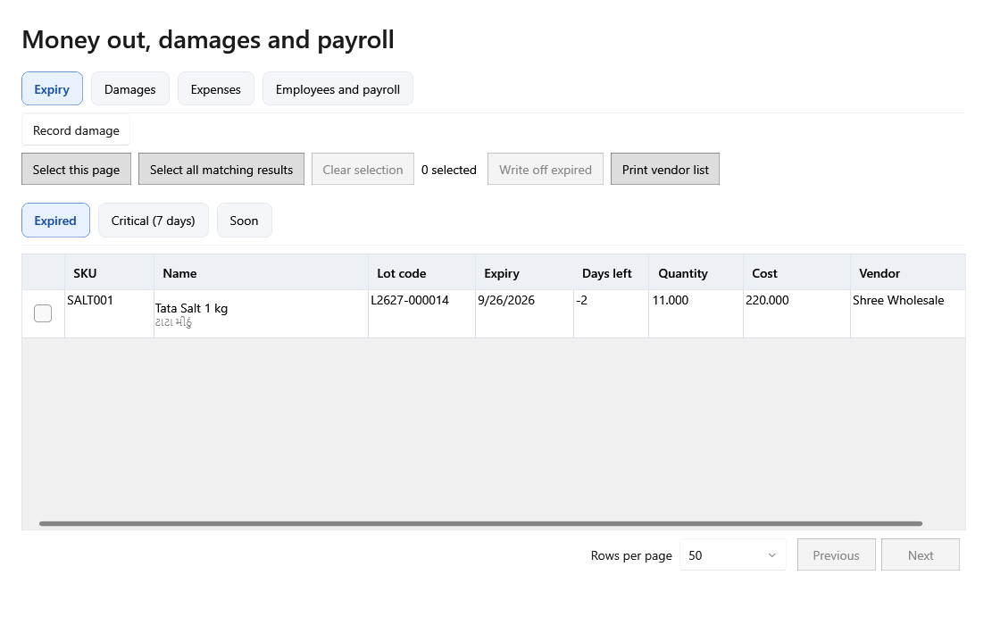
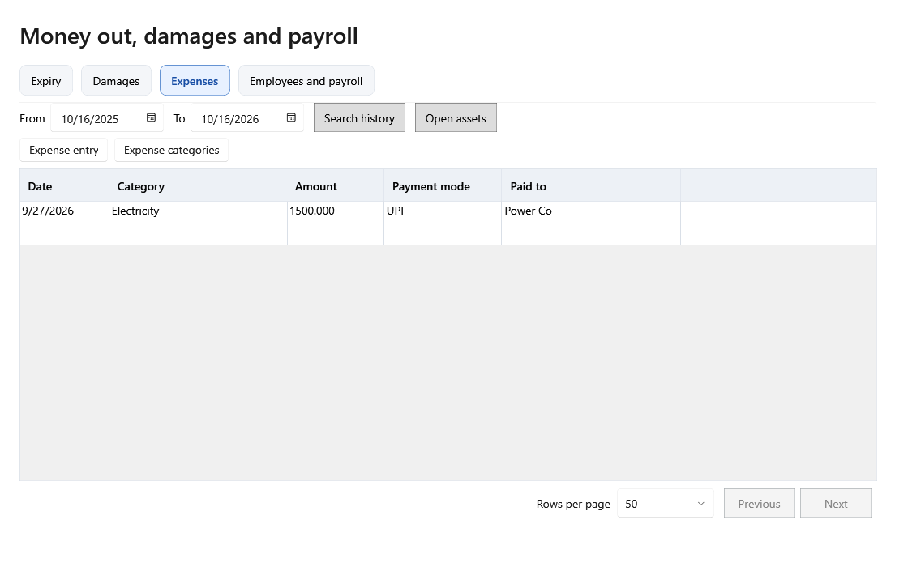
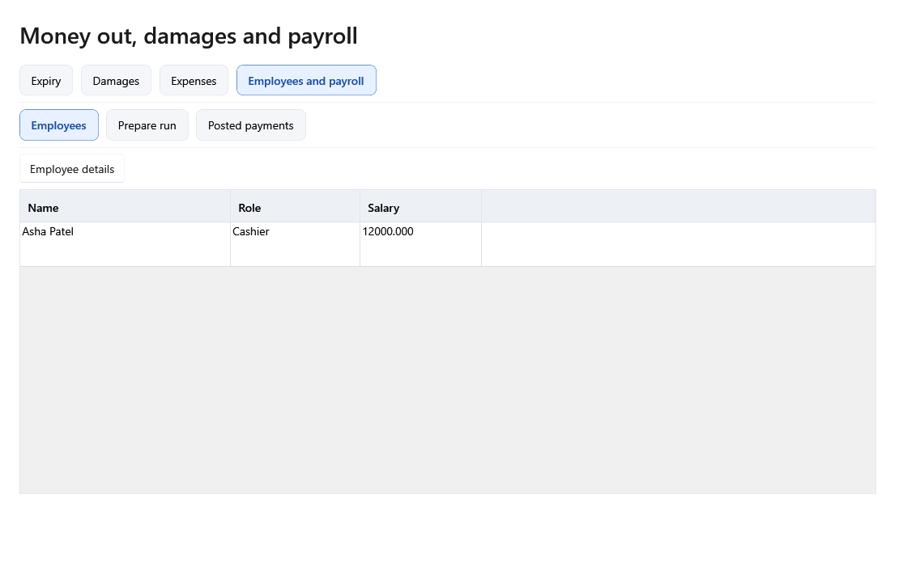
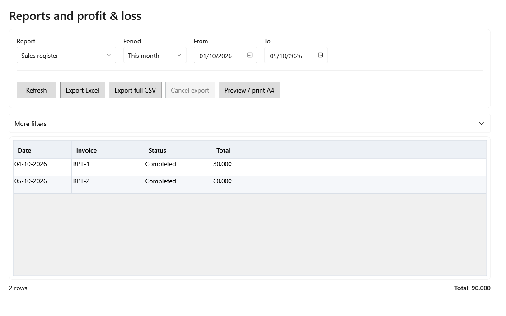

# Hare Krushna Grocery ERP — screen by screen

[ગુજરાતી માર્ગદર્શિકા](gujarati.md) · [Guide index](README.md)

Screenshots show example records. Fields marked **Save**, **Post**, **Confirm**, or **Restore** change stored data; a filter or **Refresh** changes only the view. A row must usually be selected before its action becomes available. Tables with checkboxes support actions on several selected records. **Rows per page**, **Previous**, and **Next** change the visible page, not the records.

## 1. Start, login, and navigation

On a fresh installation, the eight step [setup wizard](screenshots/onboarding-1-language.en.png) runs before login. **Back** returns to the previous step and **Next** validates the current step.

| Step and screenshot | Fields and effect |
|---|---|
| [1. Language](screenshots/onboarding-1-language.en.png) | English or Gujarati sets the interface language. It can also be switched later from the shell. |
| [2. Store](screenshots/onboarding-2.en.png) | Store name, address, phone, GSTIN, state, and tax mode identify the business and affect receipts and tax calculations. |
| [3. Owner](screenshots/onboarding-3.en.png) | Username, password, and confirmation create the owner login. |
| [4. Data and backups](screenshots/onboarding-4.en.png) | Data folder locates the database; backup folder and USB reminder set backup storage and prompts. |
| [5. Printers](screenshots/onboarding-5.en.png) | Receipt printer, width, and raster/text mode affect receipts. Label printer and size affect barcode labels. A4 printer affects report output. Each **Print test** checks the selected device. |
| [6. Barcodes](screenshots/onboarding-6.en.png) | Lot and product prefixes, plus the scale rule, tell the scanner how to interpret in store and weighted barcodes. |
| [7. Gujarati keyboard](screenshots/onboarding-7.en.png) | Shows keyboard availability and setup guidance for Gujarati text entry. |
| [8. Start](screenshots/onboarding-8.en.png) | Start empty or choose the import path for opening stock. **Next** finishes setup. |

At [login](screenshots/login.en.png), enter the owner credentials. The [shell](screenshots/shell.en.png) provides navigation to Dashboard, Billing, Sales History, Products, Purchases, Stock, Money Out, Assets, Reports, and Settings. Its top bar shows store/business date, scanner/printer status, backup status, update check, **Lock**, and `EN`/`ગુ` language switches. [Lock screen](screenshots/session-lock.en.png) asks for the password to resume the session. An [expiry alert](screenshots/expiry-alert.en.png) can open at startup and lead to the expiry list.

**Workflow:** Complete setup → log in → check device and backup status → choose a navigation item. Use **Lock** when leaving the till.

## 2. Dashboard

**Today sales** and **Month sales** tiles open the corresponding sales report. **Stock value** opens stock valuation; **Payables** opens vendor balances. The trend chart opens sales for the selected period. Expired, critical, soon to expire, and low stock badges lead to their working lists. Payment split leads to reporting and backup status to Settings. The two product tables rank revenue and margin; double click a product to inspect it. **Refresh** recalculates the display. A [narrow view](screenshots/dashboard.narrow.en.png) shows how the same information reflows.

**Workflow:** Review the four totals → open any attention badge → resolve its records in the destination screen → return and refresh.

## 3. Products and catalog

The **search** box finds products; **Category** and **Brand** restrict the list. The **Filters** menu offers low stock, no barcode, missing local name, loose products, and archived products. Grid columns show SKU, English/local names, category, on hand stock, selling price, MRP, and active status. A row opens **Edit** and **Actions** (lots, ledger, labels, barcode generation, restore). Row checkboxes reveal bulk edit, labels, barcode generation, remove, or restore actions.

| Dialog or panel | Fields and effect |
|---|---|
| [Product editor: basic](screenshots/product-editor.en.png) · [pricing and stock](screenshots/product-editor-pricing.en.png) | SKU is the internal identifier; names and aliases affect search, bills, and labels; category, brand, and unit classify the product; barcode lines connect scans. HSN and tax rate affect tax; reorder level drives low stock; selling price and MRP affect billing; shelf life and alert days drive expiry warnings. **Prices include tax**, **Track expiry**, and **Loose/PLU** change pricing, lot tracking, and scale lookup behavior. **Save** stores changes. |
| [Catalog masters: categories](screenshots/category-tree.en.png) · [brands](screenshots/catalog-master-1.en.png) · [units](screenshots/catalog-master-2.en.png) · [tax rates](screenshots/catalog-master-3.en.png) | Category name/local name, parent and expiry alert days define the hierarchy and default alert. Brand name labels a brand. Unit code, names and **Allow fraction** control quantity entry. Tax name, percentage and active state define a selectable tax rate. |
| [Bulk edit](screenshots/catalog-bulk-edit.en.png) | Apply a selected category or tax rate to the checked products. Each **Apply** button changes that one property on the selected set. |
| [Excel import](screenshots/product-import.en.png) · [narrow layout](screenshots/product-import.narrow.en.png) | **Download template** gives the expected columns. **Browse** loads a file. Select valid preview rows; **Import valid** creates/updates them. **Export errors** saves row errors for correction. |
| [Product label](screenshots/product-label.en.png) · [label batch](screenshots/label-batch.en.png) | The single label preview shows names, barcode, price and MRP; printer name, printer mode and copies control output. The batch screen adds label template, product/lot source selection and copies per source. **Save print file** writes a job file; **Print** sends it to the printer. |
| [Product lots](screenshots/product-lots.en.png) · [ledger](screenshots/product-ledger.en.png) | Lots show batch, expiry, available quantity, cost and price. Ledger traces each stock movement and its source. |
| [Unknown barcode: quick add](screenshots/unknown-barcode.en.png) · [attach existing](screenshots/unknown-barcode-attach.en.png) · [quick product](screenshots/quick-product.en.png) | A scan that has no match can create a product or attach the barcode to an existing one. Quick add asks for name, category, unit, price, MRP, tax and HSN; optional opening quantity, cost and expiry create initial stock. |

**Workflow:** Maintain category/brand/unit/tax masters → add or import products → set barcodes, prices, tax, and expiry rules → inspect lots/ledger → print labels. On an unknown scan, attach to the correct existing product or create it before billing.

## 4. Purchases and vendors

The **Purchases** tab lists GRN, vendor, invoice number, received date, status, and total. Select a draft to **Edit draft**; a posted purchase can be cancelled or used for a vendor return when allowed. The [expanded Filters panel](screenshots/purchase-filters.en.png) applies From/To dates, vendor, and product search; **Clear filters** restores the full list. Checkbox selection enables eligible bulk cancellation.

The [Vendors tab](screenshots/purchases-vendors.en.png) lists name, phone, GSTIN, balance due, and active status. **New/Edit vendor**, **Vendor ledger**, and **Payment** open these workflows. Selection also exposes activate/deactivate actions.

| Dialog or panel | Fields and effect |
|---|---|
| [New purchase](screenshots/purchase-entry.en.png) · [additional details expanded](screenshots/purchase-additional.en.png) · [warnings](screenshots/purchase-entry-warnings.en.png) | Vendor, invoice number/date and received date identify the GRN. Search and add products; each line's batch, manufacturing/expiry dates, quantity, free quantity, rate, discount, GST, MRP and selling price determine stock lots, costs, tax and margin. **Additional details** holds notes, other charges and supplier bill total; computed totals and difference help reconcile. **Save draft** keeps an editable GRN; **Post** adds stock and vendor balance. Warnings flag short expiry, low margin, or unusual rate. |
| [Vendor editor: top](screenshots/vendor-editor.en.png) · [bottom](screenshots/vendor-editor-bottom.en.png) | Name/contact, phones, email and address support lookup and contact; GSTIN/PAN identify tax records; UPI/bank and payment terms support settlement; opening balance starts the vendor ledger. Notes are internal. |
| [Vendor payment](screenshots/vendor-payment.en.png) · [narrow layout](screenshots/vendor-payment.narrow.en.png) | Vendor and optional purchase allocate the payment. Date, amount, mode, reference and notes record settlement and reduce the payable balance. |
| [Vendor history](screenshots/vendor-history.en.png) | Tabs show [payments](screenshots/vendor-history-1.en.png), [returns](screenshots/vendor-history-2.en.png), [ledger](screenshots/vendor-history-3.en.png), and [lots supplied](screenshots/vendor-history-4.en.png), alongside purchases. |
| [Vendor return](screenshots/vendor-return.en.png) | Date, credit note number and reason identify the return. Enter return quantity and before tax/tax credit per lot. **Post return** removes stock and credits the vendor balance. |

**Workflow:** Create the vendor → start a purchase → enter and check each lot and supplier total → save a draft if needed → post → inspect the vendor ledger → record payment or return. A posted purchase is a stock and payable transaction, so review it before posting.

## 5. Stock and counting

**Overview** searches products and shows quantity, cost value, reorder level and low stock. **Actions** exports an opening stock template or imports opening stock. **New count** starts a count, while **Resume count** opens a saved draft.

| Tab or dialog | Fields and effect |
|---|---|
| [Lots](screenshots/stock-lots.en.png) | Search product/lot; inspect batch, expiry bucket, on hand quantity, unit cost, selling price, and active state. **Adjust** changes quantity, **Correct lot** changes lot values, **Block/Unblock** controls sale eligibility, and expired write off removes unusable stock. Checkbox actions apply to several lots. |
| [Ledger](screenshots/stock-ledger.en.png) · [source document](screenshots/stock-source.en.png) | From/To and movement type filter the audit trail. Quantity and lot balance show each change. **Open source** displays the linked purchase or other document. |
| [Valuation](screenshots/stock-valuation.en.png) | Category totals show quantity, cost, selling, and MRP value. **Refresh** updates the view. |
| [Adjustment](screenshots/stock-adjustment.en.png) · [lot correction](screenshots/lot-price.en.png) | Enter signed quantity and reason for an adjustment. Lot correction can change batch, expiry, unit cost, selling price, MRP and corrected quantity; a reason is required. The change affects current/future stock and prices; completed bills keep their original prices. |
| [Count scope](screenshots/stock-count-scope.en.png) · [count sheet](screenshots/stock-count.en.png) · [draft picker](screenshots/draft-count-picker.en.png) | Choose all categories or selected categories and notes to create the sheet. Search a lot and enter **Counted** beside **Expected**. Movement since snapshot, difference and difference value expose discrepancies. **Save count** preserves a draft; **Review count** checks it; **Post** applies differences; **Discard count** abandons it. The draft picker shows ID, date, lot count and counted count so the correct unfinished sheet can be reopened. |
| [Opening stock preview](screenshots/opening-stock-preview.en.png) | Review imported SKU, quantity, unit cost, selling price and row errors; **Import reviewed** posts valid opening lots. |

**Workflow:** Receive or import stock → inspect overview/lots → perform adjustments only with a reason → start a scoped count → record counts and review differences → post → verify ledger and valuation.

## 6. Money Out: expiry, damage, expense, and payroll

### Expiry and damage

**Expired**, **Critical**, and **Soon** tabs sort lots by urgency. SKU, lot, expiry, days left, quantity, cost, and vendor identify affected stock. Select a page or all matching rows, clear selection, print a vendor list, or write off eligible expired lots. In [Damage entry expanded](screenshots/expiry-damage-entry.en.png), **Reason**, **Quantity**, and **Recovered** record what was lost and any recovered amount. **Record damage** removes stock; **Block lot** prevents sale; **Mark down** changes the lot price.

The [Damages tab](screenshots/damages.en.png) filters posted damage by date. [Damage entry expanded](screenshots/damages-entry.en.png) searches a lot and records quantity, reason, recovered amount and notes. Select a posted row and **Correct posted** to open the [correction dialog](screenshots/damage-correction.en.png), which takes replacement quantity, recovered amount, reason, notes and a required correction reason.

### Expenses

From/To filters the expense history. [Expense entry](screenshots/expense-entry.en.png) opens date, category, amount, payment mode, paid to, reference and notes; **Save expense** records cash outflow. **New entry** clears it. **Repeat last month** prepares a draft for chosen categories in the [Repeat categories panel](screenshots/expense-repeat-categories.en.png); review the draft before saving. The [Category details panel](screenshots/expense-categories.en.png) creates or edits an expense category, local name, and active state. Selecting an expense fills the [correction form](screenshots/expense-correction.en.png), where the replacement values require a correction reason. **Open assets** moves to the Assets screen.

### Payroll

[Employee details expanded](screenshots/employee-details.en.png) contains name, phone, role, join/leave dates, monthly salary, notes, and active state. These determine which employees appear in salary preparation. [Prepare salary](screenshots/salary-prepare.en.png) uses period, pay date and mode; **Prepare** makes editable rows with base salary, leave deduction, overtime and bonus. Select rows and **Post salary** to record payments. [Posted payments](screenshots/salary-posted.en.png) filters by period; its [correction dialog](screenshots/salary-correction.en.png) changes amount, pay date, mode and notes with a required reason. [Advance details expanded](screenshots/salary-advance.en.png) records employee, pay date, mode, advance amount and notes.

**Workflow:** Resolve expiring lots → record damage or price action → log day to day expenses → maintain employees → prepare and check salary → post payments or advances → use correction actions with reasons when a posted value must change.

## 7. Assets

[Asset details](screenshots/asset-details.en.png) records name, category, purchase date, in use date, cost, WDV/SLM depreciation method, rate, salvage value, vendor and notes. These values determine the depreciation schedule. **Save** creates or updates the asset. Search and **Include disposed** filter the table; **Edit selected** reloads its details. [View timeline](screenshots/asset-timeline.en.png) shows monthly opening value, depreciation and closing value. **Post now** posts due depreciation.

[Disposal details](screenshots/asset-disposal.en.png) appears after selecting an active asset. Disposal date and proceeds determine the disposal entry and gain/loss; **Dispose** confirms the action. The table shows cost, method, rate, book value and disposed date.

**Workflow:** Add asset → review its schedule → post due depreciation → edit when permitted → select and dispose when retired.

## 8. Billing and held bills

Scan or search in the top box (`F3`). The line table shows product, quantity, unit price, line discount and total. The right panel recalculates gross, discount, GST, round off and amount to pay. **Cash**, **UPI**, or **Split** completes payment. The bottom commands start a new bill, change quantity, choose lot, override price, apply line or bill discount, set customer, delete a line, hold, and resume.

| Dialog | Fields and effect |
|---|---|
| [Quantity](screenshots/quantity.en.png) · [lot picker](screenshots/lot-picker.en.png) | Quantity changes the selected line and stock demand; lot selection chooses which batch is sold. |
| [Discount](screenshots/discount-percent.en.png) | Enter a value and choose amount or percent; the preview shows the resulting discount before **Save** applies it to the chosen line or bill. |
| [Customer](screenshots/customer.en.png) | Search an existing customer or create one with name, phone and GSTIN. **Use customer** attaches it to the bill; **Walk in** proceeds without a saved customer. |
| [Hold](screenshots/hold-bill.en.png) · [saved bills](screenshots/saved-bills.en.png) · [held review](screenshots/held-review.en.png) | Give an unfinished bill a label. Search held bills by ID or label, then **Open bill**. Review compares previous/current price, MRP, on hand quantity and status before **Accept and resume**. |
| [Split payment](screenshots/payment.en.png) | Cash, UPI and card amounts must cover the payable total; references document digital/card components. **Confirm payment** posts the sale. |

**Workflow:** Scan/search product → verify quantity, batch, price and discount → attach customer if needed → check payable total → take payment → give the receipt. Use Hold/Resume for interrupted transactions. See [sale receipt preview](screenshots/sale-receipt.en.png).

## 9. Sales History and day end

From/To, invoice, status, payment mode and minimum/maximum amount filter invoices. **Export** saves the result. Select an invoice to inspect [items](screenshots/sales-history.en.png), [returns](screenshots/sales-detail-1.en.png), and [stock movements](screenshots/sales-detail-2.en.png). **Reprint** queues a receipt, **Void** opens the [reason dialog](screenshots/void.en.png), and **Return** opens the [return dialog](screenshots/return.en.png). Return quantity, resellable state, refund mode and reason determine refund and stock handling. [Day end](screenshots/day-end.en.png) summarizes sales, refunds, tax and payment modes for the selected business date.

**Workflow:** Filter and select invoice → inspect items and payments → reprint, void, or return with a reason as appropriate → review day end. See [return receipt preview](screenshots/return-receipt.gu.png).

## 10. Reports

**Report** chooses the dataset; **Period** or From/To sets the date range. **Refresh** runs the query. **Export Excel**, **Full CSV**, and **Print A4** produce output. [More filters expanded](screenshots/reports-filters.en.png) contains status, payment, product, lot, vendor, asset, slow moving days, audit entity/action, monthly matrix and previous period comparison. Relevant filters depend on the chosen report. The [profit and loss view](screenshots/reports-pnl.en.png) ([narrow layout](screenshots/reports-pnl.narrow.en.png)) shows sales, cost and profit; the [hourly view](screenshots/reports-hourly.en.png) shows time distribution. Row count and totals describe the current result.

**Workflow:** Choose report → set period and applicable filters → refresh → inspect totals → export or print. Wide A4 output can span [band 1](screenshots/report-a4-band1.en.png) and [band 2](screenshots/report-a4-band2.en.png).

## 11. Settings, backup, and restore

**Local backup** and **USB copy** cards show backup health. **Backup now** creates a local copy. Choose a removable drive, **Refresh** it, then **Export to USB** to copy the backup. **Scanner port** chooses the serial scanner connection; **Save scanner port** applies it. [Settings bottom](screenshots/settings-bottom.en.png) shows the data and backup folders; **Move data** relocates the working data. Current, new and confirmed passwords change the owner password.

[Restore](screenshots/restore.en.png) compares current data with selected backup data. Typing the required confirmation unlocks **Restore**. Restore replaces the active database with the backup, so check the displayed source and dates before continuing.

**Workflow:** Back up locally → export to USB regularly → verify device status → change paths/credentials as needed. For recovery, select a known backup, compare summaries, type the confirmation, and restore.
