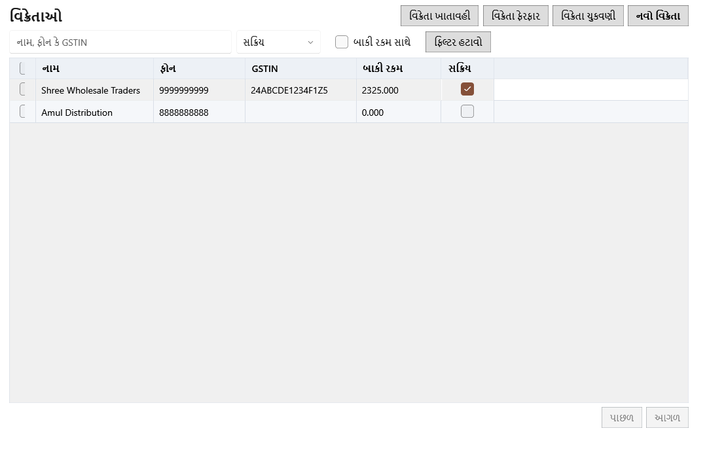
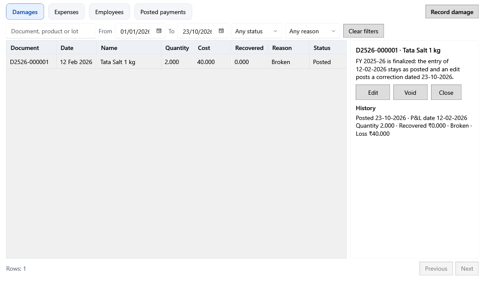
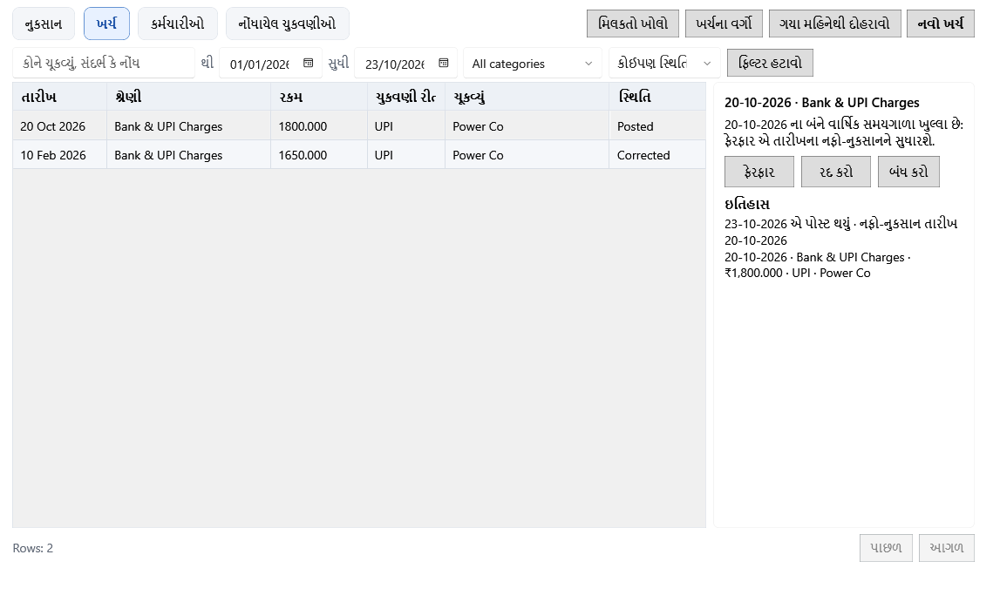
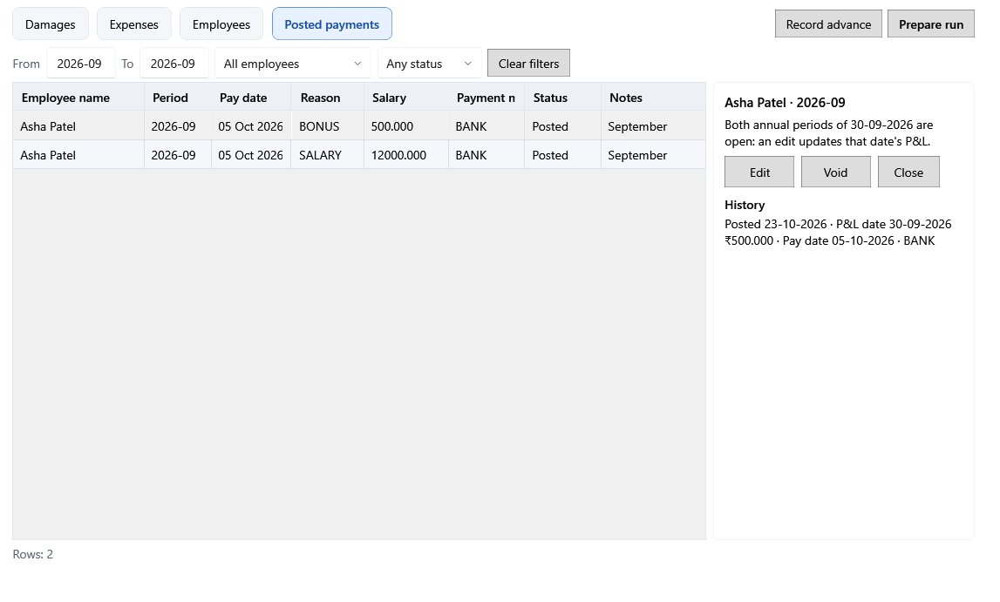

# હરે કૃષ્ણ ગ્રોસરી ERP — સ્ક્રીન પ્રમાણે માર્ગદર્શિકા

> આ માર્ગદર્શિકા schema 35 (સુધારેલો તબક્કો 7) ની સ્ક્રીન વર્ણવે છે. schema 33 થી બેચનો જથ્થો ફક્ત તેના પોતાના વેચાણ, પરત, ખરીદી, નુકસાન, વિક્રેતા-પરત, આંતરિક ઉપયોગ અથવા તપાસેલી ગણતરીના દસ્તાવેજથી બદલાય છે; સ્ટોક ઋણ થઈ શકતો નથી અને જૂની હિલચાલની ખાતાવહી ફક્ત જોવા માટે રહે છે. વેચાણ ઇતિહાસમાં પૂર્ણ, આંશિક રિફંડ, રિફંડ થયેલ અને રદ સ્થિતિ દેખાય છે. ફરી વેચી શકાય એવો પરત માલ મૂળ બેચમાં ત્યારે જ જાય છે જ્યારે વેચાણ પછી તે બેચ બદલાઈ ન હોય; નહીં તો નવી પરત બેચ બને છે, અને નુકસાન પામેલો કે સમાપ્ત પરત માલ નુકસાનમાં જાય છે. schema 34 થી કૅલેન્ડર વર્ષ (જાન્યુઆરી–ડિસેમ્બર) અને નાણાકીય વર્ષ (એપ્રિલ–માર્ચ) અલગ અલગ બંધ થાય છે: વર્ષની નોંધો વર્ષ પૂરું થયા પછીના સાતમા દિવસ સુધી બદલી શકાય છે અને આઠમા દિવસથી (8 જાન્યુઆરી અને 8 એપ્રિલ) બંધ થાય છે. બંધ વર્ષનું નફા-નુકસાન checksum સાથે એક જ વાર સચવાય છે અને હંમેશાં એ જ આંકડા બતાવે છે. પોસ્ટ થયેલા ખર્ચ, નુકસાન અને પગાર ચુકવણી ફરી લખાતા નથી: **ફેરફાર** અથવા **રદ કરો** સુધારાની નોંધ બનાવે છે. schema 35 થી સ્ટોક સ્ક્રીન અને ખર્ચ વિભાગની સમાપ્તિ ટૅબ નથી: બેચ, સમાપ્તિ, નુકસાન અને ગણતરીની દરેક ક્રિયા **ઉત્પાદનો**માં છે, અને **વિક્રેતાઓ**નું અલગ પાનું છે. બાકીના મંજૂર ફેરફારો [સુધારેલી અમલ યોજના](../../revised-implementation-plan.md) માં છે.
>
> આ ગુજરાતી લખાણ મશીનથી તૈયાર કરેલું છે; મૂળ ગુજરાતી ભાષીની સમીક્ષા બાકી છે.

[English guide](english.md) · [માર્ગદર્શિકા સૂચિ](README.md)

સ્ક્રીનશૉટમાં દેખાતા નામ, રકમ અને તારીખો નમૂના ડેટા છે. **સાચવો**, **પોસ્ટ**, **પુષ્ટિ** અને **Restore** જેવી ક્રિયાઓ સંગ્રહિત ડેટા બદલે છે. ફિલ્ટર અને **Refresh** ફક્ત દેખાતી યાદી બદલે છે. મોટાભાગની ક્રિયાઓ પહેલાં પંક્તિ પસંદ કરવી પડે છે.

## ૧. શરૂઆત, લૉગિન અને મુખ્ય મેનુ

નવા ઇન્સ્ટોલેશનમાં [સેટઅપનું પ્રથમ પાનું](screenshots/onboarding-1-language.gu.png) ખુલે છે. **Back** પાછલા પગલે લઈ જાય છે; **Next** હાલનું પાનું ચકાસીને આગળ લઈ જાય છે.

| પગલું અને ચિત્ર | ફીલ્ડનો હેતુ અને અસર |
|---|---|
| [૧. ભાષા](screenshots/onboarding-1-language.gu.png) | English અથવા ગુજરાતી પસંદ કરો. મુખ્ય વિન્ડોમાંથી ભાષા પછી પણ બદલી શકાય છે. |
| [૨. દુકાન](screenshots/onboarding-2.en.png) | દુકાનનું નામ, સરનામું, ફોન, GSTIN, રાજ્ય અને કર પદ્ધતિ રસીદ તથા કરની ગણતરીમાં વપરાય છે. |
| [૩. માલિક](screenshots/onboarding-3.en.png) | યુઝરનેમ, પાસવર્ડ અને તેની પુષ્ટિથી માલિકનું લૉગિન બને છે. |
| [૪. ડેટા અને બેકઅપ](screenshots/onboarding-4.en.png) | ડેટા ફોલ્ડરમાં મુખ્ય ડેટાબેઝ રહે છે; બેકઅપ ફોલ્ડર અને USB યાદ અપાવવાનો સમય સુરક્ષિત નકલ માટે છે. |
| [૫. પ્રિન્ટર](screenshots/onboarding-5.en.png) | રસીદ પ્રિન્ટર, કાગળની પહોળાઈ અને raster/text મોડ રસીદ નક્કી કરે છે. લેબલ પ્રિન્ટર અને કદ બારકોડ લેબલ માટે છે. A4 પ્રિન્ટર રિપોર્ટ માટે છે. **Print test**થી ઉપકરણ ચકાસો. |
| [૬. બારકોડ](screenshots/onboarding-6.en.png) | બેચ અને પ્રોડક્ટ prefix તથા scale rule સ્કૅન થયેલો કોડ કેવી રીતે વાંચવો તે નક્કી કરે છે. |
| [૭. ગુજરાતી કીબોર્ડ](screenshots/onboarding-7.en.png) | ગુજરાતી લખવા માટે કીબોર્ડની સ્થિતિ અને મદદ બતાવે છે. |
| [૮. શરૂ કરો](screenshots/onboarding-8.en.png) | ખાલી ડેટાથી શરૂ કરો અથવા શરૂઆતના સ્ટોકની આયાતનો માર્ગ પસંદ કરો. **Next**થી સેટઅપ પૂરું કરો. |

[લૉગિન](screenshots/login.en.png)માં માલિકનો યુઝરનેમ અને પાસવર્ડ નાખો. [મુખ્ય વિન્ડો](screenshots/shell.en.png)ના મેનુમાં ડૅશબોર્ડ, બિલિંગ, ઉત્પાદનો, ખરીદી, વિક્રેતાઓ, વેચાણ ઇતિહાસ, ખર્ચ, મિલકતો, રિપોર્ટ અને Settings છે. ઉપરની એક લીટીમાં દુકાન, સ્કૅનર અને પ્રિન્ટર સ્થિતિ, બેકઅપ, અપડેટ, **Lock**, `EN` અને `ગુ` છે. સમાપ્ત કે સમાપ્ત થતો સ્ટોક હોય ત્યારે જ ઉત્પાદનો પર સંખ્યાનું ચિહ્ન દેખાય છે. [લૉક સ્ક્રીન](screenshots/session-lock.en.png) ફરી પાસવર્ડ માગે છે. શરૂ કરતી વખતે [સમાપ્તિ ચેતવણી](screenshots/expiry-alert.gu.png) આવી શકે છે; **સમાપ્તિ જુઓ** ઉત્પાદનોમાં સમાપ્ત સ્ટોકવાળી સક્રિય પ્રોડક્ટ બતાવે છે.

**ક્રમ:** સેટઅપ પૂરું કરો → લૉગિન કરો → ઉપકરણ અને બેકઅપ સ્થિતિ જુઓ → મેનુમાંથી કામ પસંદ કરો. કાઉન્ટર છોડો ત્યારે **Lock** વાપરો.

## ૨. યાદીઓ સાથે કામ

ઉત્પાદનો, ખરીદી, વિક્રેતાઓ, વેચાણ ઇતિહાસ, ખર્ચ અને મિલકતોનાં પાનાં એક જ રચના વાપરે છે: પાનાના નામ અને ક્રિયાઓની લીટી, ફિલ્ટરની એક લીટી, કોષ્ટક, અને નીચે પંક્તિઓની સંખ્યા તથા **પાછળ**/**આગળ**.

- **એક પાનામાં વિન્ડોમાં સમાય એટલી પંક્તિઓ** દેખાય છે, તેથી કોષ્ટક અંદર સ્ક્રોલ થતું નથી; વિન્ડોનું કદ બદલવાથી પાનાનું કદ બદલાય છે. ઉત્પાદનોમાં શોધ વધુમાં વધુ આઠ પરિણામ બતાવે છે.
- **ફિલ્ટર લખતાં કે પસંદ કરતાં જ લાગુ થાય છે.** **વધુ ફિલ્ટર** બીજી લીટી ખોલે છે. વિન્ડો સાંકડી હોય ત્યારે ઓછા વપરાતા ફિલ્ટર એ લીટીમાં જાય છે; ત્યારે બટન છુપાયેલા લાગુ ફિલ્ટરની સંખ્યા બતાવે છે, જેમ કે **વધુ ફિલ્ટર · 2**. **ફિલ્ટર હટાવો** મૂળ સ્થિતિ લાવે છે. પ્રોગ્રામ બંધ ન થાય ત્યાં સુધી દરેક પાનું પોતાના ફિલ્ટર યાદ રાખે છે.
- **પંક્તિઓ પસંદ કરતાં** ફિલ્ટરની લીટીની જગ્યાએ વાદળી પસંદગી પટ્ટી આવે છે: ચોક્કસ સંખ્યા, **પસંદગી સાફ કરો** અને પાનાની **સમૂહ ક્રિયાઓ ▾**. શીર્ષકના બૉક્સથી આ પાનું પસંદ થાય છે; વધુ પાનાં હોય ત્યારે **બધા મળતા પરિણામો પસંદ કરો** ફિલ્ટરને મળતી દરેક પંક્તિ પસંદ કરે છે, અને પટ્ટી એ ફિલ્ટર પણ બતાવે છે.
- **દરેક સમૂહ ક્રિયા પહેલાં તપાસાય છે** ([તપાસ](screenshots/bulk-review.en.png)). પંક્તિઓ ડેટાબેઝમાં ફરી ચકાસાય છે અને વિન્ડો કેટલી યોગ્ય છે અને કેટલી છોડાઈ (કારણ સાથે), તથા અસર પામતો જથ્થો અને મૂલ્ય બતાવે છે. **લાગુ કરો (42)** જેવું ક્રિયા બટન યોગ્ય પંક્તિઓ નાના ભાગમાં બદલે છે; દરેક ભાગ અલગ સચવાય છે, તેથી કાઉન્ટરનું બિલ લાંબું અટકતું નથી. **આ ભાગ પછી રોકો** અટકાવે છે; **ફરી ચાલુ કરો** બાકીનું ચાલુ રાખે છે. [પરિણામ](screenshots/bulk-result.en.png)માં બદલાયેલી, છોડાયેલી, તપાસ પછી બદલાયેલી અને બાકી પંક્તિઓની સંખ્યા છે, અને **પરિણામ યાદી સાચવો…** દરેક પંક્તિનું પરિણામ CSV ફાઇલમાં લખે છે.
- ફોર્મમાં જરૂરી ફીલ્ડ લાલ * થી દેખાય છે, દરેક ભૂલ તેના ફીલ્ડ નીચે દેખાય છે, અને સાચવવું કે પોસ્ટ નિષ્ફળ જાય ત્યારે બધી ભૂલો ઉપર યાદીમાં આવે છે. લખેલી કિંમતો રહે છે ([ઉદાહરણ](screenshots/vendor-form-errors.en.png)).

## ૩. ડૅશબોર્ડ

**આજનું વેચાણ** અને **મહિનાનું વેચાણ** સંબંધિત વેચાણ રિપોર્ટ ખોલે છે. **સ્ટોક મૂલ્ય** મૂલ્યાંકન અને **ચૂકવવાપાત્ર રકમ** વિક્રેતાની બાકી રકમ બતાવે છે. વેચાણના ગ્રાફ પર પસંદ કરેલા સમયનો રિપોર્ટ ખુલે છે. સમય પૂરો થયેલો, ગંભીર, ટૂંક સમયમાં પૂરો થનાર અને ઓછા સ્ટોકના બૅજ સંબંધિત યાદી ખોલે છે. Payment split રિપોર્ટ તરફ અને બેકઅપ સ્થિતિ Settings તરફ લઈ જાય છે. નીચે આવક અને માર્જિન પ્રમાણે પ્રોડક્ટની યાદી છે; પ્રોડક્ટ પર બે વાર ક્લિક કરીને વિગત જુઓ. **Refresh** આંકડા ફરી લાવે છે. [નાની વિન્ડોનું ચિત્ર](screenshots/dashboard.narrow.gu.png) પણ જુઓ.

**ક્રમ:** ચાર મુખ્ય આંકડા જુઓ → ચેતવણીવાળી યાદી ખોલો → જરૂરી કાર્યવાહી કરો → પાછા આવી Refresh કરો.

## ૪. ઉત્પાદનો, બેચ અને સ્ટોક

SKU, બારકોડ, નામ, ગુજરાતી નામ, વૈકલ્પિક નામ અથવા બ્રાન્ડથી શોધો. ચોક્કસ SKU કે બારકોડ પહેલાં આવે છે, અને કોઈ પણ લંબાઈના શબ્દો સાથે લખી શકાય છે ("બાસમતી 5 kg"). ફિલ્ટરમાં પ્રકાર (વેચાણ માટે/આંતરિક ઉપયોગ), સક્રિય/આર્કાઇવ, શ્રેણી, **સ્ટોક છે**/**ઓછો સ્ટોક** અને સમાપ્ત કે સમાપ્ત થતો સ્ટોક છે; **વધુ ફિલ્ટર**માં બ્રાન્ડ, વિક્રેતા, **બારકોડ નથી**, **ગુજરાતી નામ બાકી** અને **છૂટક ઉત્પાદન** છે. **આયાત ▾** Excelથી ઉત્પાદનો, શરૂઆતનો સ્ટોક અથવા તેનું template આપે છે. **શ્રેણીઓ અને બ્રાન્ડ** [મૂળ યાદીઓ](screenshots/category-tree.en.png) સંભાળે છે. **નવું ઉત્પાદન** (Ctrl+N) [ઉત્પાદન ફોર્મ](screenshots/product-editor.en.png) ખોલે છે.

ઉત્પાદન પર બે વાર ક્લિક કરો અથવા Enter દબાવો એટલે કોષ્ટકની બાજુમાં તેની [પૅનલ](screenshots/product-panel.en.png) ખુલે છે. ઉપર SKU, શ્રેણી, પ્રકાર, હાથમાં સ્ટોક અને FEFO વેચાણ ભાવ છે. **મૂળ વિગતો** ઉત્પાદન ફોર્મ છે; સાચવો ફેરફાર સંગ્રહે છે અને પાછું ફેરવો ફેરફાર રદ કરે છે. **બેચ** ટૅબ ઉત્પાદનની [બેચ](screenshots/product-lots.gu.png) બતાવે છે; તે પસંદ કરો ત્યારે જ બને છે. **ઇતિહાસ (અપગ્રેડ પહેલાં)** ડાયરેક્ટ-સ્ટોક અપગ્રેડ પહેલાંની ફક્ત જોવાની ખાતાવહી છે. **બંધ કરો** અથવા Esc પૅનલ બંધ કરે છે; ન સાચવેલા ફેરફાર હોય તો પહેલાં પૂછે છે.

| વિભાગ અથવા પૉપઅપ | ફીલ્ડનો હેતુ અને અસર |
|---|---|
| [ઉત્પાદન ફોર્મ](screenshots/product-editor.en.png) | **ઓળખ**: SKU, નામ, ગુજરાતી નામ, વૈકલ્પિક નામ અને બારકોડ (લીટી દીઠ એક, પહેલો મુખ્ય). **વર્ગીકરણ**: શ્રેણી, બ્રાન્ડ, એકમ અને **ઉત્પાદનનો પ્રકાર** — આંતરિક ઉપયોગની વસ્તુ બિલ અને નફા-નુકસાનથી બહાર રહે છે. **કર અને ભાવ**: HSN, GST દર, વેચાણ ભાવ, MRP અને ભાવમાં કર સામેલ છે કે નહીં. **સ્ટોક નિયમો**: reorder level, સમાપ્તિની નોંધ અને ચેતવણીના દિવસ, છૂટક/PLU. નવું ઉત્પાદન એ જ વખતે પહેલી બેચ ઉમેરી શકે છે. |
| [બેચ ટૅબ](screenshots/product-lots.gu.png) | દરેક બેચમાં બેચ કોડ, બેચ નંબર, સમાપ્તિ અને તેની સ્થિતિ, હાથમાં જથ્થો, ભાવ, MRP, એકમ કિંમત, સ્ત્રોત (ખરીદી, સીધી નોંધ, ગ્રાહક પરત) અને મળ્યાની તારીખ છે. બેચ નંબર/કોડ, સ્થિતિ (બધી, ઉપલબ્ધ, ખાલી, અવરોધિત) અને સમાપ્તિથી ફિલ્ટર કરો; **વધુ ફિલ્ટર**માં સ્ત્રોત, સમાપ્તિ તારીખની શ્રેણી અને ભાવની શ્રેણી છે. |
| [સીધી બેચ ઉમેરો](screenshots/direct-lot.en.png) | જથ્થો, એકમ કિંમત, ભાવ, MRP, બેચ નંબર, સમાપ્તિ, મળ્યાની તારીખ અને કારણથી ખરીદી વિના સ્ટોક ઉમેરાય છે. તેની કિંમત વેચાય ત્યારે જ નફા-નુકસાનમાં ગણાય છે. |
| [કિંમત અને સમાપ્તિ તારીખ બદલો](screenshots/lot-price.en.png) | આગળના વેચાણ માટે બેચનો ભાવ, MRP અને સમાપ્તિ બદલે છે; પૂર્ણ બિલના ભાવ બદલાતા નથી. |
| [નુકસાન નોંધો](screenshots/damage-form.en.png) | જથ્થો (ઉપલબ્ધ સ્ટોક સુધી), વસૂલેલી રકમ, કારણ, નુકસાનની તારીખ અને નોંધ. પૂર્વદર્શન નુકસાન અને તે નફા-નુકસાનમાં કઈ તારીખે ગણાશે તે બતાવે છે. જથ્થો સ્ટોકમાંથી ઘટે છે અને ખર્ચ → નુકસાનમાં દેખાય છે. |
| આંતરિક ઉપયોગ માટે વાપરો | ફક્ત આંતરિક ઉપયોગની પ્રોડક્ટ માટે: જથ્થો અને કારણ દુકાનનો વપરાશ નોંધે છે; નફા-નુકસાન પર અસર નથી. |
| **સમૂહ ક્રિયાઓ ▾** (ઉત્પાદનો) | **પસંદ કરેલા દૂર કરો**, **પસંદ કરેલા ફરી સક્રિય કરો**, **શ્રેણી બદલો…**, **GST દર બદલો…**, **ઉત્પાદનનો પ્રકાર બદલો…**, **પસંદ કરેલાં માટે લેબલ છાપો**, **પસંદ કરેલાં માટે બારકોડ બનાવો**, **પસંદ કરેલા સ્ટોકનું મિલાન કરો** અને **સમાપ્ત સ્ટોક કાઢો…**. સ્ટોકવાળું ઉત્પાદન કાઢી નખાતું નથી, આર્કાઇવ થાય છે; સ્ટોકવાળા ઉત્પાદનનો પ્રકાર બદલાતો નથી. |
| **સમૂહ ક્રિયાઓ ▾** (બેચ) | **પસંદ કરેલી બેચ અવરોધો**, **પસંદ કરેલી બેચ ખોલો**, **[પસંદ કરેલી બેચ નુકસાનમાં નોંધો](screenshots/bulk-damage.en.png)** (50 બેચ સુધી, દરેકનો જથ્થો) અને **પસંદ કરેલી ખાલી બેચ કાઢી નાખો** (ફક્ત શૂન્ય જથ્થાવાળી અને ખુલ્લા બિલ વગરની). |
| [સ્ટોકનું મિલાન](screenshots/direct-count-review.gu.png) | પસંદ કરેલા ઉત્પાદનોની દરેક બેચ માટે ગણેલો જથ્થો (50 બેચનાં પાનાં), કારણ અને નુકસાનનો પ્રકાર લખો. ઘટ નુકસાન બને છે; વધારો નવી સીધી બેચ બને છે. |
| [સમાપ્ત સ્ટોક કાઢો](screenshots/bulk-review.en.png) | પસંદ કરેલા ઉત્પાદનોની સ્ટોકવાળી દરેક સમાપ્ત બેચ જથ્થો અને કિંમત સાથે તપાસીને આખી Expired નુકસાન તરીકે નોંધે છે. |
| [Excel આયાત](screenshots/product-import.en.png) · [શરૂઆતના સ્ટોકનું પૂર્વદર્શન](screenshots/opening-stock-preview.en.png) | **Download template**થી કૉલમ મેળવો; **Browse**થી ફાઇલ ખોલો; માન્ય પંક્તિ પસંદ કરી **Import valid** કરો. શરૂઆતના સ્ટોકના પૂર્વદર્શનમાં SKU, જથ્થો, કિંમત, ભાવ અને ભૂલો છે; **Import reviewed** માન્ય બેચ ઉમેરે છે. |
| [પ્રોડક્ટ લેબલ](screenshots/product-label.en.png) · [લેબલ સમૂહ](screenshots/label-batch.en.png) | પ્રિન્ટર, template અને નકલો પસંદ કરો; **Print** લેબલ મોકલે છે. |
| [અજાણ્યો બારકોડ](screenshots/unknown-barcode.en.png) · [હાલની સાથે જોડો](screenshots/unknown-barcode-attach.en.png) · [ઝડપી ઉમેરો](screenshots/quick-product.en.png) | મેળ ન ખાતો બારકોડ નવી પ્રોડક્ટ (SKU, નામ, શ્રેણી, એકમ, વેચાણ ભાવ, ઇચ્છો તો MRP, GST અને HSN) બનાવી શકે અથવા હાલની પ્રોડક્ટ સાથે જોડાય. |

**ક્રમ:** મૂળ યાદીઓ તૈયાર કરો → ઉત્પાદનો ઉમેરો/આયાત કરો → ઉત્પાદન ખોલીને બેચ તપાસો → સીધી બેચ ઉમેરો, ભાવ/સમાપ્તિ સુધારો, નુકસાન નોંધો → **સમાપ્ત સ્ટોક** ફિલ્ટર કરીને કાઢો → છાજલી ગણીને **પસંદ કરેલા સ્ટોકનું મિલાન કરો**.

## ૫. ખરીદી અને વિક્રેતાઓ

GRN અથવા વિક્રેતાના બિલ નંબરની શરૂઆત (કોઈ પણ case), વિક્રેતા, સ્થિતિ અને માલ મળ્યાની તારીખથી ખરીદી શોધો; [**વધુ ફિલ્ટર**](screenshots/purchases-filters.en.png)માં લાઇનનો પ્રકાર, ઉત્પાદન અને **પરત કરવા સ્ટોક બાકી** છે. **ખોલો** draft સુધારવા અથવા પોસ્ટ થયેલી ખરીદીનું [ઇન્વૉઇસ](screenshots/purchase-entry.en.png) જોવા ખોલે છે. **વિક્રેતાને પરત** પોસ્ટ થયેલી ખરીદીનો આંશિક પરત નોંધે છે; **પરત ઇતિહાસ** તેના પરત બતાવે છે. **ખરીદી રદ કરો** ખરીદીનો કોઈ સ્ટોક વપરાયો ન હોય ત્યાં સુધી જ ચાલે છે; બટન બંધ હોય તો tooltip કારણ જણાવે છે. **નવી ખરીદી** (Ctrl+N) ફોર્મ ખોલે છે; **પોસ્ટ** પછી ઉપર નવો GRN નંબર દેખાય છે. **સમૂહ ક્રિયાઓ ▾ → પસંદ કરેલી ખરીદીઓ રદ કરો** યોગ્ય ખરીદીઓ તપાસીને પાંચ-પાંચના ભાગમાં રદ કરે છે.

**વિક્રેતાઓ**માં નામ, ફોન, GSTIN, બાકી રકમ અને સક્રિય સ્થિતિ છે; નામ, ફોન કે GSTINથી શોધો, સક્રિય/નિષ્ક્રિય અને **બાકી રકમ સાથે** ફિલ્ટર કરો. **વિક્રેતા ખાતાવહી**, **વિક્રેતા ફેરફાર**, **વિક્રેતા ચુકવણી** અને **નવો વિક્રેતા** પૉપઅપ ખોલે છે; **સમૂહ ક્રિયાઓ ▾** પસંદ કરેલા વિક્રેતાઓ સક્રિય કે નિષ્ક્રિય કરે છે.

| પૉપઅપ | ફીલ્ડનો હેતુ અને અસર |
|---|---|
| [નવી ખરીદી](screenshots/purchase-entry.en.png) · [ચેતવણીઓ](screenshots/purchase-entry-warnings.en.png) | વિક્રેતા, ઇન્વૉઇસ નંબર/તારીખ અને માલ મળ્યાની તારીખ GRN ઓળખાવે છે. દરેક લાઇનનો **પ્રકાર** ઉત્પાદન (વેચાણની બેચ), આંતરિક ઉપયોગ (નફા-નુકસાન બહારની બેચ) અથવા ખર્ચ (શ્રેણી, બેચ નહીં) છે; તે પ્રકારના ફીલ્ડ જ વપરાય છે. જથ્થો, મફત જથ્થો, દર, ડિસ્કાઉન્ટ, GST, બેચ નંબર, સમાપ્તિ, MRP અને ભાવથી બેચ, કિંમત અને કર નક્કી થાય છે. Ctrl+D ઉપરનો ખાનો નકલ કરે છે (લાઇનનો પ્રકાર કે ઉત્પાદન ક્યારેય નહીં); Ctrl+S draft સાચવે છે. નોંધ અને અન્ય ખર્ચ, સપ્લાયરના બિલનું કુલ અને તફાવત મેળવણીમાં મદદ કરે છે. **પોસ્ટ** બેચ અને વિક્રેતાની બાકી રકમ બનાવે છે. |
| [વિક્રેતા ફોર્મ](screenshots/vendor-editor.gu.png) · [નીચે](screenshots/vendor-editor-bottom.en.png) | નામ, સંપર્ક, ફોન, ઇમેઇલ, સરનામું, GSTIN (15 અક્ષર), PAN (10), પિનકોડ (6), UPI/બૅંક, ચુકવણીની શરતો અને શરૂઆતની બાકી રકમ. |
| [વિક્રેતા ચુકવણી](screenshots/vendor-payment.gu.png) | વિક્રેતા અને ઇચ્છો તો ચોક્કસ બિલ; તારીખ, રકમ, રીત, reference અને નોંધ બાકી રકમ ઘટાડે છે. |
| [વિક્રેતા ખાતાવહી](screenshots/vendor-history.en.png) | ખરીદી, ચુકવણી, પરત, ચાલુ ખાતું અને આપેલી બેચ. |
| [વિક્રેતાને પરત](screenshots/vendor-return.en.png) | તારીખ, credit note અને કારણ; દરેક બેચ માટે મળેલો, પહેલાં પરત અને ઉપલબ્ધ જથ્થો તથા પરત જથ્થો અને ક્રેડિટ. **પરત પોસ્ટ કરો** સ્ટોક ઘટાડે છે અને વિક્રેતાને ક્રેડિટ આપે છે. |

**ક્રમ:** વિક્રેતા બનાવો → ખરીદી નોંધો, દરેક લાઇન અને સપ્લાયરનું કુલ તપાસો → જરૂર હોય તો draft રાખો → પોસ્ટ કરો → વિક્રેતાના રેકૉર્ડમાંથી ચુકવણી કે પરત કરો.

## ૬. ખર્ચ: નુકસાન, ખર્ચ અને પગાર

**નુકસાન**, **ખર્ચ**, **કર્મચારીઓ** અને **નોંધાયેલ ચુકવણીઓ** ટૅબ પાનાનું મથાળું છે; ખુલ્લી ટૅબની ક્રિયાઓ એ જ લીટીમાં જમણી બાજુ છે. દરેક ટૅબના પોતાના ફિલ્ટર છે અને પસંદ કરેલી નોંધ માટે સાંકડી વિગત પૅનલ ખુલે છે.

**નુકસાન** દસ્તાવેજ, પ્રોડક્ટ કે બેચ, તારીખ, સ્થિતિ (પોસ્ટ, સુધારેલ, રદ) અને કારણથી ફિલ્ટર થાય છે. **નુકસાન નોંધો** બેચ શોધ સાથે [નુકસાન ફોર્મ](screenshots/damage-form.en.png) ખોલે છે. નુકસાન પસંદ કરતાં પૅનલ જણાવે છે કે ફેરફાર કઈ તારીખે ગણાશે: "બંને વાર્ષિક સમયગાળા ખુલ્લા છે" એટલે મૂળ તારીખે; "… અંતિમ છે" એટલે મૂળ નોંધ રહેશે અને આજની તારીખે સુધારો નોંધાશે. **ફેરફાર** [સુધારાનો પૉપઅપ](screenshots/damage-correction.en.png) ખોલે છે; **રદ કરો** જથ્થો શૂન્ય કરે છે. જથ્થાનો ફેરફાર આજના બેચ સ્ટોકમાં માલ પાછો ઉમેરે અથવા ઘટાડે છે; નુકસાનવાળી બેચ શૂન્ય થઈને કાઢી નાખી હોય તો પાછા આવેલા નંગથી નવી બેચ બને છે. **ઇતિહાસ** મૂળ નોંધ અને દરેક સુધારો બતાવે છે. આંતરિક ઉપયોગના માલનું નુકસાન નફા-નુકસાનમાં ગણાતું નથી.

**ખર્ચ** કોને ચૂકવ્યું, reference કે નોંધ, તારીખ, શ્રેણી અને સ્થિતિ (પોસ્ટ, સુધારેલ, રદ, ખરીદી)થી ફિલ્ટર થાય છે. **નવો ખર્ચ** [ખર્ચ ફોર્મ](screenshots/expense-form.en.png) ખોલે છે: તારીખ, શ્રેણી, રકમ, રીત, કોને ચૂકવ્યું, reference અને નોંધ, તથા ખર્ચ કઈ તારીખે ગણાશે તેની સૂચના. **ગયા મહિનેથી દોહરાવો** પસંદ કરેલી શ્રેણી માટે [draft](screenshots/repeat-expenses.en.png) બનાવે છે; સાચવતા પહેલાં તપાસો. **ખર્ચના વર્ગો** [શ્રેણી યાદી](screenshots/expense-categories.en.png) ખોલે છે. વિગત પૅનલમાં **ફેરફાર** ફરજિયાત કારણ સાથે [સુધારાનું ફોર્મ](screenshots/expense-correction.en.png) ખોલે છે; **રદ કરો** સુધારા દ્વારા ખર્ચ શૂન્ય કરે છે. ખરીદીની ખર્ચ લાઇનથી બનેલો ખર્ચ ખરીદી બતાવે છે અને ફક્ત તે ખરીદી રદ કરવાથી બદલાય છે. **મિલકતો ખોલો**થી મિલકતો ખુલે છે.

**કર્મચારીઓ** નામ, હોદ્દો કે ફોન અને કાર્યરત/છૂટા થયેલાથી ફિલ્ટર થાય છે. **નવો કર્મચારી** અને **ફેરફાર** [કર્મચારી ફોર્મ](screenshots/employee-form.en.png) ખોલે છે; માસિક પગાર બદલતાં **કયા મહિનાથી પગાર** (YYYY-MM) પૂછે છે: નવી રકમ એ મહિનાથી લાગુ થાય છે, જે કૅલેન્ડર અને નાણાકીય બંને વર્ષ ખુલ્લાં હોય એવા પહેલા મહિનાથી વહેલો ન હોઈ શકે; પોસ્ટ થયેલી ચુકવણી જેમ ચૂકવી તેમ જ રહે છે.

**નોંધાયેલ ચુકવણીઓ** મહિનાની શ્રેણી, કર્મચારી અને સ્થિતિથી ફિલ્ટર થાય છે. **પગાર તૈયાર કરો** [પગાર તૈયારી](screenshots/salary-run.en.png) ખોલે છે: મહિનો, ચુકવણી તારીખ અને રીત; લાઇન તૈયાર કરવાથી દરેક કાર્યરત કર્મચારીનો પગાર, રજાની કપાત, overtime અને bonus ભરાય છે; પગાર પોસ્ટ કરવાથી ચુકવણી નોંધાય છે, જે કામ કરેલા મહિનામાં ગણાય છે. **પેશગી નોંધો** [પેશગી ફોર્મ](screenshots/advance-form.en.png) ખોલે છે. વિગત પૅનલમાં **ફેરફાર** [સુધારાનો પૉપઅપ](screenshots/salary-correction.en.png) ખોલે છે; **રદ કરો** ભૂલથી નોંધાયેલી ચુકવણી શૂન્ય કરે છે.

**ક્રમ:** નુકસાન થાય ત્યારે નોંધો → ખર્ચ નોંધો → કર્મચારી માહિતી રાખો → પગાર તૈયાર કરીને પોસ્ટ કરો → પોસ્ટ થયેલી રકમ ફક્ત કારણ સાથે ફેરફાર કે રદ કરો.

## ૭. મિલકતો (Assets)

મિલકત શોધો અને **Include disposed** ટિક કરવાથી નિકાલ થયેલી પણ દેખાય છે. **New asset** અને **Edit selected** [મિલકત ફોર્મ](screenshots/asset-form.en.png) ખોલે છે: નામ, શ્રેણી, ખરીદી અને વપરાશ શરૂ તારીખ, કિંમત, WDV/SLM પદ્ધતિ, દર, salvage value, વિક્રેતા અને નોંધ. **View timeline** તારીખવાળી શરતો અને દરેક મહિનાનું શરૂઆતનું મૂલ્ય, ઘસારો અને અંતિમ મૂલ્ય બતાવે છે; વર્ષ બંધ થયા પછી પોસ્ટ થયેલો મહિનો કઈ તારીખે ગણાયો તે પણ બતાવે છે. **Post depreciation now** બાકી મહિના નોંધે છે. બંધ વર્ષનો કોઈ મહિનો કદી પોસ્ટ ન થયો હોય તો તે હજી પોસ્ટ થાય છે, પણ તેનો ખર્ચ આજે ગણાય છે.

સાચવેલી મિલકત સુધારતી વખતે પદ્ધતિ, દર અથવા salvage બદલતાં **Effective from** (મૂળભૂત રીતે પહેલો ખુલ્લો મહિનો) અને [પૂર્વદર્શન](screenshots/asset-terms.en.png) દેખાય છે: કયા મહિના ફરી ગણાશે, અને પહેલાં તથા પછીનો ઘસારો અને book value; સાચવતાં ફક્ત એ ખુલ્લા મહિના ફરી ગણાય છે. કિંમત અને વપરાશ શરૂ તારીખ ફક્ત ત્યારે બદલાય જ્યારે દરેક પોસ્ટ થયેલો મહિનો હજી ખુલ્લો હોય; બંધ વર્ષનો ઘસારો પોસ્ટ થયા પછી તે સ્થિર રહે છે અને **Save** બંધ રહે છે. **Dispose** [નિકાલ ફોર્મ](screenshots/asset-disposal.en.png) ખોલે છે: નિકાલની તારીખ અને મળેલી રકમ; નફો/નુકસાન નિકાલ વખતે સાચવેલી book value સામે ગણાય છે.

**ક્રમ:** મિલકત ઉમેરો → સમયરેખા તપાસો → બાકી ઘસારો પોસ્ટ કરો → મંજૂર ફેરફાર કરો → ઉપયોગ બંધ થાય ત્યારે નિકાલ કરો.

## ૮. બિલિંગ અને હોલ્ડ કરેલા બિલ

ઉપરના બૉક્સમાં બારકોડ સ્કૅન કરો અથવા `F3`થી શોધો. લાઇનમાં પ્રોડક્ટ, જથ્થો, એકમ ભાવ, ડિસ્કાઉન્ટ અને કુલ છે. જમણે gross, discount, GST, round off અને ચૂકવવાની રકમ તરત ગણાય છે. **Cash**, **UPI** અથવા **Split**થી ચુકવણી પૂર્ણ કરો. નીચે નવું બિલ, જથ્થો, બેચ, ભાવ ફેરફાર, લાઇન/બિલ ડિસ્કાઉન્ટ, ગ્રાહક, લાઇન દૂર કરવી, hold અને resume મળે છે.

| પૉપઅપ | ફીલ્ડનો હેતુ અને અસર |
|---|---|
| [જથ્થો](screenshots/quantity.en.png) · [બેચ પસંદગી](screenshots/lot-picker.en.png) | જથ્થો લાઇન અને વેચાતા સ્ટોકને બદલે છે; બેચ પસંદગી કઈ બેચમાંથી માલ જશે તે નક્કી કરે છે. |
| [ડિસ્કાઉન્ટ](screenshots/discount-percent.en.png) | રકમ નાખીને amount અથવા percent પસંદ કરો. Previewમાં અસર જોઈ **Save** કરવાથી લાઇન/બિલનું કુલ બદલાય છે. |
| [ગ્રાહક](screenshots/customer.en.png) | હાલનો ગ્રાહક શોધો અથવા નામ, ફોન અને GSTINથી નવો બનાવો. **Use customer** બિલ સાથે જોડે છે; **Walk in** સાચવેલા ગ્રાહક વગર આગળ વધે છે. |
| [Hold](screenshots/hold-bill.en.png) · [સાચવેલા બિલ](screenshots/saved-bills.en.png) · [ફરી તપાસ](screenshots/held-review.en.png) | અધૂરા બિલને ઓળખ આપો. ID અથવા labelથી શોધીને **Open bill** કરો. ફરી શરૂ કરતાં પહેલાં જૂનો/નવો ભાવ, MRP, ઉપલબ્ધ જથ્થો અને સ્થિતિ તપાસીને **Accept and resume** કરો. |
| [વિભાજિત ચુકવણી](screenshots/payment.gu.png) | રોકડ, UPI અને કાર્ડની રકમ મળીને બિલના કુલ જેટલી હોવી જોઈએ. reference ડિજિટલ/કાર્ડ ચુકવણી ઓળખાવે છે. **Confirm payment** વેચાણ નોંધે છે. |

**ક્રમ:** પ્રોડક્ટ સ્કૅન/શોધો → જથ્થો, બેચ, ભાવ અને ડિસ્કાઉન્ટ તપાસો → જરૂર હોય તો ગ્રાહક ઉમેરો → કુલ રકમ જુઓ → ચુકવણી લો → રસીદ આપો. કામ અટકે તો Hold/Resume વાપરો. [રસીદ નમૂનો](screenshots/sale-receipt.en.png).

## ૯. વેચાણ ઇતિહાસ અને દિવસનું સમાપન

ઇન્વૉઇસ નંબર, પ્રોડક્ટ કે SKU, From/To તારીખ અને સ્થિતિથી બિલ શોધો; **વધુ ફિલ્ટર**માં ગ્રાહક, ચુકવણી રીત અને રકમની શ્રેણી છે. **Search** (Enter) ફિલ્ટર લાગુ કરે છે. **Export CSV** મળતાં દરેક બિલ સાચવે છે; પહેલી લીટીમાં ફિલ્ટર અને છેલ્લીમાં કુલ હોય છે. બિલ પસંદ કરીને વસ્તુઓ, [પરત](screenshots/sales-detail-1.en.png) અને પ્રવૃત્તિ જુઓ. **Reprint** સાચવેલી રસીદ ફરી છાપે છે. **Void** માટે [કારણ](screenshots/void.en.png) આપો. **Return**માં [પરત ફોર્મ](screenshots/return.gu.png) બેચ, સમાપ્તિ, વેચાયેલો, પહેલાં પરત અને બાકી જથ્થો, રિફંડ અને સ્ટોક ક્યાં જશે તે બતાવે છે. જૂની લાઇનમાં વિગત ખૂટે તો [ચકાસણી ફોર્મ](screenshots/return-recreation.gu.png) ખુલે છે: જૂના વેચાણમાં ન સચવાયેલી દરેક વિગતની નીચે તે લખેલું હોય છે, અને ન સચવાયેલ **સમાપ્તિ તારીખ ટ્રેક કરો** કે **અપૂર્ણાંક જથ્થો** માટે હા કે ના પસંદ કરવું પડે છે. [Day end](screenshots/day-end.en.png) વ્યવસાય તારીખનું વેચાણ, રિફંડ, કર અને ચુકવણી રીતનો સાર આપે છે.

**ક્રમ:** ફિલ્ટરથી બિલ શોધો → વસ્તુઓ અને ચુકવણી તપાસો → યોગ્ય હોય તો ફરી છાપો, Void અથવા Return કરો → Day end જુઓ. [પરત રસીદ નમૂનો](screenshots/return-receipt.gu.png).

## ૧૦. રિપોર્ટ

**Report**માં રિપોર્ટનો પ્રકાર અને **Period** અથવા From/Toમાં સમય પસંદ કરો; પસંદ કરેલા રિપોર્ટને લાગુ પડતા ફિલ્ટર જ દેખાય છે. **Refresh** પરિણામ લાવે છે. કોષ્ટકમાં મર્યાદિત પંક્તિઓ દેખાય છે; **Export Excel** અને **Print A4** એ જ પંક્તિઓ વાપરે છે (A4 પહેલી 100 છાપે છે) અને અધૂરું હોય ત્યારે જણાવે છે, જ્યારે **આખો CSV એક્સપોર્ટ કરો** પ્રગતિ અને **Cancel** સાથે દરેક પંક્તિ લખે છે. દરેક export રિપોર્ટ, સમયગાળો અને લાગુ ફિલ્ટર જણાવે છે, અને CSVના અંતે બધી પંક્તિઓનું કુલ છે. [નફા-નુકસાન](screenshots/reports-pnl.en.png)માં **Month**, **Calendar year**, **Fiscal year** અથવા **Custom range** અને પછી સમયગાળો પસંદ કરો; સાચવેલું વર્ષ યાદીમાં "· Finalized" તરીકે દેખાય છે. કોષ્ટક ઉપરનું ચિહ્ન **Open** સાથે નોંધો બદલી શકાય એવી છેલ્લી તારીખ, અથવા **Finalized** સાથે વર્ષ, ફેરફારની અંતિમ તારીખ, આવૃત્તિ અને checksum બતાવે છે. પહેલાં મુખ્ય હેડના કુલ દેખાય છે; **Expenses** પસંદ કરતાં તેની શ્રેણીઓ ખૂલે છે, અને **Show months** દરેક મહિનાની કૉલમ ઉમેરે છે. **Actions ▾ → Export P&L CSV** બરાબર દેખાતી આવૃત્તિ લખે છે, તેથી અંતિમ વર્ષની ફાઇલ દર વખતે એકસરખી હોય છે. [કલાકવાર રિપોર્ટ](screenshots/reports-hourly.gu.png)માં સમય પ્રમાણે વેચાણ છે.

**Current unsold stock** હાલનો બેચ જથ્થો અને કિંમત વાંચે છે. **Include expired stock** વેપારની તારીખે સમાપ્ત થયેલી બેચ ઉમેરે અથવા છોડે છે, અને કોષ્ટક નીચેની લીટી હંમેશાં સમાપ્ત બેચ, જથ્થો અને કિંમત મૂલ્ય જણાવે છે. **Purchased vs used reconciliation** નવી બેચ પહેલાં (અથવા એક પ્રોડક્ટની બેચ) સાથે મળેલો, વેચાયેલો, પરત આવેલો, નુકસાન, આંતરિક ઉપયોગ, વિક્રેતાને પરત અને સુધારેલો જથ્થો, અપેક્ષિત અને ઉપલબ્ધ સ્ટોક તથા કોઈ ફરક બતાવે છે. **Differences only** સાપ્તાહિક પૂરી તપાસમાં અલગ મળેલી બેચ હમણાં ફરી તપાસીને બતાવે છે.

**ક્રમ:** રિપોર્ટ પસંદ કરો → સમય અને સંબંધિત ફિલ્ટર આપો → Refresh કરો → કુલ તપાસો → export અથવા print કરો. પહોળો A4 રિપોર્ટ [પાનું ૧](screenshots/report-a4-band1.en.png) અને [પાનું ૨](screenshots/report-a4-band2.en.png) તરીકે છપાઈ શકે છે.

## ૧૧. Settings, બેકઅપ અને પુનઃસ્થાપન

**Local backup** અને **USB copy**માં નકલની સ્થિતિ છે. **Backup now** સ્થાનિક નકલ બનાવે છે. removable drive પસંદ કરીને **Refresh** કરો અને **Export to USB**થી નકલ લઈ જાઓ. **Scanner port**માં serial scannerનો port પસંદ કરીને **Save scanner port** કરો. [નીચેના Settings](screenshots/settings-bottom.en.png)માં ડેટા અને બેકઅપ ફોલ્ડર છે; **Move data** કામ કરતા ડેટાનું સ્થાન બદલે છે. હાલનો, નવો અને પુષ્ટિ પાસવર્ડ આપીને માલિકનો પાસવર્ડ બદલો.

[Restore](screenshots/restore.gu.png)માં હાલના ડેટા અને પસંદ કરેલા બેકઅપનો સાર સરખાવો. જરૂરી પુષ્ટિ શબ્દ લખ્યા પછી **Restore** ચાલુ થાય છે. આ ક્રિયા હાલનો ડેટાબેઝ બેકઅપથી બદલે છે; પહેલાં સ્રોત અને તારીખો તપાસો.

**ક્રમ:** સ્થાનિક બેકઅપ લો → નિયમિત USB નકલ લો → ઉપકરણ સ્થિતિ જુઓ → જરૂરી હોય ત્યારે સ્થાન/પાસવર્ડ સુધારો. પુનઃસ્થાપન માટે વિશ્વસનીય બેકઅપ પસંદ કરો, સાર સરખાવો, પુષ્ટિ લખો અને Restore કરો.
