# હરે કૃષ્ણ ગ્રોસરી ERP — સ્ક્રીન પ્રમાણે માર્ગદર્શિકા

> આ માર્ગદર્શિકા અને ચિત્રો schema-28 સંસ્કરણ માટે લખાયાં હતાં. schema 33 થી લોટનો જથ્થો ફક્ત તેના પોતાના વેચાણ, પરત, ખરીદી, નુકસાન, વેન્ડર-પરત, આંતરિક ઉપયોગ અથવા તપાસેલી ગણતરીના દસ્તાવેજથી બદલાય છે. Stock Ledger જૂની હિલચાલ ફક્ત જોવા માટે રાખે છે, અને સ્ટોક હવે ઋણ થઈ શકતો નથી. **New count**/**Resume count** ની જગ્યાએ **ઉત્પાદનો → ક્રિયાઓ ▾ → પસંદ કરેલા સ્ટોકનું મિલાન કરો** છે: ઘટ નુકસાન બને છે અને વધારો નવો ડાયરેક્ટ લોટ બને છે. વેચાણ ઇતિહાસમાં પૂર્ણ, આંશિક રિફંડ, રિફંડ થયેલ અને રદ સ્થિતિ દેખાય છે. ફરી વેચી શકાય એવો પરત માલ મૂળ લોટમાં ત્યારે જ જાય છે જ્યારે વેચાણ પછી તે લોટ બદલાયો ન હોય; નહીં તો નવો પરત લોટ બને છે. નુકસાન પામેલો અથવા સમાપ્ત થયેલો પરત માલ નુકસાનમાં જાય છે. schema 34 થી કૅલેન્ડર વર્ષ (જાન્યુઆરી–ડિસેમ્બર) અને નાણાકીય વર્ષ (એપ્રિલ–માર્ચ) અલગ અલગ બંધ થાય છે: વર્ષની નોંધો વર્ષ પૂરું થયા પછીના સાતમા દિવસ સુધી બદલી શકાય છે અને આઠમા દિવસથી (8 જાન્યુઆરી અને 8 એપ્રિલ) બંધ થાય છે. બંધ વર્ષનું નફા-નુકસાન checksum સાથે એક જ વાર સચવાય છે અને હંમેશાં એ જ સાચવેલા આંકડા બતાવે છે. પોસ્ટ થયેલા ખર્ચ, નુકસાન અને પગાર ચુકવણી ક્યારેય ફરી લખાતા નથી: **Edit** અથવા **Void** સુધારાની નોંધ બનાવે છે. મૂળ તારીખનાં બંને વર્ષ ખુલ્લાં હોય ત્યાં સુધી સુધારો એ જ તારીખે ગણાય છે; કોઈ એક વર્ષ બંધ થાય પછી મૂળ નોંધ એમ જ રહે છે અને ફરક આજની તારીખે નોંધાય છે. પગાર અને ઘસારાની શરતો "આખું વર્ષ ફરી ગણો" વિકલ્પને બદલે અમલની તારીખના મહિનાથી લાગુ થાય છે. બાકીના મંજૂર ફેરફારો [સુધારેલી અમલ યોજના](../../revised-implementation-plan.md) અને [Phase 0 વર્તન કોષ્ટક](../phase0/behavior-matrix.md) માં છે.

[English guide](english.md) · [માર્ગદર્શિકા સૂચિ](README.md)

સ્ક્રીનશૉટમાં દેખાતા નામ, રકમ અને તારીખો નમૂના ડેટા છે. **Save**, **Post**, **Confirm** અને **Restore** જેવી ક્રિયાઓ સંગ્રહિત ડેટા બદલે છે. ફિલ્ટર અને **Refresh** ફક્ત દેખાતી યાદી બદલે છે. મોટાભાગની ક્રિયાઓ પહેલાં પંક્તિ પસંદ કરવી પડે છે. ચેકબૉક્સથી અનેક પંક્તિ પર એકસાથે કામ કરી શકાય છે. **Rows per page**, **Previous** અને **Next** ફક્ત યાદીનું પાનું બદલે છે.

## ૧. શરૂઆત, લૉગિન અને મુખ્ય મેનુ

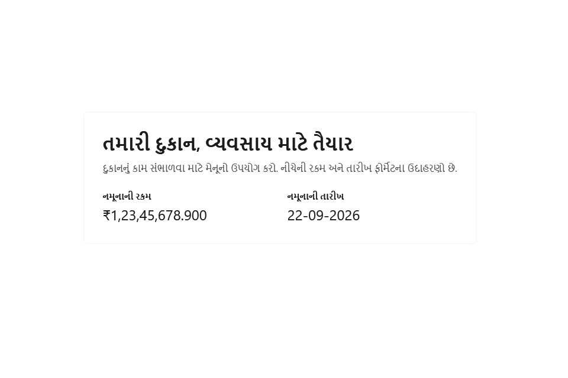

નવા ઇન્સ્ટોલેશનમાં [સેટઅપનું પ્રથમ પાનું](screenshots/onboarding-1-language.gu.png) ખુલે છે. **Back** પાછલા પગલે લઈ જાય છે; **Next** હાલનું પાનું ચકાસીને આગળ લઈ જાય છે.

| પગલું અને ચિત્ર | ફીલ્ડનો હેતુ અને અસર |
|---|---|
| [૧. ભાષા](screenshots/onboarding-1-language.gu.png) | English અથવા ગુજરાતી પસંદ કરો. મુખ્ય વિન્ડોમાંથી ભાષા પછી પણ બદલી શકાય છે. |
| [૨. દુકાન](screenshots/onboarding-2.en.png) | દુકાનનું નામ, સરનામું, ફોન, GSTIN, રાજ્ય અને કર પદ્ધતિ રસીદ તથા કરની ગણતરીમાં વપરાય છે. |
| [૩. માલિક](screenshots/onboarding-3.en.png) | યુઝરનેમ, પાસવર્ડ અને તેની પુષ્ટિથી માલિકનું લૉગિન બને છે. |
| [૪. ડેટા અને બેકઅપ](screenshots/onboarding-4.en.png) | ડેટા ફોલ્ડરમાં મુખ્ય ડેટાબેઝ રહે છે; બેકઅપ ફોલ્ડર અને USB યાદ અપાવવાનો સમય સુરક્ષિત નકલ માટે છે. |
| [૫. પ્રિન્ટર](screenshots/onboarding-5.en.png) | રસીદ પ્રિન્ટર, કાગળની પહોળાઈ અને raster/text મોડ રસીદ નક્કી કરે છે. લેબલ પ્રિન્ટર અને કદ બારકોડ લેબલ માટે છે. A4 પ્રિન્ટર રિપોર્ટ માટે છે. **Print test**થી ઉપકરણ ચકાસો. |
| [૬. બારકોડ](screenshots/onboarding-6.en.png) | લૉટ અને પ્રોડક્ટ prefix તથા scale rule સ્કૅન થયેલો કોડ કેવી રીતે વાંચવો તે નક્કી કરે છે. |
| [૭. ગુજરાતી કીબોર્ડ](screenshots/onboarding-7.en.png) | ગુજરાતી લખવા માટે કીબોર્ડની સ્થિતિ અને મદદ બતાવે છે. |
| [૮. શરૂ કરો](screenshots/onboarding-8.en.png) | ખાલી ડેટાથી શરૂ કરો અથવા શરૂઆતના સ્ટૉકની આયાતનો માર્ગ પસંદ કરો. **Next**થી સેટઅપ પૂરું કરો. |

[લૉગિન](screenshots/login.en.png)માં માલિકનો યુઝરનેમ અને પાસવર્ડ નાખો. [મુખ્ય વિન્ડો](screenshots/shell.en.png)માં Dashboard, Billing, Sales History, Products, Purchases, Stock, Money Out, Assets, Reports અને Settings મળે છે. ઉપર દુકાન/વ્યવસાય તારીખ, સ્કૅનર અને પ્રિન્ટર સ્થિતિ, બેકઅપ, અપડેટ, **Lock**, `EN` અને `ગુ` છે. [લૉક સ્ક્રીન](screenshots/session-lock.en.png) ફરી પાસવર્ડ માગે છે. શરૂ કરતી વખતે [સમાપ્તિ ચેતવણી](screenshots/expiry-alert.gu.png) આવી શકે છે; તેમાંથી સંબંધિત યાદી ખોલી શકાય છે.

**ક્રમ:** સેટઅપ પૂરું કરો → લૉગિન કરો → ઉપકરણ અને બેકઅપ સ્થિતિ જુઓ → મેનુમાંથી કામ પસંદ કરો. કાઉન્ટર છોડો ત્યારે **Lock** વાપરો.

## ૨. ડૅશબોર્ડ

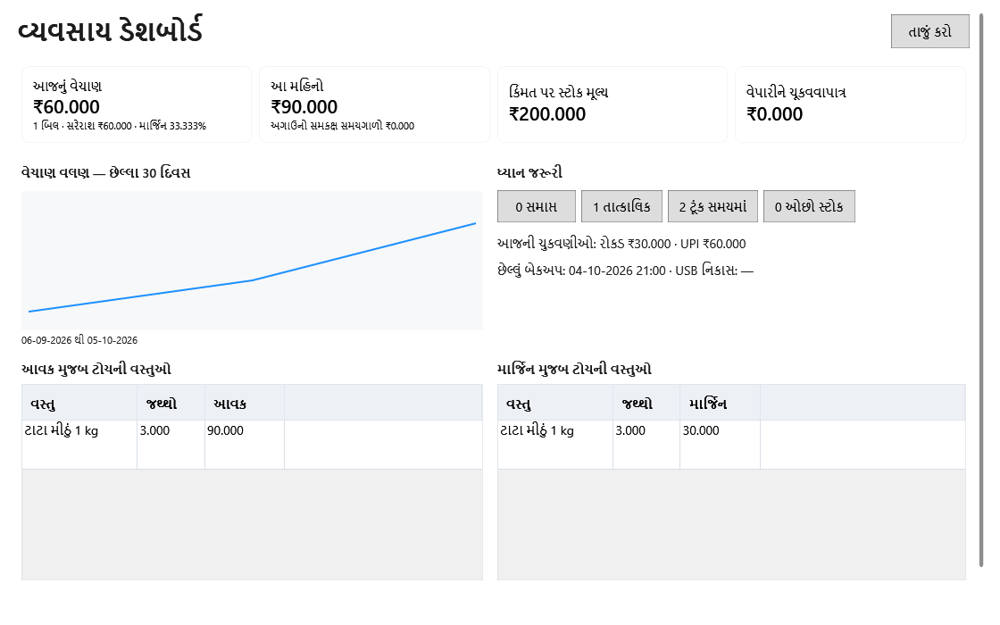

**આજનું વેચાણ** અને **મહિનાનું વેચાણ** સંબંધિત વેચાણ રિપોર્ટ ખોલે છે. **સ્ટૉક મૂલ્ય** મૂલ્યાંકન અને **ચૂકવવાપાત્ર રકમ** વિક્રેતાની બાકી રકમ બતાવે છે. વેચાણના ગ્રાફ પર પસંદ કરેલા સમયનો રિપોર્ટ ખુલે છે. સમય પૂરો થયેલો, ગંભીર, ટૂંક સમયમાં પૂરો થનાર અને ઓછા સ્ટૉકના બૅજ સંબંધિત યાદી ખોલે છે. Payment split રિપોર્ટ તરફ અને બેકઅપ સ્થિતિ Settings તરફ લઈ જાય છે. નીચે આવક અને માર્જિન પ્રમાણે પ્રોડક્ટની યાદી છે; પ્રોડક્ટ પર બે વાર ક્લિક કરીને વિગત જુઓ. **Refresh** આંકડા ફરી લાવે છે. [નાની વિન્ડોનું ચિત્ર](screenshots/dashboard.narrow.gu.png) પણ જુઓ.

**ક્રમ:** ચાર મુખ્ય આંકડા જુઓ → ચેતવણીવાળી યાદી ખોલો → જરૂરી કાર્યવાહી કરો → પાછા આવી Refresh કરો.

## ૩. પ્રોડક્ટ અને કૅટલૉગ

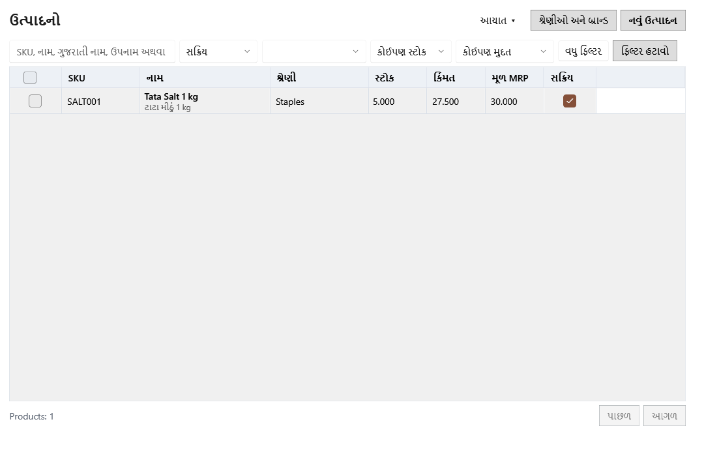

**Search**થી પ્રોડક્ટ શોધો; **Category** અને **Brand** યાદી મર્યાદિત કરે છે. **Filters**માં ઓછો સ્ટૉક, બારકોડ વિનાની, ગુજરાતી નામ વિનાની, છૂટક અને આર્કાઇવ પ્રોડક્ટ મળે છે. યાદીમાં SKU, અંગ્રેજી/સ્થાનિક નામ, કેટેગરી, સ્ટૉક, વેચાણ કિંમત, MRP અને સક્રિય સ્થિતિ છે. પંક્તિ પસંદ કર્યા પછી **Edit** અને **Actions**થી લૉટ, લેજર, લેબલ, બારકોડ અને restore મળે છે. ચેકબૉક્સથી bulk edit, લેબલ, બારકોડ, દૂર કરવું અથવા restore કરી શકાય છે.

| પૉપઅપ અથવા વિભાગ | ફીલ્ડનો હેતુ અને અસર |
|---|---|
| [પ્રોડક્ટ: મૂળ વિગતો](screenshots/product-editor.en.png) · [કિંમત/સ્ટૉક](screenshots/product-editor-pricing.en.png) | SKU આંતરિક ઓળખ છે; નામ અને aliases શોધ, બિલ અને લેબલમાં વપરાય છે. Category, brand અને unit વર્ગીકરણ કરે છે; barcode સ્કૅન સાથે જોડે છે. HSN/કર દર ટેક્સમાં, reorder level ઓછા સ્ટૉકની ચેતવણીમાં, વેચાણ કિંમત/MRP બિલમાં, shelf life/alert days સમાપ્તિ ચેતવણીમાં વપરાય છે. **Prices include tax**, **Track expiry** અને **Loose/PLU** ભાવ, લૉટ અને વજનવાળા માલનું વર્તન નક્કી કરે છે. **Save**થી ફેરફાર સંગ્રહાય છે. |
| [કેટેગરી](screenshots/category-tree.en.png) · [બ્રાન્ડ](screenshots/catalog-master-1.en.png) · [એકમ](screenshots/catalog-master-2.en.png) · [કર દર](screenshots/catalog-master-3.en.png) | કેટેગરીનું નામ/સ્થાનિક નામ, parent અને alert days વૃક્ષ તથા સમાપ્તિ ચેતવણી નક્કી કરે છે. બ્રાન્ડ નામ ઓળખ આપે છે. એકમનો કોડ/નામ અને **Allow fraction** દશાંશ જથ્થો ચાલશે કે નહીં તે નક્કી કરે છે. કરનું નામ, ટકાવારી અને સક્રિય સ્થિતિ પ્રોડક્ટમાં પસંદ થઈ શકે તે દર બનાવે છે. |
| [Bulk edit](screenshots/catalog-bulk-edit.en.png) | પસંદ કરેલી પ્રોડક્ટ પર કેટેગરી અથવા કર દર લાગુ કરો. દરેક **Apply** ફક્ત તે એક ફીલ્ડ બદલે છે. |
| [Excel import](screenshots/product-import.en.png) · [નાની વિન્ડો](screenshots/product-import.narrow.gu.png) | **Download template**થી યોગ્ય કૉલમ મેળવો. **Browse**થી ફાઇલ ખોલો, માન્ય પંક્તિ પસંદ કરો, **Import valid**થી ઉમેરો. **Export errors** ભૂલવાળી પંક્તિ સુધારવામાં મદદ કરે છે. |
| [પ્રોડક્ટ લેબલ](screenshots/product-label.en.png) · [લેબલ બૅચ](screenshots/label-batch.en.png) | પૂર્વદર્શનમાં નામ, બારકોડ, ભાવ અને MRP છે. પ્રિન્ટર નામ, મોડ અને નકલો આઉટપુટ નક્કી કરે છે. બૅચમાં template, પ્રોડક્ટ/લૉટ સ્રોત અને દરેક સ્રોતની નકલો પસંદ કરો. **Save print file** જોબ ફાઇલ રાખે છે; **Print** પ્રિન્ટરને મોકલે છે. |
| [લૉટ](screenshots/product-lots.en.png) · [લેજર](screenshots/product-ledger.en.png) | લૉટમાં બૅચ, સમાપ્તિ, જથ્થો, ખર્ચ અને ભાવ દેખાય છે. લેજર દરેક સ્ટૉક ફેરફાર અને તેનું સ્રોત બતાવે છે. |
| [અજાણ્યો બારકોડ: નવી પ્રોડક્ટ](screenshots/unknown-barcode.en.png) · [હાલની સાથે જોડો](screenshots/unknown-barcode-attach.en.png) · [ઝડપી પ્રોડક્ટ](screenshots/quick-product.en.png) | મેળ ન ખાતો બારકોડ નવી પ્રોડક્ટમાં ઉમેરો અથવા યોગ્ય હાલની પ્રોડક્ટ સાથે જોડો. ઝડપી ફોર્મમાં નામ, કેટેગરી, એકમ, ભાવ, MRP, કર અને HSN છે. શરૂઆતનો જથ્થો, ખર્ચ અને સમાપ્તિ આપવાથી શરૂઆતનો સ્ટૉક બને છે. |

**ક્રમ:** Master યાદીઓ તૈયાર કરો → પ્રોડક્ટ ઉમેરો/આયાત કરો → બારકોડ, ભાવ, કર અને સમાપ્તિ નિયમ સેટ કરો → લૉટ/લેજર તપાસો → લેબલ છાપો. અજાણ્યો બારકોડ આવે ત્યારે બિલ બનાવતાં પહેલાં યોગ્ય પ્રોડક્ટ સાથે જોડો.

## ૪. ખરીદી અને વિક્રેતા

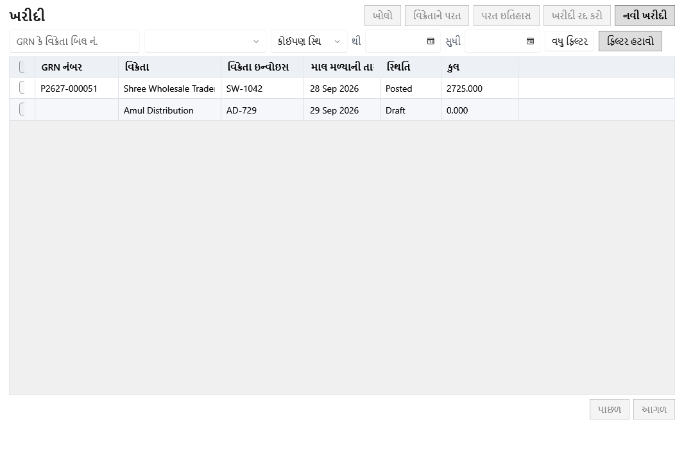

**Purchases**માં GRN, વિક્રેતા, ઇન્વૉઇસ નંબર, માલ મળ્યાની તારીખ, સ્થિતિ અને કુલ રકમ છે. Draft પસંદ કરીને **Edit draft** કરો. નિયમ અનુસાર posted ખરીદી cancel અથવા vendor return માટે પસંદ કરી શકાય છે. [ખુલેલું Filters પેનલ](screenshots/purchase-filters.en.png)માં From/To તારીખ, વિક્રેતા અને પ્રોડક્ટ છે; **Clear filters** આખી યાદી પાછી લાવે છે. ચેકબૉક્સથી યોગ્ય ખરીદીઓ એકસાથે cancel કરી શકાય છે.

[Vendors ટૅબ](screenshots/purchases-vendors.en.png)માં નામ, ફોન, GSTIN, બાકી રકમ અને સક્રિય સ્થિતિ છે. અહીંથી નવા/હાલના વિક્રેતા, ledger અને payment ખૂલે છે. પસંદગીથી activate/deactivate ક્રિયાઓ દેખાય છે.

| પૉપઅપ અથવા વિભાગ | ફીલ્ડનો હેતુ અને અસર |
|---|---|
| [નવી ખરીદી](screenshots/purchase-entry.en.png) · [વધારાની વિગતો](screenshots/purchase-additional.en.png) · [ચેતવણીઓ](screenshots/purchase-entry-warnings.en.png) | વિક્રેતા, ઇન્વૉઇસ નંબર/તારીખ અને માલ મળ્યાની તારીખ GRN ઓળખાવે છે. પ્રોડક્ટની દરેક લાઇનમાં બૅચ, ઉત્પાદન/સમાપ્તિ તારીખ, જથ્થો, મફત જથ્થો, દર, ડિસ્કાઉન્ટ, GST, MRP અને વેચાણ ભાવ દાખલ કરો. તે લૉટ, ખર્ચ, કર અને માર્જિન નક્કી કરે છે. **Additional details**માં નોંધ, અન્ય ખર્ચ અને સપ્લાયર બિલનું કુલ છે. ગણાયેલું કુલ અને તફાવત સરખાવો. **Save draft** સંપાદનયોગ્ય ખરીદી રાખે છે; **Post** સ્ટૉક અને વિક્રેતાની બાકી રકમ વધારે છે. ચેતવણી ટૂંકી સમાપ્તિ, ઓછા માર્જિન કે અસામાન્ય દર બતાવે છે. |
| [વિક્રેતા: ઉપર](screenshots/vendor-editor.gu.png) · [નીચે](screenshots/vendor-editor-bottom.en.png) | નામ/સંપર્ક, ફોન, ઇમેઇલ, સરનામું સંપર્ક માટે; GSTIN/PAN કર ઓળખ માટે; UPI/બૅંક અને payment terms ચુકવણી માટે; opening balance શરૂઆતના લેજર માટે છે. નોંધ અંદરના ઉપયોગ માટે છે. |
| [વિક્રેતા ચુકવણી](screenshots/vendor-payment.gu.png) | વિક્રેતા અને ઇચ્છો તો ચોક્કસ ખરીદી પસંદ કરો. તારીખ, રકમ, રીત, reference અને નોંધ ચુકવણી નોંધે છે અને બાકી રકમ ઘટાડે છે. |
| [વિક્રેતાનો ઇતિહાસ](screenshots/vendor-history.en.png) | ખરીદી સાથે [ચુકવણી](screenshots/vendor-history-1.en.png), [રીટર્ન](screenshots/vendor-history-2.en.png), [લેજર](screenshots/vendor-history-3.en.png) અને [આપેલા લૉટ](screenshots/vendor-history-4.en.png) ટૅબ છે. |
| [વિક્રેતા રીટર્ન](screenshots/vendor-return.en.png) | તારીખ, credit note નંબર અને કારણ આપો. દરેક લૉટ માટે પાછો જથ્થો તથા કર પહેલાં/કર ક્રેડિટ દાખલ કરો. **Post return** સ્ટૉક ઘટાડે છે અને વિક્રેતાના ખાતામાં ક્રેડિટ નોંધે છે. |

**ક્રમ:** વિક્રેતા બનાવો → ખરીદી શરૂ કરો → દરેક લૉટ અને સપ્લાયરનું કુલ તપાસો → જરૂર હોય તો draft રાખો → Post કરો → ledger તપાસો → ચુકવણી અથવા રીટર્ન નોંધો.

## ૫. સ્ટૉક અને ગણતરી

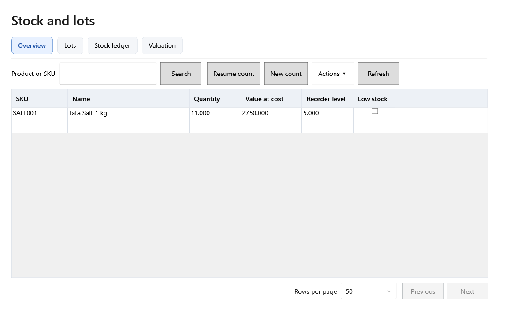

**Overview**માં પ્રોડક્ટ શોધ અને જથ્થો, ખર્ચ મૂલ્ય, reorder level, ઓછા સ્ટૉકની સ્થિતિ છે. **Actions**માંથી opening stock template અથવા import ખૂલે છે. **New count** નવી ગણતરી શરૂ કરે છે; **Resume count** સાચવેલો draft ખોલે છે.

| ટૅબ અથવા પૉપઅપ | ફીલ્ડનો હેતુ અને અસર |
|---|---|
| [લૉટ](screenshots/stock-lots.en.png) | પ્રોડક્ટ/લૉટ શોધો. બૅચ, સમાપ્તિ સ્થિતિ, હાથમાં જથ્થો, એકમ ખર્ચ, વેચાણ ભાવ અને સક્રિય સ્થિતિ જુઓ. **Adjust** જથ્થો બદલે છે; **Correct lot** લૉટ મૂલ્યો; **Block/Unblock** વેચાણની યોગ્યતા; expired write off નકામો સ્ટૉક દૂર કરે છે. |
| [લેજર](screenshots/stock-ledger.en.png) · [સ્રોત દસ્તાવેજ](screenshots/stock-source.en.png) | From/To અને movement typeથી ફેરફારો શોધો. Quantity અને lot balance અસર બતાવે છે. **Open source** સંબંધિત ખરીદી/દસ્તાવેજ ખોલે છે. |
| [મૂલ્યાંકન](screenshots/stock-valuation.en.png) | કેટેગરી પ્રમાણે જથ્થો, ખર્ચ, વેચાણ અને MRP મૂલ્ય દેખાય છે. **Refresh** ફરી ગણતરી બતાવે છે. |
| [જથ્થો સુધારો](screenshots/stock-adjustment.en.png) · [લૉટ સુધારો](screenshots/lot-price.en.png) | જથ્થો વધારવા/ઘટાડવા signed quantity અને કારણ આપો. લૉટમાં બૅચ, સમાપ્તિ, એકમ ખર્ચ, વેચાણ ભાવ, MRP અને જથ્થો સુધારી શકાય છે; કારણ આપવું જરૂરી છે. હાલના/આગામી સ્ટૉક અને ભાવ પર અસર થાય છે; પૂર્ણ થયેલા બિલના ભાવ બદલાતા નથી. |
| [ગણતરીનો વ્યાપ](screenshots/stock-count-scope.en.png) · [ગણતરી પત્રક](screenshots/stock-count.gu.png) · [બાકી draft પસંદગી](screenshots/draft-count-picker.en.png) | બધી અથવા પસંદ કરેલી કેટેગરી અને નોંધ આપો. લૉટ શોધીને **Expected** સામે **Counted** નાખો. વચ્ચેના movements, તફાવત અને તેનું મૂલ્ય જુઓ. **Save count** draft રાખે છે; **Review count** ચકાસે છે; **Post** તફાવત સ્ટૉકમાં લાગુ કરે છે; **Discard** રદ કરે છે. Draft યાદીમાં ID, તારીખ, કુલ લૉટ અને ગણાયેલા લૉટ પરથી યોગ્ય પત્રક ખોલો. |
| [શરૂઆતના સ્ટૉકનું પૂર્વદર્શન](screenshots/opening-stock-preview.en.png) | આયાત થયેલા SKU, જથ્થા, એકમ ખર્ચ, વેચાણ ભાવ અને પંક્તિ ભૂલો તપાસો. **Import reviewed** માન્ય લૉટ ઉમેરે છે. |

**ક્રમ:** ખરીદી/આયાતથી સ્ટૉક લાવો → overview અને લૉટ જુઓ → કારણ સાથે જ સુધારો કરો → ગણતરીનો વ્યાપ પસંદ કરો → જથ્થા લખો અને તફાવત તપાસો → Post કરો → ledger અને મૂલ્યાંકન ચકાસો.

## ૬. Money Out: સમાપ્તિ, નુકસાન, ખર્ચ અને પગાર

### સમાપ્તિ અને નુકસાન

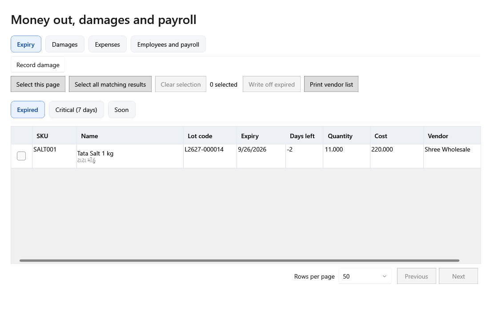

**Expired**, **Critical** અને **Soon** ટૅબ તાકીદ પ્રમાણે લૉટ બતાવે છે. SKU, લૉટ, સમાપ્તિ, બાકી દિવસ, જથ્થો, ખર્ચ અને વિક્રેતા પરથી માલ ઓળખો. હાલનું પાનું અથવા બધી મળતી પંક્તિ પસંદ કરી શકાય છે; પસંદગી સાફ કરો, વિક્રેતાની યાદી છાપો અથવા યોગ્ય expired લૉટ write off કરો. [ખુલેલા Damage entryમાં](screenshots/expiry-damage-entry.en.png) **Reason**, **Quantity**, **Recovered** આપો. **Record damage** સ્ટૉક ઘટાડે છે; **Block lot** વેચાણ રોકે છે; **Mark down** ભાવ ઘટાડે છે.

[Damages ટૅબ](screenshots/damages.en.png) તારીખથી જૂના નુકસાન શોધે છે. [ખુલેલા ફોર્મમાં](screenshots/damages-entry.en.png) લૉટ શોધો અને જથ્થો, કારણ, વસૂલેલી રકમ તથા નોંધ દાખલ કરો. Posted પંક્તિ પસંદ કરતાં જમણી બાજુ વિગત પૅનલ ખુલે છે. તે જણાવે છે કે ફેરફાર કઈ તારીખે ગણાશે: "બંને વાર્ષિક સમયગાળા ખુલ્લા છે" એટલે ફેરફાર મૂળ તારીખે ગણાશે; "… અંતિમ છે" એટલે મૂળ નોંધ એમ જ રહેશે અને આજની તારીખે સુધારો નોંધાશે. **Edit** [સુધારાનો પૉપઅપ](screenshots/damage-correction.en.png) ખોલે છે, જેમાં સુધારેલો જથ્થો, વસૂલેલી રકમ, કારણ, નોંધ અને ફરજિયાત સુધારાનું કારણ આપો; **Void** જથ્થો શૂન્ય કરે છે. જથ્થાનો ફેરફાર આજના બેચ સ્ટૉકમાં માલ પાછો ઉમેરે અથવા ઘટાડે છે; નુકસાનવાળી બેચ શૂન્ય થઈને કાઢી નાખી હોય તો પાછા આવેલા નંગથી નવી બેચ બને છે. **History** મૂળ નોંધ અને દરેક સુધારો બતાવે છે, અને **Status** કૉલમમાં Posted, Corrected અથવા Void દેખાય છે. આંતરિક ઉપયોગના માલનું નુકસાન સ્ટૉક ઘટાડે છે પણ નફા-નુકસાનમાં ગણાતું નથી.

### ખર્ચ

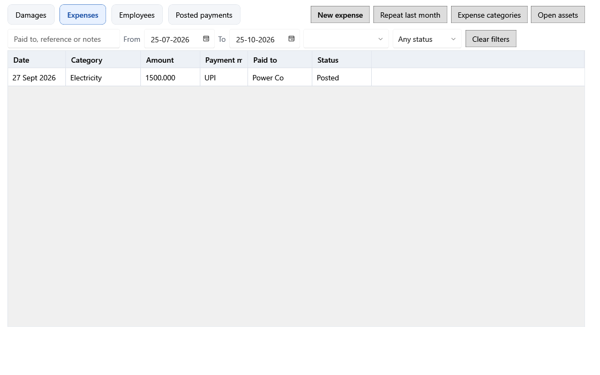

From/To તારીખથી ખર્ચ શોધો. [Expense entry](screenshots/expense-entry.en.png)માં તારીખ, કેટેગરી, રકમ, ચુકવણીની રીત, કોને ચૂકવ્યું, reference અને નોંધ છે. **Save expense** ચુકવણી નોંધે છે; **New entry** ફોર્મ ખાલી કરે છે. **Repeat last month** [Repeat categories વિભાગ](screenshots/expense-repeat-categories.en.png)માં પસંદ કરેલી કેટેગરી માટે draft બનાવે છે; સાચવતા પહેલાં તપાસો. [Category details](screenshots/expense-categories.en.png)માં નામ, સ્થાનિક નામ અને સક્રિય સ્થિતિથી કેટેગરી બનાવો/સુધારો. ખર્ચ પસંદ કરવાથી તેની વિગત પૅનલ ખુલે છે, જેમાં તારીખ અંગેની સૂચના, **Edit**, **Void** અને **History** છે. **Edit** [સુધારાનું ફોર્મ](screenshots/expense-correction.en.png) ખોલે છે: તારીખ, કેટેગરી, રકમ, રીત, કોને ચૂકવ્યું, reference અથવા નોંધ બદલો અને ફરજિયાત કારણ આપો. નવી તારીખ પણ ખુલ્લા સમયગાળામાં હોવી જોઈએ. **Void** સુધારા દ્વારા ખર્ચ શૂન્ય કરે છે; ખર્ચ ક્યારેય કાઢી નખાતો નથી. ખરીદીની Expense લાઇનથી બનેલો ખર્ચ Purchase બતાવે છે અને ફક્ત તે ખરીદી Void કરવાથી બદલાય છે. **Open assets**થી Assets ખુલે છે.

### પગાર

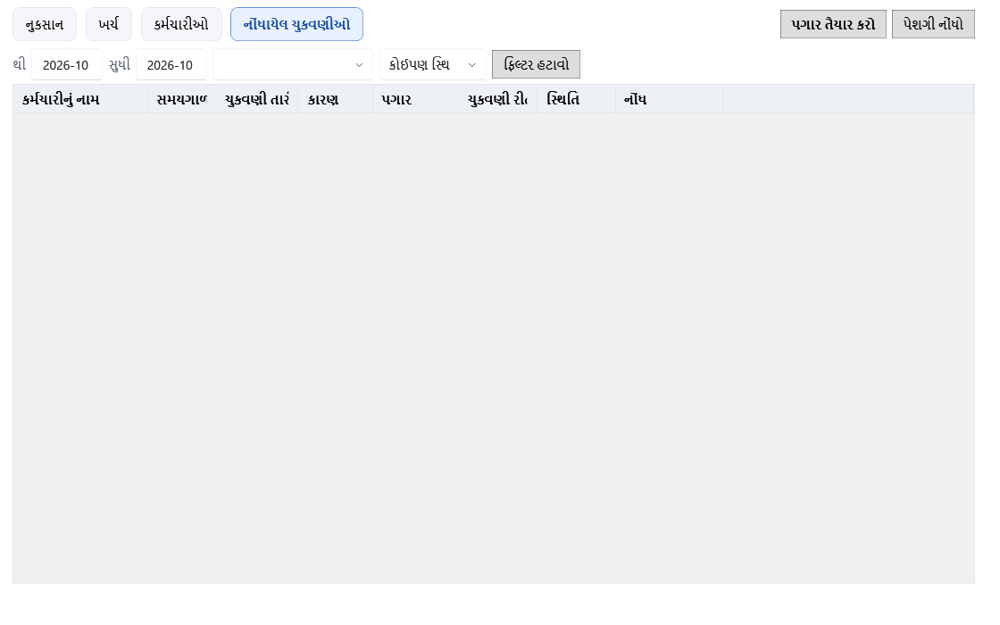

[ખુલેલી Employee details](screenshots/employee-details.en.png)માં નામ, ફોન, હોદ્દો, જોડાવાની/છોડવાની તારીખ, માસિક પગાર, નોંધ અને સક્રિય સ્થિતિ છે. આથી પગાર તૈયાર કરતી યાદી બને છે. [Prepare salary](screenshots/salary-prepare.en.png)માં મહિનો, ચુકવણી તારીખ અને રીત પસંદ કરો. તૈયાર થયેલી પંક્તિમાં મૂળ પગાર, રજાની કપાત, overtime અને bonus સુધારો; પંક્તિ પસંદ કરીને **Post salary** કરો. કર્મચારીનો માસિક પગાર બદલતાં **Salary from** (YYYY-MM) દેખાય છે: નવી રકમ એ મહિનાથી પગાર તૈયાર કરવામાં ભરાય છે, અને તે મહિનો કૅલેન્ડર તથા નાણાકીય બંને વર્ષ ખુલ્લાં હોય એવા પહેલા મહિનાથી વહેલો ન હોઈ શકે; પોસ્ટ થયેલી ચુકવણી જેમ ચૂકવી તેમ જ રહે છે અને સૂચના તેની સંખ્યા બતાવે છે. કર્મચારી પસંદ કરતાં તેની પગારની શરતો દેખાય છે. [Posted payments](screenshots/salary-posted.en.png)માં મહિના પ્રમાણે ચુકવણી છે; ચુકવણી પસંદ કરતાં વિગત પૅનલ ખુલે છે, જ્યાં **Edit** [પગાર સુધારાનો પૉપઅપ](screenshots/salary-correction.en.png) ખોલે છે (રકમ, તારીખ, રીત, નોંધ અને ફરજિયાત કારણ) અને **Void** ભૂલથી નોંધાયેલી ચુકવણી શૂન્ય કરે છે. પગાર કામ કરેલા મહિનામાં ગણાય છે, તેથી સુધારાની તારીખ એ મહિના પરથી નક્કી થાય છે. [Advance details](screenshots/salary-advance.en.png)માં કર્મચારી, તારીખ, રીત, advance રકમ અને નોંધ આપો.

**ક્રમ:** સમાપ્તિ નજીકના લૉટ ઉકેલો → નુકસાન/ભાવની કાર્યવાહી કરો → દૈનિક ખર્ચ નોંધો → કર્મચારી માહિતી રાખો → પગાર તૈયાર કરીને તપાસો → ચૂકવણી અથવા advance Post કરો → જરૂર પડે તો કારણ સાથે સુધારો કરો.

## ૭. સ્થિર સંપત્તિ (Assets)

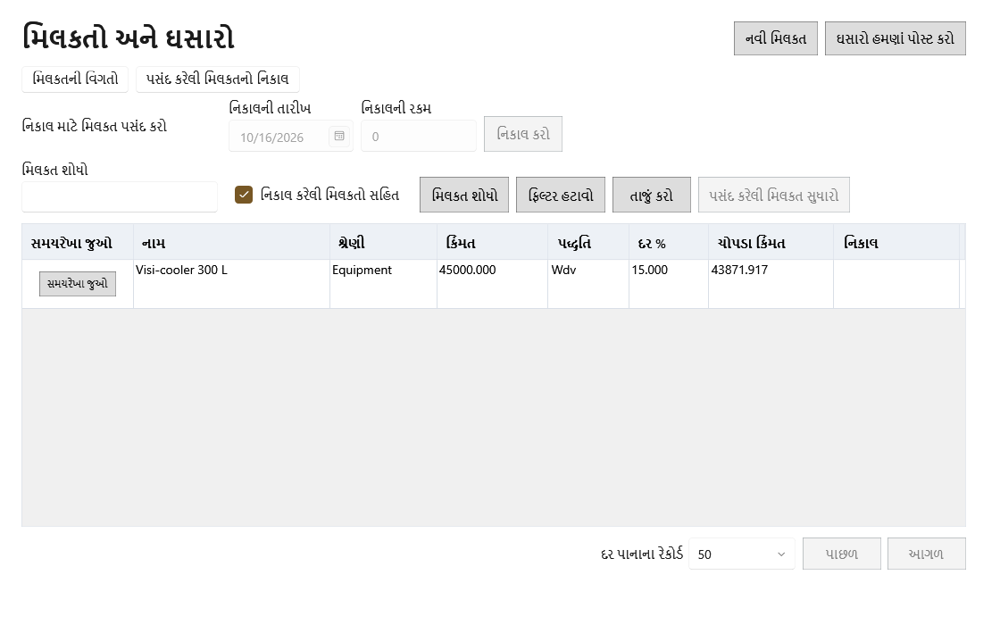

[Asset details](screenshots/asset-details.en.png)માં નામ, કેટેગરી, ખરીદી તારીખ, વપરાશ શરૂ તારીખ, ખર્ચ, WDV/SLM depreciation પદ્ધતિ, દર, salvage value, વિક્રેતા અને નોંધ છે. આથી માસિક ઘસારો ગણાય છે. **Save** સંપત્તિ બનાવે/સુધારે છે. Search અને **Include disposed** યાદી ગાળે છે; **Edit selected** વિગતો ફરી ભરે છે. [View timeline](screenshots/asset-timeline.en.png) તારીખવાળી શરતો અને મહિના પ્રમાણે શરૂઆતનું મૂલ્ય, ઘસારો અને અંતિમ મૂલ્ય બતાવે છે; વર્ષ બંધ થયા પછી પોસ્ટ થયેલો મહિનો કઈ તારીખે ગણાયો તે પણ બતાવે છે. **Post depreciation now** બાકી મહિના નોંધે છે. બંધ વર્ષનો કોઈ મહિનો કદી પોસ્ટ ન થયો હોય તો તે હજી પોસ્ટ થાય છે, પણ તેનો ખર્ચ આજે ગણાય છે.

સાચવેલી સંપત્તિ સુધારતી વખતે પદ્ધતિ, દર અથવા salvage બદલતાં **Effective from** (મૂળભૂત રીતે પહેલો ખુલ્લો મહિનો) અને પૂર્વદર્શન દેખાય છે: કયા મહિના ફરી ગણાશે, અને પહેલાં તથા પછીનો ઘસારો અને book value. સાચવતાં ફક્ત એ ખુલ્લા મહિના ફરી ગણાય છે; "આખું વર્ષ ફરી ગણો" વિકલ્પ નથી. ખર્ચ અને વપરાશ શરૂ તારીખ ફક્ત ત્યારે બદલાય જ્યારે દરેક પોસ્ટ થયેલો મહિનો હજી ખુલ્લો હોય; બંધ વર્ષનો ઘસારો પોસ્ટ થયા પછી તે સ્થિર રહે છે અને **Save** બંધ રહે છે.

[Disposal details](screenshots/asset-disposal.en.png) સક્રિય સંપત્તિ પસંદ કરતાં ખુલે છે. Disposal date અને proceedsથી નિકાલ નક્કી થાય છે; નફો/નુકસાન નિકાલ વખતે સાચવેલી book value સામે ગણાય છે; **Dispose** પુષ્ટિ પછી નોંધે છે. યાદીમાં ખર્ચ, પદ્ધતિ, દર, book value અને નિકાલ તારીખ છે.

**ક્રમ:** સંપત્તિ ઉમેરો → સમયરેખા તપાસો → બાકી ઘસારો Post કરો → મંજૂર ફેરફાર કરો → ઉપયોગ બંધ થાય ત્યારે નિકાલ કરો.

## ૮. બિલિંગ અને હોલ્ડ કરેલા બિલ

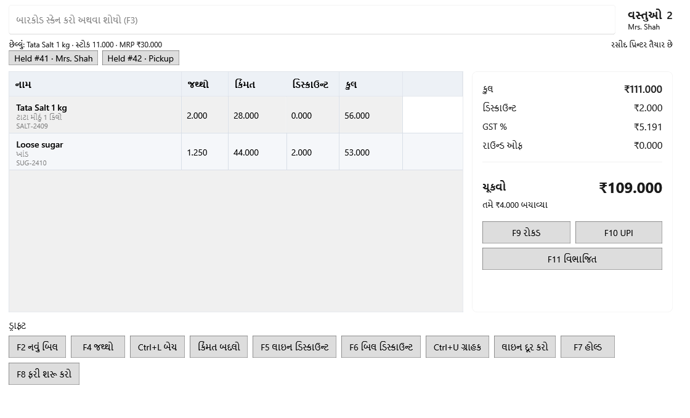

ઉપરના બૉક્સમાં બારકોડ સ્કૅન કરો અથવા `F3`થી શોધો. લાઇનમાં પ્રોડક્ટ, જથ્થો, એકમ ભાવ, ડિસ્કાઉન્ટ અને કુલ છે. જમણે gross, discount, GST, round off અને ચૂકવવાની રકમ તરત ગણાય છે. **Cash**, **UPI** અથવા **Split**થી ચુકવણી પૂર્ણ કરો. નીચે નવું બિલ, જથ્થો, લૉટ, ભાવ ફેરફાર, લાઇન/બિલ ડિસ્કાઉન્ટ, ગ્રાહક, લાઇન દૂર કરવી, hold અને resume મળે છે.

| પૉપઅપ | ફીલ્ડનો હેતુ અને અસર |
|---|---|
| [જથ્થો](screenshots/quantity.en.png) · [લૉટ પસંદગી](screenshots/lot-picker.en.png) | જથ્થો લાઇન અને વેચાતા સ્ટૉકને બદલે છે; લૉટ પસંદગી કયા બૅચમાંથી માલ જશે તે નક્કી કરે છે. |
| [ડિસ્કાઉન્ટ](screenshots/discount-percent.en.png) | રકમ નાખીને amount અથવા percent પસંદ કરો. Previewમાં અસર જોઈ **Save** કરવાથી લાઇન/બિલનું કુલ બદલાય છે. |
| [ગ્રાહક](screenshots/customer.en.png) | હાલનો ગ્રાહક શોધો અથવા નામ, ફોન અને GSTINથી નવો બનાવો. **Use customer** બિલ સાથે જોડે છે; **Walk in** સાચવેલા ગ્રાહક વગર આગળ વધે છે. |
| [Hold](screenshots/hold-bill.en.png) · [સાચવેલા બિલ](screenshots/saved-bills.en.png) · [ફરી તપાસ](screenshots/held-review.en.png) | અધૂરા બિલને ઓળખ આપો. ID અથવા labelથી શોધીને **Open bill** કરો. ફરી શરૂ કરતાં પહેલાં જૂનો/નવો ભાવ, MRP, ઉપલબ્ધ જથ્થો અને સ્થિતિ તપાસીને **Accept and resume** કરો. |
| [વિભાજિત ચુકવણી](screenshots/payment.gu.png) | રોકડ, UPI અને કાર્ડની રકમ મળીને બિલના કુલ જેટલી હોવી જોઈએ. reference ડિજિટલ/કાર્ડ ચુકવણી ઓળખાવે છે. **Confirm payment** વેચાણ નોંધે છે. |

**ક્રમ:** પ્રોડક્ટ સ્કૅન/શોધો → જથ્થો, બૅચ, ભાવ અને ડિસ્કાઉન્ટ તપાસો → જરૂર હોય તો ગ્રાહક ઉમેરો → કુલ રકમ જુઓ → ચુકવણી લો → રસીદ આપો. કામ અટકે તો Hold/Resume વાપરો. [રસીદ નમૂનો](screenshots/sale-receipt.en.png).

## ૯. વેચાણ ઇતિહાસ અને દિવસનું સમાપન

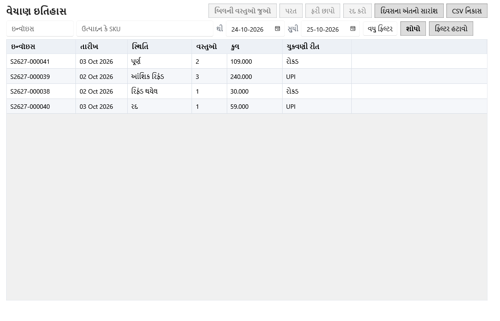

From/To તારીખ, ઇન્વૉઇસ, સ્થિતિ, ચુકવણી રીત અને ઓછામાં ઓછી/વધુમાં વધુ રકમથી બિલ શોધો. **Export** પરિણામ સાચવે છે. બિલ પસંદ કરીને [વસ્તુઓ](screenshots/sales-history.en.png), [રીટર્ન](screenshots/sales-detail-1.en.png) અને [સ્ટૉક ફેરફારો](screenshots/sales-detail-2.en.png) જુઓ. **Reprint** રસીદ ફરી છાપે છે. **Void** માટે [કારણ](screenshots/void.en.png) આપો. **Return**માં [રીટર્ન ફોર્મ](screenshots/return.en.png) ખૂલે છે; જથ્થો, ફરી વેચી શકાય કે નહીં, refund રીત અને કારણ રિફંડ તથા સ્ટૉકની અસર નક્કી કરે છે. [Day end](screenshots/day-end.en.png) પસંદ કરેલી વ્યવસાય તારીખનું વેચાણ, રિફંડ, કર અને ચુકવણી રીતનો સાર આપે છે.

**ક્રમ:** ફિલ્ટરથી બિલ શોધો → વસ્તુઓ અને ચુકવણી તપાસો → યોગ્ય હોય તો ફરી છાપો, Void અથવા Return કરો → Day end જુઓ. [રીટર્ન રસીદ નમૂનો](screenshots/return-receipt.gu.png).

## ૧૦. રિપોર્ટ

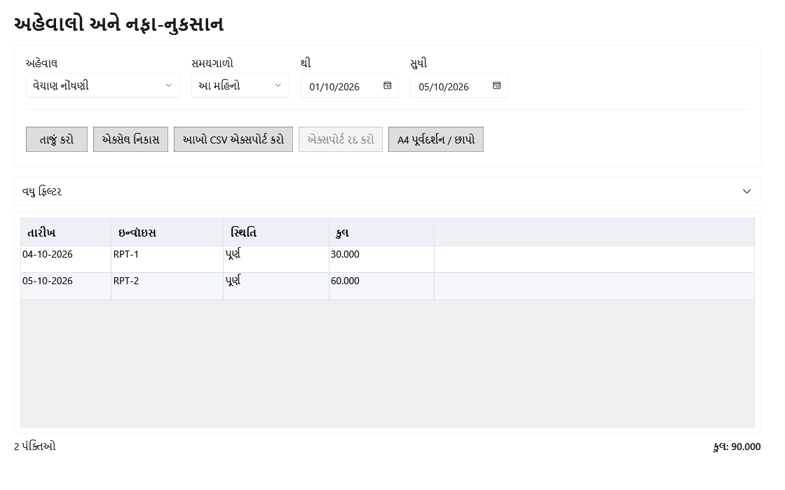

**Report**માં રિપોર્ટનો પ્રકાર અને **Period** અથવા From/Toમાં સમય પસંદ કરો. **Refresh** પરિણામ લાવે છે. **Export Excel**, **Full CSV** અને **Print A4** આઉટપુટ આપે છે. [ખુલેલા More filters](screenshots/reports-filters.en.png)માં status, payment, product, lot, vendor, asset, slow moving days, audit entity/action, monthly matrix અને અગાઉના સમય સાથે સરખામણી છે. લાગુ પડતા ફીલ્ડ રિપોર્ટ પ્રમાણે બદલાય છે. [નફા-નુકસાન](screenshots/reports-pnl.en.png)માં **Month**, **Calendar year**, **Fiscal year** અથવા **Custom range** અને પછી સમયગાળો પસંદ કરો; સાચવેલું વર્ષ યાદીમાં "· Finalized" તરીકે દેખાય છે. કોષ્ટક ઉપરનું ચિહ્ન **Open** સાથે નોંધો બદલી શકાય એવી છેલ્લી તારીખ, અથવા **Finalized** સાથે વર્ષ, ફેરફારની અંતિમ તારીખ, આવૃત્તિ અને checksum બતાવે છે. પહેલાં મુખ્ય હેડના કુલ દેખાય છે; **Expenses** પસંદ કરતાં તેની કેટેગરી ખૂલે છે, અને **Show months** દરેક મહિનાની કૉલમ ઉમેરે છે. **Actions ▾ → Export P&L CSV** બરાબર દેખાતી આવૃત્તિ લખે છે, તેથી અંતિમ વર્ષની ફાઇલ દર વખતે એકસરખી હોય છે. [કલાકવાર રિપોર્ટ](screenshots/reports-hourly.gu.png)માં સમય પ્રમાણે વેચાણ છે. નીચે પંક્તિઓની સંખ્યા અને કુલ છે.

**Current unsold stock** હાલનો બેચ જથ્થો અને કિંમત વાંચે છે. **Include expired stock** વેપારની તારીખે સમાપ્ત થયેલી બેચ ઉમેરે અથવા છોડે છે, અને કોષ્ટક નીચેની લીટી હંમેશાં સમાપ્ત બેચ, જથ્થો અને કિંમત મૂલ્ય જણાવે છે, જેથી બંને કુલ સમજી શકાય. **Purchased vs used reconciliation** નવી બેચ પહેલાં (અથવા એક પ્રોડક્ટની બેચ) સાથે મળેલો, વેચાયેલો, પરત આવેલો, નુકસાન, આંતરિક ઉપયોગ, વિક્રેતાને પરત અને સુધારેલો જથ્થો, અપેક્ષિત અને ઉપલબ્ધ સ્ટૉક તથા કોઈ ફરક બતાવે છે. **Differences only** સાપ્તાહિક પૂરી તપાસમાં અલગ મળેલી બેચ હમણાં ફરી તપાસીને બતાવે છે; કોષ્ટક નીચેની લીટી એ તપાસની તારીખ આપે છે.

**ક્રમ:** રિપોર્ટ પસંદ કરો → સમય અને સંબંધિત ફિલ્ટર આપો → Refresh કરો → કુલ તપાસો → export અથવા print કરો. પહોળો A4 રિપોર્ટ [પાનું ૧](screenshots/report-a4-band1.en.png) અને [પાનું ૨](screenshots/report-a4-band2.en.png) તરીકે છપાઈ શકે છે.

## ૧૧. Settings, બેકઅપ અને પુનઃસ્થાપન

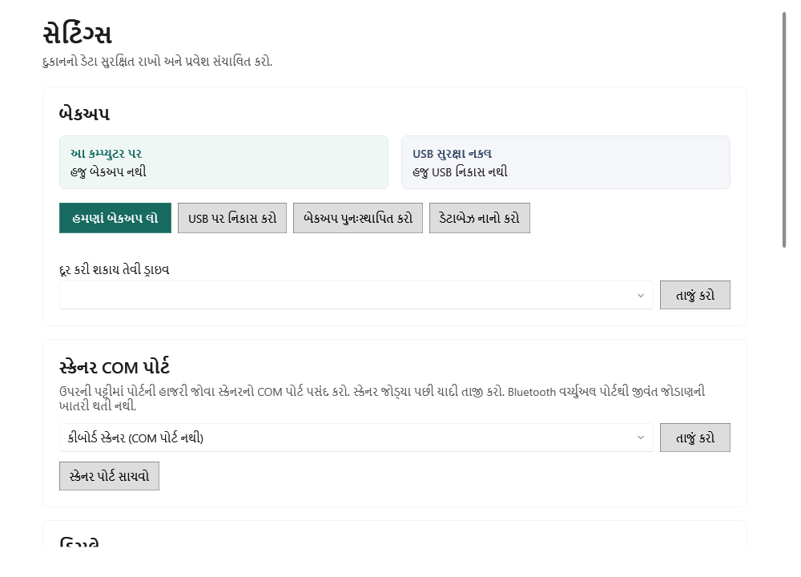

**Local backup** અને **USB copy**માં નકલની સ્થિતિ છે. **Backup now** સ્થાનિક નકલ બનાવે છે. removable drive પસંદ કરીને **Refresh** કરો અને **Export to USB**થી નકલ લઈ જાઓ. **Scanner port**માં serial scannerનો port પસંદ કરીને **Save scanner port** કરો. [નીચેના Settings](screenshots/settings-bottom.en.png)માં ડેટા અને બેકઅપ ફોલ્ડર છે; **Move data** કામ કરતા ડેટાનું સ્થાન બદલે છે. હાલનો, નવો અને પુષ્ટિ પાસવર્ડ આપીને માલિકનો પાસવર્ડ બદલો.

[Restore](screenshots/restore.gu.png)માં હાલના ડેટા અને પસંદ કરેલા બેકઅપનો સાર સરખાવો. જરૂરી પુષ્ટિ શબ્દ લખ્યા પછી **Restore** ચાલુ થાય છે. આ ક્રિયા હાલનો ડેટાબેઝ બેકઅપથી બદલે છે; પહેલાં સ્રોત અને તારીખો તપાસો.

**ક્રમ:** સ્થાનિક બેકઅપ લો → નિયમિત USB નકલ લો → ઉપકરણ સ્થિતિ જુઓ → જરૂરી હોય ત્યારે સ્થાન/પાસવર્ડ સુધારો. પુનઃસ્થાપન માટે વિશ્વસનીય બેકઅપ પસંદ કરો, સાર સરખાવો, પુષ્ટિ લખો અને Restore કરો.
