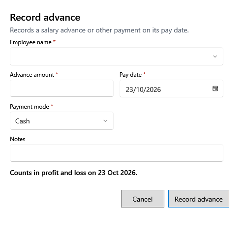

<!-- Screen help for Record advance (topic "advance-form"). The app shows this file for the ⓘ button and F1. Bold names in a table's first column must match the labels on screen; see ../README.md. -->
# Record advance

Record money paid to an employee ahead of their salary, or another payment to them.

Fields marked * are required. The advance counts on its pay date; the line under the fields says where.

## Fields

| Field | What it means |
|---|---|
| **Employee name** | Who was paid. |
| **Advance amount** | How much was paid. |
| **Pay date** | The day it was paid. A date in a finalized year is refused. |
| **Payment mode** | Cash, UPI, Bank or Other. |
| **Notes** | What it was for. |

## Buttons

| Button | What it does |
|---|---|
| **Record advance** | Saves the payment. |
| **Cancel** | Closes without saving. |
