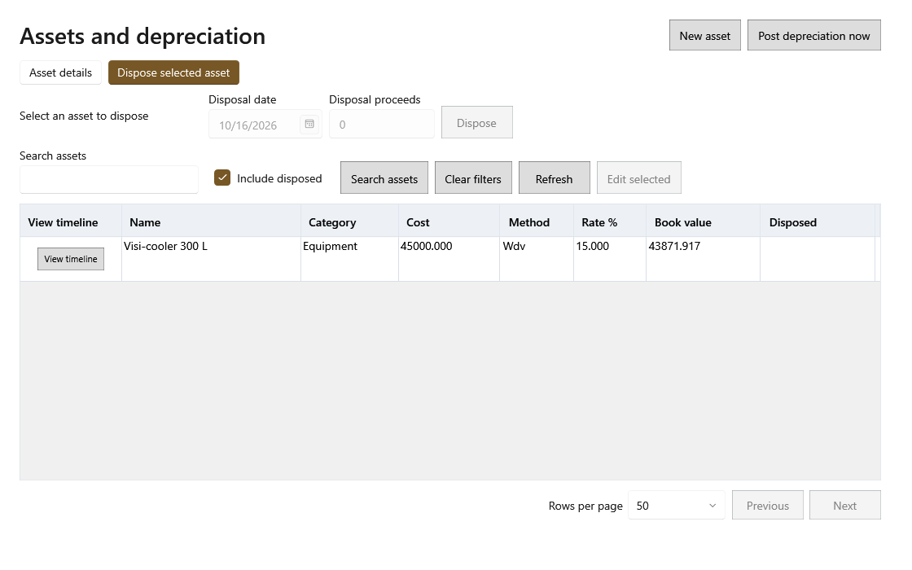

<!-- Screen help for Dispose (topic "asset-disposal"). The app shows this file for the ⓘ button and F1. Bold names in a table's first column must match the labels on screen; see ../README.md. -->
# Dispose

Record that an asset was sold, scrapped or thrown away.

The line under the title names the asset and its book value. Disposing posts the depreciation due up to that date, then the difference between what it fetched and its book value counts as a gain or loss. The asset stays listed as disposed. You confirm before anything changes.

## Fields

| Field | What it means |
|---|---|
| **Disposal date** | The day it left the shop. |
| **Disposal proceeds** | What it was sold for; 0 when it was thrown away. |

## Buttons

| Button | What it does |
|---|---|
| **Dispose** | Disposes of the asset after you confirm. |
| **Cancel** | Closes without a change. |
