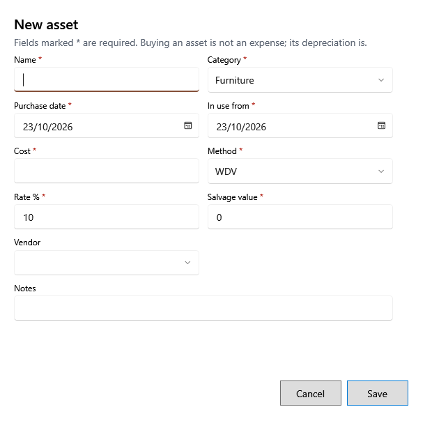

<!-- Screen help for the asset form (topic "asset-form"). The app shows this file for the ⓘ button and F1. Bold names in a table's first column must match the labels on screen; see ../README.md. -->
# New asset

Add something the shop owns and uses for years, such as a fridge or a computer, or change one.

Fields marked * are required. Buying an asset is not an expense: each month's depreciation is. When you change the terms of an asset already depreciating, the line under the fields shows how many posted months change and the new book value before you save. A disposed asset keeps its financial terms; only its name, category, vendor and notes can change.

## Fields

| Field | What it means |
|---|---|
| **Name** | What the asset is. |
| **Category** | Furniture, Equipment, Electronics, Vehicle or Other. For a new asset it suggests a rate: 10% for furniture, 40% for electronics, 15% otherwise. |
| **Purchase date** | The day it was bought. |
| **In use from** | The day it started being used. Depreciation starts from that month. It cannot be before the purchase date. |
| **Cost** | What it cost. |
| **Method** | **WDV** (written-down value: the rate applies to what is left, so the charge gets smaller) or **SLM** (straight line: the same charge every month). |
| **Rate %** | The yearly depreciation rate. |
| **Salvage value** | What it will still be worth at the end. Depreciation stops there. |
| **Effective from** | Shown when you change the method, rate or salvage value: the month the new terms apply from, typed as YYYY-MM. Cost and in-use date can change only while every posted month is in an open year. |
| **Vendor** | Whom it was bought from. |
| **Notes** | Anything else worth keeping. |

## Buttons

| Button | What it does |
|---|---|
| **Save** | Saves the asset. A change to its terms asks you to confirm first. |
| **Cancel** | Closes without saving. |
