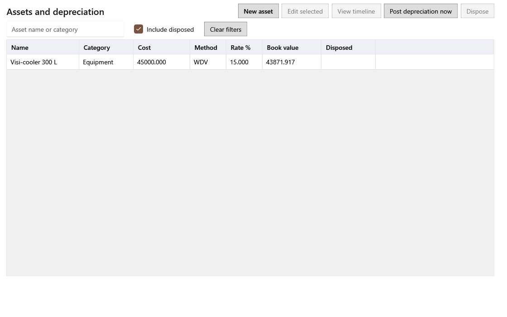

<!-- Screen help for Assets (topic "assets"). The app shows this file for the ⓘ button and F1. Bold names in a table's first column must match the labels on screen; see ../README.md. -->
# Assets and depreciation

Keep the things the shop owns for years, such as fridges, scales and computers, and spread their cost over the months they are used.

Each month an asset is in use, part of its cost is charged to profit and loss as depreciation, and its book value falls by that amount. Due months are posted when the app is idle for ten minutes, or with **Post depreciation now**.

## Filters

| Field | What it means |
|---|---|
| **Search assets** | Type part of an asset's name or category. Ctrl+F jumps here. |
| **Include disposed** | Also lists assets that were sold or thrown away. Ticked by default. |
| **Clear filters** | Puts every filter back to its default. |

## Table

| Column | What it means |
|---|---|
| **Name** | The asset's name. |
| **Category** | The asset's category. |
| **Cost** | What the asset cost. |
| **Method** | **WDV** (written-down value: the rate applies to what is left each year, so the charge gets smaller) or **SLM** (straight line: the same charge every month). |
| **Rate %** | The yearly depreciation rate. |
| **Book value** | The cost less the depreciation posted so far. |
| **Disposed** | The day the asset was disposed of, if it was. |

## Buttons

| Button | What it does |
|---|---|
| **New asset** | Opens the asset form (Ctrl+N): name, category, purchase and in-use dates, cost, method, rate, salvage value, vendor and notes. |
| **Edit selected** | Opens the selected asset's form. A change to method, rate or salvage value asks from which month it applies and shows the months it changes before you save. Cost and in-use date can change only while every posted month is in an open year. |
| **View timeline** | Opens the selected asset in the panel (Enter or a double-click). |
| **Post depreciation now** | Posts every month that is due, for every asset. A month of a locked year that was never posted is still posted, but its charge counts today. |
| **Dispose** | Records that the asset was sold or thrown away: the date and what it fetched. The gain or loss is measured against its book value on that day. |
| **More ▾** | Holds the actions that do not fit when the window is narrow. |

## Asset panel

The panel opens beside the list and follows the selection. While it is open, **Edit selected** and **Dispose** are in the panel.

| Field | What it means |
|---|---|
| **Previous record**, **Next record** | Open the asset above or below in the list. |
| **Use the full width**, **Show beside the list** | Switches the panel between beside the list and the whole page. The screen remembers the choice. |
| **Close** | Closes the panel (Esc). |
| **Depreciation terms** | Each set of terms the asset has had: the month it starts, method and rate, salvage value, cost and when it was recorded. |
| **Period** | The month. |
| **Opening** | The book value at the start of the month. |
| **Depreciation** | The month's charge. |
| **Closing** | The book value at the end of the month. |
| **Charged on** | For a month posted after its year locked, the day its charge counted. |

## How to use it

1. Add each asset with **New asset**.
2. Check its timeline.
3. Let due depreciation post, or click **Post depreciation now**.
4. Edit the terms only when the rules allow.
5. Dispose of the asset when it is sold or thrown away.
