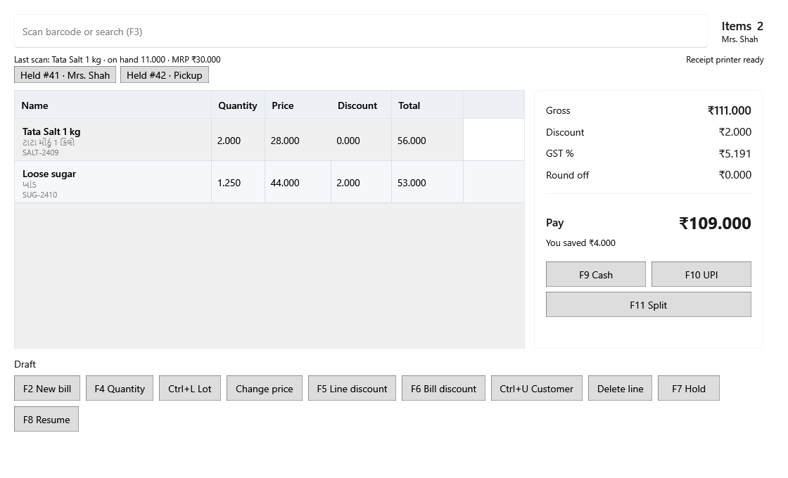

<!-- Screen help for Billing (topic "billing"). The app shows this file for the ⓘ button and F1. Bold names in a table's first column must match the labels on screen; see ../README.md. -->
# Billing

Make a bill: scan or search products, check quantities, batches, prices and discounts, and take the payment.

Every line takes its stock from the lot a bill takes next: the earliest expiry first, then the earliest received. Prices include tax. A bill takes its date and number when it is paid, so a bill held or left open from an earlier day counts on the day it is completed. When Billing opens and unfinished bills are waiting, it offers them first.

## Adding products

| Field | What it means |
|---|---|
| **Scan barcode or search (F3)** | Scan a barcode, or type a barcode, SKU or part of a name and press Enter. One match joins the bill. Type a quantity and * first, such as 2*salt or 2*8901234567890, to add that many. A number of eight or more digits that matches nothing opens Unknown barcode, where you can add the product or attach the barcode to one. F3 jumps here from anywhere on the screen. |
| **Matching products** | When several products match a name, they are listed under the box with SKU, Gujarati name, price and stock. The price is that of the lot the bill takes next. Pick one with the arrow keys and Enter, or click it; Esc closes the list. |
| **Items** | How many lines the bill has. Under it, the customer: **Walk-in customer** until you choose one. |
| Last: … | The last product added, with its stock and MRP. |
| Held bills | A button for each recently held bill, with its label or number. Click one to check it and carry on with it. |
| Receipt printer | Whether the receipt printer is ready. When a receipt did not print, it says so; press Ctrl+P to try again. |

## Bill lines

| Column | What it means |
|---|---|
| **Name** | The product, its Gujarati name and the batch the line is sold from. |
| **Quantity** | The quantity sold. Change it with **F4 Quantity**. |
| **Price** | The price of one unit, tax included. |
| **Discount** | The line's discount, from **F5 Line discount** or its share of a bill discount. |
| **Total** | Quantity × price, less the discount. |

## Totals and payment

| Field | What it means |
|---|---|
| **Gross** | The lines' quantity × price, before discounts. |
| **Discount** | All the line and bill discounts. |
| **Tax** | The tax included in the bill, shown for the receipt. It is not added on top. |
| **Round off** | The paise added or taken off so the bill comes to a round amount. |
| **Pay** | What the customer pays. Under it, how much the customer saved against MRP. |
| **F9 Cash** | Opens Take payment with all of the bill in cash: type the cash handed over to see the change, then complete the bill. F12 does the same. |
| **F10 UPI** | Opens Take payment with all of the bill by UPI, with a box for the UPI reference. |
| **F11 Split** | Opens Take payment to share the bill between cash, UPI and card, with references for UPI and card. |

## Buttons

Most buttons work on the line selected in the table.

| Button | What it does |
|---|---|
| **F2 New bill** | Starts an empty bill. A bill that was not paid stays open and can be resumed with **F8 Resume**. |
| **F4 Quantity** | Changes the selected line's quantity. |
| **Ctrl+L Lot** | Chooses which batch the selected line is sold from. |
| **Change price** | Changes the selected line's price for this bill. It must be above zero and cannot be above MRP. |
| **F5 Line discount** | Gives the selected line a discount, as an amount or a percent. |
| **F6 Bill discount** | Gives the whole bill a discount, shared across the lines. |
| **Ctrl+U Customer** | Finds or adds a customer, with name, phone and GSTIN, for this bill. |
| **Delete line** | Removes the selected line. The Delete key does the same. |
| **F7 Hold** | Puts the bill aside with a label, such as the customer's name, and starts an empty one. |
| **F8 Resume** | Lists held bills by number or label. Before a held bill carries on, a review shows any price, MRP or stock that changed since it was held. |

Ctrl+P prints the last receipt again, marked DUPLICATE, or retries a receipt that did not print.

## How to use it

1. Scan or search each product.
2. Check the quantity, batch, price and discount of each line.
3. Choose the customer if the bill needs one.
4. Check the amount under **Pay** and take the payment with **F9 Cash**, **F10 UPI** or **F11 Split**.
5. Give the receipt. Use **F7 Hold** and **F8 Resume** when a customer has to step away.
