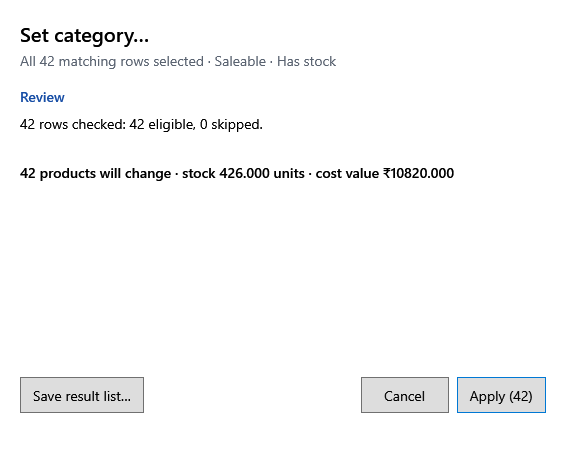

<!-- Screen help for a bulk action's review (topic "bulk-action"): every Bulk actions ▾ choice opens it. The app shows this file for the ⓘ button and F1. Bold names in a table's first column must match the labels on screen; see ../README.md. -->
# Bulk action

Check what a bulk action will change before anything is saved, run it in small parts, and keep a list of what happened to each row.

The title names the action, such as Remove selected or Void selected purchases. The rows are checked again in the database first, so the review counts what can really change now.

## Stages

| Stage | What it shows |
|---|---|
| **Review** | How many rows were checked, how many are eligible and how many are skipped, with the reason for each skip, and the quantity and value affected. Nothing has changed yet. |
| **Progress** | Which part is being saved and how many rows are done. Each part is saved on its own, so a bill at the till never waits long. |
| **Result** | How many rows changed, were skipped, changed since the review (someone changed them meanwhile) or were not processed. |

## Buttons

| Button | What it does |
|---|---|
| Apply (count) | Runs the action on the eligible rows; the button names the action and the count, such as Apply (42). |
| **Stop after this part** | Stops once the part being saved is done. Saved parts are kept. |
| **Resume** | Carries on with the rows not done yet, or retries a part that failed. |
| **Save result list…** | Saves every row's outcome and reason to a CSV file. |
| **Cancel**, **Close** | Closes the window. Before Apply nothing has changed; after it, the saved parts stay saved. |
