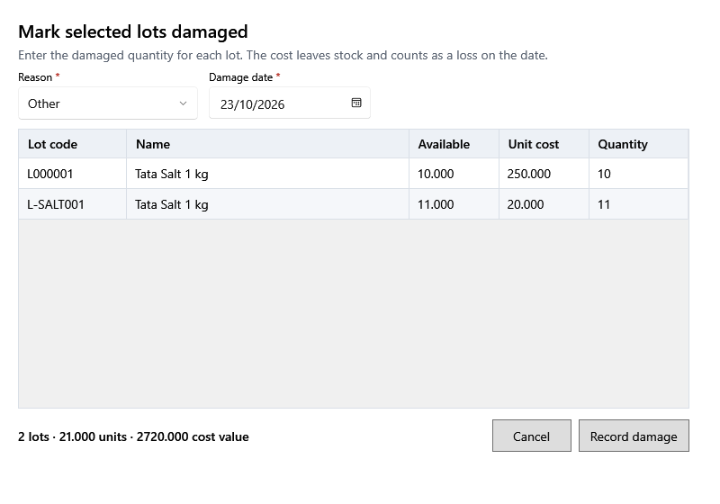

<!-- Screen help for Mark selected lots damaged (topic "bulk-damage"). The app shows this file for the ⓘ button and F1. Bold names in a table's first column must match the labels on screen; see ../README.md. -->
# Mark selected lots damaged

Record damage on several lots of a product at once, with a quantity for each lot.

Each lot with a quantity becomes its own damage in Money out → Damages, with the reason and date below. Its cost leaves stock and counts as a loss on that date. Up to 50 lots at a time; the line under the table adds up the lots, units and cost.

## Fields

| Field | What it means |
|---|---|
| **Reason** | The reason for every lot: **Expired**, **Broken**, **Spoiled**, **Pest damage**, **Lost** or **Other**. |
| **Damage date** | The day it happened, for every lot. |
| **Lot code** | The shop's code for the lot. |
| **Name** | The product. |
| **Available** | The lot's stock. |
| **Purchase price** | One piece's cost before tax. |
| **Quantity** | How much of this lot was damaged, up to its available stock. Leave it empty or 0 to skip the lot. |

## Buttons

| Button | What it does |
|---|---|
| **Record damage** | Records a damage for each lot with a quantity. |
| **Cancel** | Closes without a change. |
