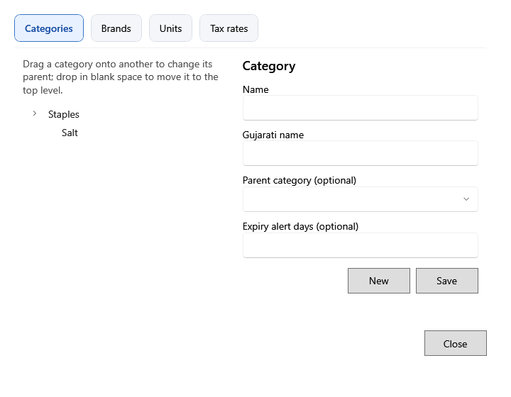

<!-- Screen help for Categories & brands (topic "catalog-masters"). The app shows this file for the ⓘ button and F1. Bold names in a table's first column must match the labels on screen; see ../README.md. Each tab has its own section, named as the tab. -->
# Categories & brands

Keep the lists products are sorted and counted by: categories, brands, units and tax rates.

Each tab lists its items on the left. Select one to change it on the right, or click **New** to add one, then **Save**. **Close** (Esc) closes the window.

## Categories

Drag a category onto another to make it a sub-category; drop it in blank space to move it back to the top level.

| Field | What it means |
|---|---|
| **Name** | The category's name. |
| **Gujarati name** | The name shown on Gujarati screens. |
| **Parent category (optional)** | The category this one sits under. Empty puts it at the top level. |
| **Expiry alert days (optional)** | How many days before expiry the lots of its products count as expiring soon, unless a product has its own. Empty uses the parent category's, else 30 days. |
| **New** | Clears the fields to add a category. |
| **Save** | Saves the category. |

## Brands

| Field | What it means |
|---|---|
| **Name** | The brand's name. |
| **New** | Clears the field to add a brand. |
| **Save** | Saves the brand. |

## Units

| Field | What it means |
|---|---|
| **Unit code** | A short code printed on bills and labels, such as KG or PCS. |
| **Name**, **Gujarati name** | The unit's name in each language. |
| **Allow fractional quantities** | Quantities can have decimals, such as 1.250 kg. A loose product needs such a unit. |
| **New** | Clears the fields to add a unit. |
| **Save** | Saves the unit. |

## Tax rates

| Field | What it means |
|---|---|
| **Name** | The rate's name, such as "GST 5%". Purchase lines, lots and bill lines save this name when they are created. |
| **Tax percentage** | The percent of tax. A change applies to products and new records only; saved ones keep the percent they had. |
| **Active** | Untick to stop the rate being chosen for new products and lines. Records that use it keep it. |
| **New** | Clears the fields to add a rate. |
| **Save** | Saves the rate. |
