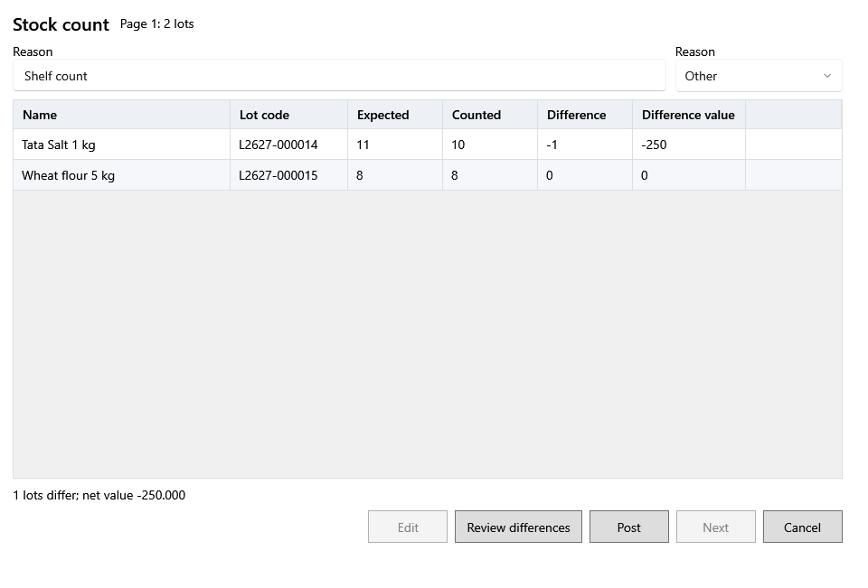

<!-- Screen help for Stock count (topic "count-review"). The app shows this file for the ⓘ button and F1. Bold names in a table's first column must match the labels on screen; see ../README.md. -->
# Stock count

Enter what you counted on the shelf for each lot of the selected products, check the differences and post them.

The lots come in pages of up to 50. A shortage becomes a damage with its own number in Money out → Damages, under the shortage reason. A surplus becomes a new direct lot with the counted lot's purchase price and tax. A lot that matches its stock is left as it is.

## Fields

| Field | What it means |
|---|---|
| **Reason** | Why the stock was counted, such as "Monthly shelf count". It is saved with every change. |
| **Shortage reason** | The damage reason for a lot with less than its stock. |
| **Name** | The product. |
| **Lot code** | The shop's code for the lot. |
| **Expected** | The lot's stock now. |
| **Counted** | What you counted. Type it for each lot. |
| **Difference** | Counted less expected: negative is a shortage, positive a surplus. |
| **Difference value** | The difference at the lot's purchase price. |

## Buttons

| Button | What it does |
|---|---|
| **Review differences** | Checks the counts and shows how many lots differ and their net value. |
| **Edit** | Goes back to change the counts after a review. |
| **Post** | Records the page's shortages and surpluses. |
| **Next** | Loads the next page of lots after a page is posted. |
| **Cancel** | Closes. Pages already posted stay posted. |
