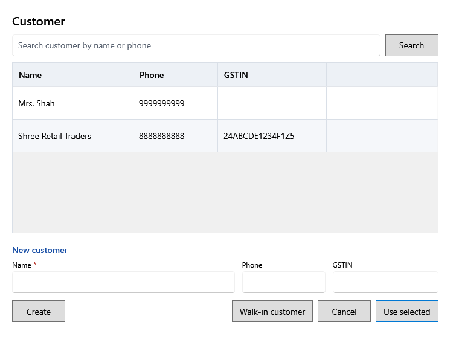

<!-- Screen help for Customer (topic "customer"). The app shows this file for the ⓘ button and F1. Bold names in a table's first column must match the labels on screen; see ../README.md. -->
# Customer

Choose who the bill is for, or add a new customer.

A bill without a customer is for a walk-in customer. The customer's name prints on the receipt.

## Customers

| Field | What it means |
|---|---|
| **Search customer by name or phone** | Type part of a name or phone number to narrow the list. |
| **Name** | The customer's name. |
| **Phone** | The customer's phone number. |
| **GSTIN** | The customer's GST number, for a business customer. |

## New customer

| Field | What it means |
|---|---|
| **Name** | Required. |
| **Phone** | Optional. |
| **GSTIN** | Optional; 15 characters. |

## Buttons

| Button | What it does |
|---|---|
| **Search** | Lists the customers that match. |
| **Create** | Adds the new customer and puts them on the bill. |
| **Walk-in customer** | Takes the customer off the bill. |
| **Use selected** | Puts the selected customer on the bill. A double-click does the same. |
| **Cancel** | Closes without a change. |
