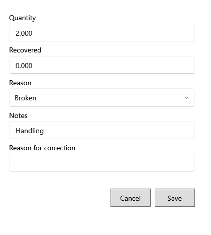

<!-- Screen help for Correct damage write-off and Void damage (topic "damage-correction"). The app shows this file for the ⓘ button and F1. Bold names in a table's first column must match the labels on screen; see ../README.md. -->
# Correct damage write-off

Correct a damage entered wrongly, or void it, with a reason.

A posted damage is never rewritten: the change is saved as a correction with its reason. The line under the title says where the change counts. A smaller quantity puts the difference back into the lot; a larger one takes more out. If the lot was deleted since, the units go into a new lot at the damage's cost, and if its product was deleted too, you are asked which product takes them. **Void** puts all of it back and cannot be undone.

## Fields

| Field | What it means |
|---|---|
| **Quantity** | How many units are really damaged. 0 puts them all back. |
| **Recovered** | Money recovered for the damaged units, such as from the vendor. It must be 0 when no units stay damaged. |
| **Reason** | Expired, Broken, Spoiled, Pest damage, Lost, Customer return or Other. |
| **Notes** | Anything else worth keeping. |
| **Reason for correction** | Why it is changed. Required; it is kept with the correction. |

## Buttons

| Button | What it does |
|---|---|
| **Save** | Saves the correction. |
| **Void** | Shown when voiding: puts all of the damaged units back. |
| **Cancel** | Closes without a change. |
