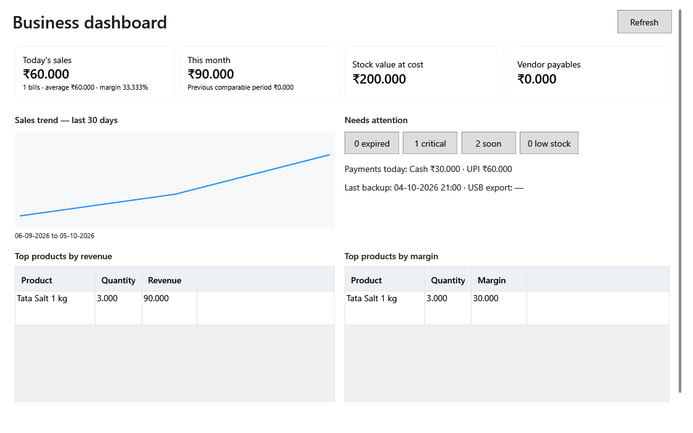

<!-- Screen help for the dashboard (topic "dashboard"). The app shows this file for the ⓘ button and F1. Bold names in a table's first column must match the labels on screen; see ../README.md. -->
# Business dashboard

See today's and this month's sales, what the stock is worth, what you owe vendors and what needs attention, and open the screen that deals with each.

The figures are worked out when the screen opens, after each completed bill and when you click **Refresh**. Every tile, count and line opens the records behind it.

## Totals

| Tile | What it means |
|---|---|
| **Today's sales** | The total of today's completed bills, tax included; voided bills are left out and returns are not taken off. Under it: the number of bills, the average bill, and the margin on today's sales before tax. Opens today's sales register. |
| **This month** | The completed bills from the 1st of this month to today. Under it: the same days of last month, to compare. Opens this month's sales register. |
| **Stock value at cost** | What every lot in stock cost, archived products included. Opens the Current unsold stock report, which adds up to the same figure. |
| **Vendor payables** | What you owe all vendors, inactive ones included. Opens Vendors with **With balance due** ticked, so the balances listed add up to it. |

## Sales and attention

| Part | What it means |
|---|---|
| **Sales trend — last 30 days** | Each day's sales over the last 30 days, with the dates under the chart. Click it to open the sales register for those days. |
| **Needs attention** | Buttons with the counts below. Each opens Products with the filter that lists those records. |
| expired | Lots with stock past their expiry date, blocked ones included. Opens Products filtered to expired stock at any status, so you can write the stock off. |
| critical | Active lots of active products that expire within the next seven days. Opens Products filtered to **Expiring soon**. |
| soon | Active lots of active products that expire later, but within their alert days: the product's own, else its category's, else the parent category's, else 30 days. Opens Products filtered to **Expiring soon**. |
| low stock | Active products at or below their reorder level. Opens Products filtered to **Low stock**, which lists the same products. |
| **Payments today:** | Today's payments by mode: cash, UPI, card and other. Cash is what was kept: what customers handed over less the change given back, so the modes add up to today's sales. Click it to open today's sales register. |
| Last backup, USB export | When the last backup was taken and the last copy saved to a USB drive. Click it to open Settings. |

## Top products

Both tables cover the last 30 days, after returns, and list up to ten products. Double-click a product to open its item-wise sales for those days.

| Column | What it means |
|---|---|
| **Top products by revenue** | The products that sold for the most, before tax. |
| **Top products by margin** | The products that earned the most: sales before tax less what the stock cost. |
| **Product** | The product's name, in Gujarati when the screen is in Gujarati and the product has a Gujarati name. |
| **Quantity** | How much was sold, less what came back. |
| **Revenue** | Sales before tax. |
| **Margin** | Sales before tax less the cost of the stock sold. |

## Buttons

| Button | What it does |
|---|---|
| **Refresh** | Works the figures out again. |

## How to use it

1. Check the four totals.
2. Open any count under **Needs attention**.
3. Deal with the records on the screen it opens, then come back and click **Refresh**.
