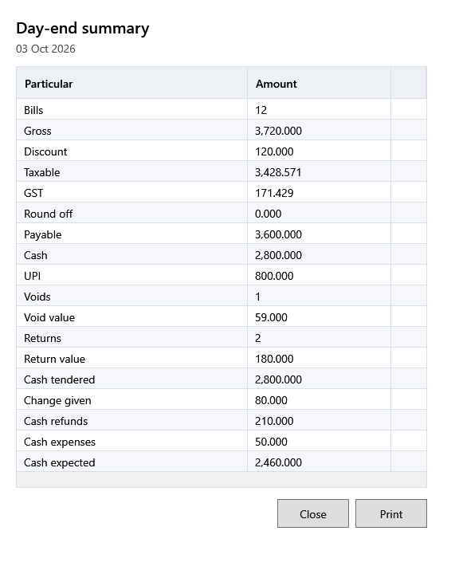

<!-- Screen help for Day-end summary (topic "day-end"). The app shows this file for the ⓘ button and F1. Bold names in a table's first column must match the labels on screen; see ../README.md. -->
# Day-end summary

The day's sales, refunds, tax and payments, and the cash that should be in the drawer.

It covers the business date shown under the title. Expenses count as they now stand: a voided expense no longer counts, and an edited one counts with its new amount, mode and date. So a past day's expected cash changes when one of its expenses is voided or edited later.

## Table

| Column | What it means |
|---|---|
| **Particular** | What the row counts. |
| **Amount** | Its value, or for **Bills**, **Voids** and **Returns**, how many. |

## Rows

| Row | What it means |
|---|---|
| **Bills** | Bills completed that day. |
| **Gross** | Their quantity × price, before discounts. |
| **Discount** | Their line and bill discounts. |
| **Taxable** | Their value before tax. |
| **GST** | The tax in them. |
| **Round off** | The paise added or taken off to round them. |
| **Payable** | What they came to. |
| **Cash**, **UPI**, **Card**, **Other** | What was paid each way; only the ways used that day are listed. Cash is what customers handed over, before change. |
| **Voids**, **Void value** | That day's bills that were voided, and what they came to. |
| **Returns**, **Return value** | Returns made that day, and their refunds. |
| **Cash tendered** | The cash customers handed over. |
| **Change given** | The change given back. |
| **Cash refunds** | Refunds paid in cash. |
| **Cash expenses** | Expenses paid in cash that day. |
| **Cash expected** | Cash tendered, less change given, cash refunds and cash expenses: what the drawer should hold from the day's business. |

## Buttons

| Button | What it does |
|---|---|
| **Print** | Prints the summary on the receipt printer. |
| **Close** | Closes the window. |
