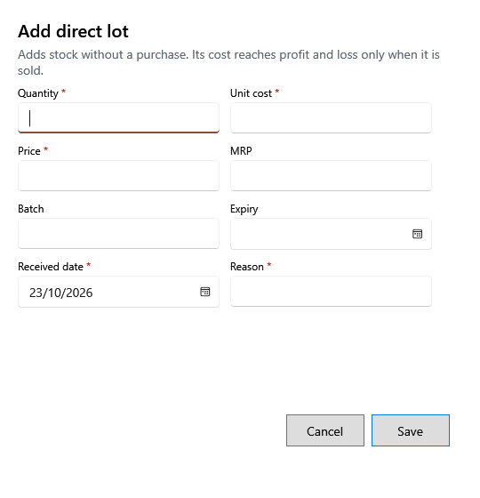

<!-- Screen help for Add direct lot (topic "direct-lot"). The app shows this file for the ⓘ button and F1. Bold names in a table's first column must match the labels on screen; see ../README.md. -->
# Add direct lot

Add stock of a product without a purchase, such as opening stock or goods found in a count.

The lot's cost reaches profit and loss only when its stock is sold. A lot's cost and tax never change after it is saved.

## Fields

| Field | What it means |
|---|---|
| **Quantity** | The stock the lot starts with. |
| **Purchase price** | One piece's cost before tax. |
| **Tax rate** | The lot's tax rate; it starts at the product's. |
| **Tax/unit**, **Purchase price incl. tax** | Worked out as you type: Purchase price + Tax/unit = Purchase price incl. tax. |
| **Selling price**, **MRP** | The lot's prices, tax included. The selling price cannot be above MRP. |
| **Batch**, **Expiry** | The supplier's batch number and the expiry date. Expiry is required for a product that tracks it and cannot be before the received date. |
| **Received date** | The day the stock arrived. |
| **Reason** | Why stock is added without a purchase. |

## Buttons

| Button | What it does |
|---|---|
| **Save** | Adds the lot. |
| **Cancel** | Closes without adding stock. |
