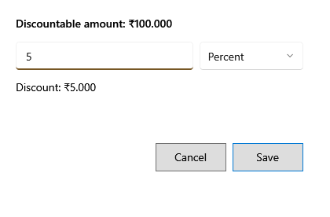

<!-- Screen help for Discount (topic "discount"). The app shows this file for the ⓘ button and F1. Bold names in a table's first column must match the labels on screen; see ../README.md. -->
# Discount

Give the selected line, or the whole bill, a discount.

**F5 Line discount** opens this for the selected line, and **F6 Bill discount** for the whole bill. The top line shows the amount the discount can come off: the line's quantity × price, or the bill after its line discounts. A bill discount is shared across the lines by their value. Under the box, the discount it comes to is shown as you type.

## Fields

| Field | What it means |
|---|---|
| **Discount** | How much to take off. 0 removes the discount. |
| **Amount**, **Percent** | Whether the number is rupees or a percent, from 0 to 100, of the amount above. The discount cannot be more than that amount. |

## Buttons

| Button | What it does |
|---|---|
| **Save** | Applies the discount. Enter does the same. |
| **Cancel** | Closes without a change. Esc does the same. |
