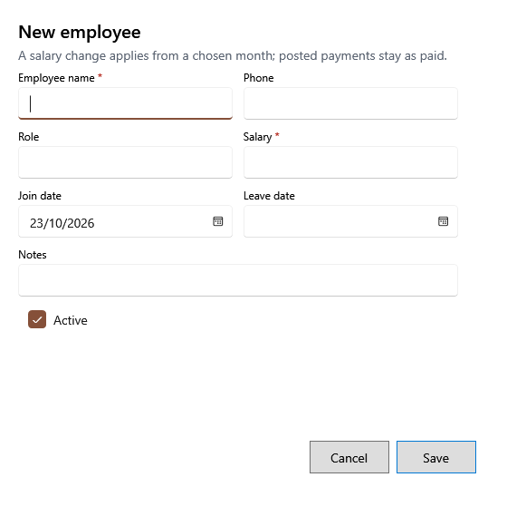

<!-- Screen help for the employee form (topic "employee-form"). The app shows this file for the ⓘ button and F1. Bold names in a table's first column must match the labels on screen; see ../README.md. -->
# New employee

Add an employee, or change one's details and salary.

Fields marked * are required. A salary change applies from the month you choose; salary already posted stays as it was paid.

## Fields

| Field | What it means |
|---|---|
| **Employee name** | The employee's name. |
| **Phone** | A number to reach them. |
| **Role** | What they do, such as Helper or Cashier. |
| **Salary** | The monthly salary. Each salary run starts from it. |
| **Join date** | When they started. A salary run includes them from that month. |
| **Leave date** | When they left. A salary run leaves them out after that month. It cannot be before the join date. |
| **Salary from** | Shown when you change the salary of an employee: the month the new salary applies from, typed as YYYY-MM. It cannot be in a finalized year. The line under it says how many posted salary months it leaves as paid; correct those in Posted payments if needed. |
| **Notes** | Anything else worth keeping. |
| **Active** | Untick for someone who no longer works here; salary runs leave them out. |

## Buttons

| Button | What it does |
|---|---|
| **Save** | Saves the employee. |
| **Cancel** | Closes without saving. |
