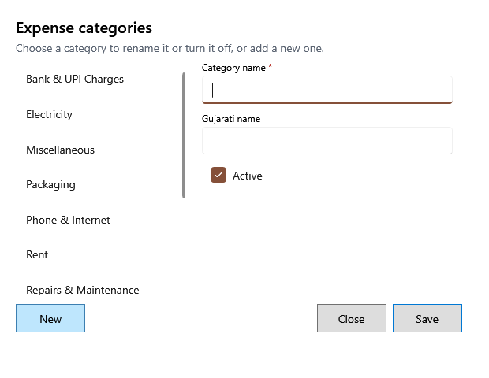

<!-- Screen help for Expense categories (topic "expense-categories"). The app shows this file for the ⓘ button and F1. Bold names in a table's first column must match the labels on screen; see ../README.md. -->
# Expense categories

Add the categories expenses are filed under, rename them, or turn off ones you no longer use.

Choose a category in the list to change it, or **New** to add one. Expenses already saved keep their category, even when it is turned off.

## Fields

| Field | What it means |
|---|---|
| **Categories** | The categories. Choose one to change it. |
| **Category name** | The name expenses and reports show. Required. |
| **Gujarati name** | The name shown when the app is in Gujarati. |
| **Active** | Untick to stop offering the category for new expenses and repeats. |

## Buttons

| Button | What it does |
|---|---|
| **New** | Clears the fields for a new category. |
| **Save** | Saves the new or changed category. |
| **Close** | Closes the window. |
