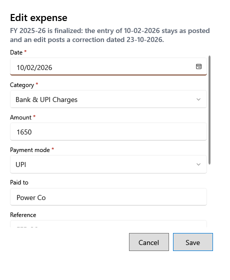

<!-- Screen help for Edit expense and Void expense (topic "expense-correction"). The app shows this file for the ⓘ button and F1. Bold names in a table's first column must match the labels on screen; see ../README.md. -->
# Edit expense

Correct an expense entered wrongly, or void it, with a reason.

A posted expense is never rewritten: the change is saved as a correction with its reason, and the expense shows as Corrected or Void. The line under the title says where the change counts. When the calendar and fiscal years of the expense's date are both open, it changes that date's profit and loss; otherwise the original stays as posted and the correction counts on the date shown. **Void** takes the expense to zero and cannot be undone. Use them only for a mistake: cash paid on a later day is a new expense on that day.

## Fields

| Field | What it means |
|---|---|
| **Date**, **Category**, **Amount**, **Payment mode** | The corrected values. A changed cash amount or date also changes the cash expected at day end. |
| **Paid to**, **Reference**, **Notes** | The corrected details. |
| **Reason for correction** | Why it is changed. Required; it is kept with the correction. |

## Buttons

| Button | What it does |
|---|---|
| **Save** | Saves the correction. |
| **Void** | Shown when voiding: takes the expense to zero. |
| **Cancel** | Closes without a change. |
