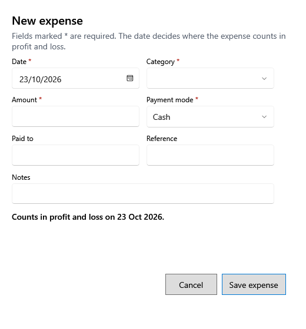

<!-- Screen help for New expense (topic "expense-form"). The app shows this file for the ⓘ button and F1. Bold names in a table's first column must match the labels on screen; see ../README.md. -->
# New expense

Record money the shop paid out for running costs, such as rent, electricity or tea.

Fields marked * are required. The line under the fields says on which date the expense counts in profit and loss. Buying something the shop keeps, such as equipment or furniture, is an asset, not an expense: record it in Assets.

## Fields

| Field | What it means |
|---|---|
| **Date** | The day the money was paid. The expense counts on this date; a date in a finalized year is refused. |
| **Category** | What the expense was for. A category that sounds like equipment, furniture, a computer, a vehicle or an asset is refused: record those in Assets. |
| **Amount** | How much was paid. |
| **Payment mode** | Cash, UPI, Bank, Card or Other. A cash expense lowers the cash expected at day end. |
| **Paid to** | Whom it was paid to. |
| **Reference** | A bill or receipt number, to find it later. |
| **Notes** | Anything else worth keeping. |

## Buttons

| Button | What it does |
|---|---|
| **Save expense** | Saves the expense. |
| **Cancel** | Closes without saving. |
