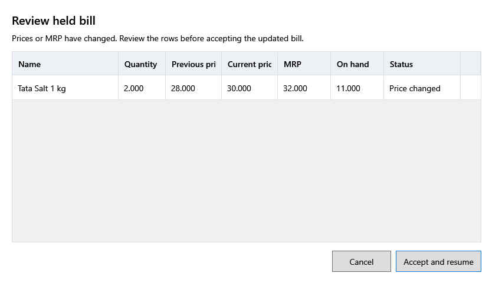

<!-- Screen help for Review held bill (topic "held-review"). The app shows this file for the ⓘ button and F1. Bold names in a table's first column must match the labels on screen; see ../README.md. -->
# Review held bill

Check what changed since the bill was held, before carrying on with it.

The line above the table says whether anything changed. The bill carries on at today's prices. When a line's stock is short, blocked or expired, **Accept and resume** stays off until that is put right.

## Table

| Column | What it means |
|---|---|
| **Name** | The product. |
| **Quantity** | How much the bill sells. |
| **Previous price** | The price when the bill was held. |
| **Current price** | The price the bill takes now, tax included. |
| **MRP** | The MRP now. |
| **On hand** | The stock that can be sold now. |
| **Status** | **Ready**, **Price changed**, or **Stock issue** when the product is inactive, its lot has expired or there is not enough stock. |

## Buttons

| Button | What it does |
|---|---|
| **Accept and resume** | Updates the bill to the current prices and opens it. |
| **Cancel** | Leaves the bill held. |
