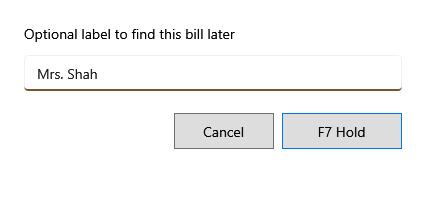

<!-- Screen help for Hold bill (topic "hold-bill"). The app shows this file for the ⓘ button and F1. Bold names in a table's first column must match the labels on screen; see ../README.md. -->
# Hold bill

Put the bill aside, such as while a customer fetches something, and start an empty one.

A held bill keeps its lines but does not take stock or a bill number until it is paid. **F8 Resume** lists held bills; before one carries on, a review shows any price or stock that changed meanwhile.

## Fields

| Field | What it means |
|---|---|
| **Label** | Optional: a word to find the bill by later, such as the customer's name. Without one, the bill is listed by its number. |

## Buttons

| Button | What it does |
|---|---|
| **F7 Hold** | Holds the bill. Enter does the same. |
| **Cancel** | Goes back to the bill without holding it. |
