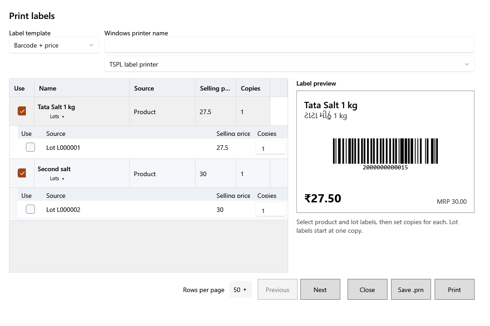

<!-- Screen help for Print labels (topic "label-batch"). The app shows this file for the ⓘ button and F1. Bold names in a table's first column must match the labels on screen; see ../README.md. -->
# Print labels

Print barcode and price labels for products and their lots, with as many copies of each as you need.

Tick the labels to print and set the copies of each. A product label carries the product's default price; a lot label carries the lot's own price and code. Lot labels start at one copy.

## Printer

| Field | What it means |
|---|---|
| **Label template** | **Barcode + price**, **Price label** or **Shelf edge**: what each label shows. |
| **Windows printer name** | The label printer, exactly as Windows names it. |
| **Printer type** | **TSPL label printer** sends the label printer's own commands; **Windows printer driver** prints through the printer's Windows driver. |

## Labels

| Column | What it means |
|---|---|
| **Use** | Tick the labels to print. |
| **Name** | The product. **Lots** under it shows or hides the product's lots, each with its own label. |
| **Source** | **Product**, or the lot's code for a lot label. |
| **Selling price** | The price printed on the label, tax included. |
| **Copies** | How many of this label to print, 1 to 100,000. |
| **Label preview** | How the selected label will look. |

## Buttons

| Button | What it does |
|---|---|
| **Rows per page** | How many lots to list at a time. |
| **Previous**, **Next** | Step through the lots when there are more than fit. |
| **Save .prn** | Saves the labels as a print file, to print later or on another computer. |
| **Print** | Prints the ticked labels. |
| **Close** | Closes the window. |
