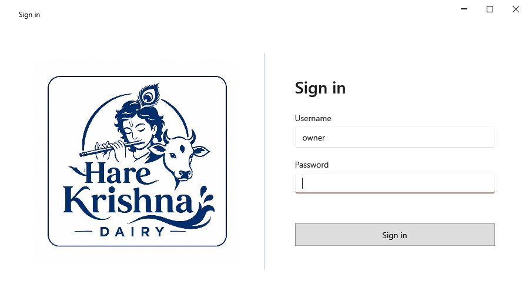

<!-- Screen help for Sign in (topic "login"). The app shows this file for the ⓘ button and F1. Bold names in a table's first column must match the labels on screen; see ../README.md. -->
# Sign in

Sign in with the owner's username and password to open the app.

The username and password were set during setup; the password can be changed in Settings. There is no password recovery, so keep it somewhere safe. After a few wrong tries, each new try waits a little longer.

## Fields

| Field | What it means |
|---|---|
| **Username** | The name set during setup, owner unless you changed it. |
| **Password** | The owner's password. Enter signs in. |

## Buttons

| Button | What it does |
|---|---|
| **Sign in** | Checks the username and password and opens the app. |
