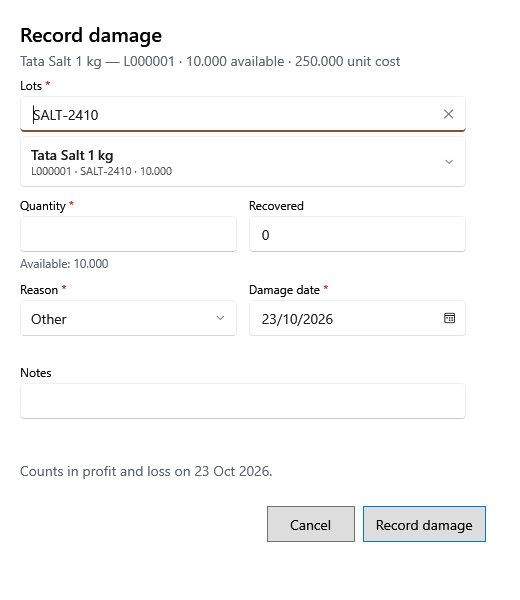

<!-- Screen help for Record damage (topic "lot-damage"). The app shows this file for the ⓘ button and F1. Bold names in a table's first column must match the labels on screen; see ../README.md. -->
# Record damage

Take damaged, spoiled, expired or lost stock out of a lot and record the loss.

The quantity leaves the lot and the damage shows in Money out → Damages. Its cost, less anything recovered, counts as a loss in profit and loss on the damage date; damage of internal-use stock has no effect on profit and loss. The preview shows the cost and the net loss before you save, and you confirm before the stock changes.

## Fields

| Field | What it means |
|---|---|
| **Product, lot or batch** | From Money out: type part of a product name, lot code or batch number to find the lot. From a product's lots, the lot is already chosen. |
| **Lots** | The lot the damage is taken from, with its stock and purchase price. |
| **Quantity** | How much was damaged, up to the lot's available stock. |
| **Recovered** | Money got back for it, such as from the vendor or an insurer. |
| **Reason** | **Expired**, **Broken**, **Spoiled**, **Pest damage**, **Lost** or **Other**. |
| **Damage date** | The day it happened. The loss counts on this date. |
| **Notes** | Anything else worth keeping with the damage. |

## Buttons

| Button | What it does |
|---|---|
| **Record damage** | Records the damage after you confirm. |
| **Cancel** | Closes without a change. |
