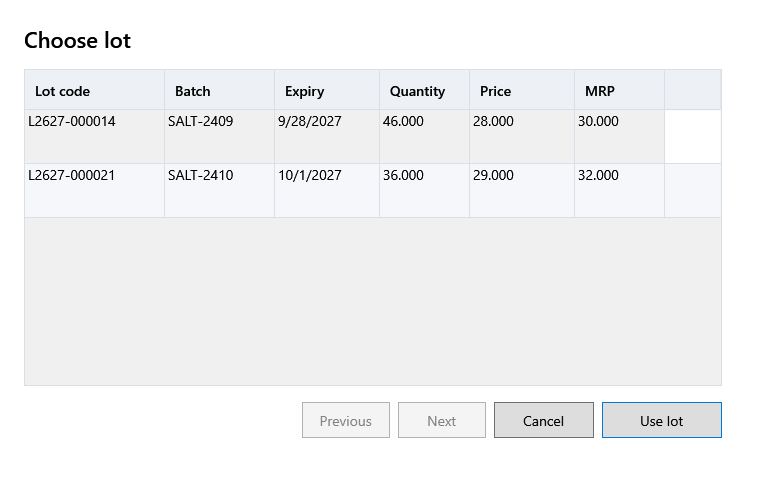

<!-- Screen help for Choose lot (topic "lot-picker"). The app shows this file for the ⓘ button and F1. Bold names in a table's first column must match the labels on screen; see ../README.md. -->
# Choose lot

Choose which lot of the product the selected bill line is sold from.

The list shows the product's active lots that have stock, with the line's current lot selected. The line takes the chosen lot's price and MRP. If another line of the bill already sells from that lot, the two lines become one.

## Fields

| Field | What it means |
|---|---|
| **Batch no. or lot code** | Type part of a batch number or lot code to narrow the list. |

## Table

| Column | What it means |
|---|---|
| **Lot code** | The app's number for the lot. |
| **Batch** | The batch number printed by the maker. |
| **Expiry** | When the lot expires. |
| **On hand** | The lot's stock now. |
| **Price** | The lot's selling price, tax included. |
| **MRP** | The lot's MRP. |

## Buttons

| Button | What it does |
|---|---|
| **Use lot** | Sells the line from the selected lot. A double-click does the same. |
| **Rows per page**, **Previous**, **Next** | Step through the lots when there are more than fit. |
| **Cancel** | Closes without a change. |
