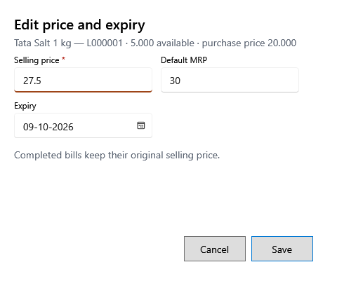

<!-- Screen help for Edit price and expiry (topic "lot-price"). The app shows this file for the ⓘ button and F1. Bold names in a table's first column must match the labels on screen; see ../README.md. -->
# Edit price and expiry

Change a lot's selling price, MRP or expiry for the sales still to come.

Completed bills keep the price they were sold at. The lot's cost and tax do not change.

## Fields

| Field | What it means |
|---|---|
| **Selling price** | The lot's new selling price, tax included. It cannot be above MRP. |
| **MRP** | The lot's MRP, tax included. |
| **Expiry** | The lot's expiry date. It cannot be before the day the lot was received. |

## Buttons

| Button | What it does |
|---|---|
| **Save** | Saves the new price and expiry. |
| **Cancel** | Closes without a change. |
