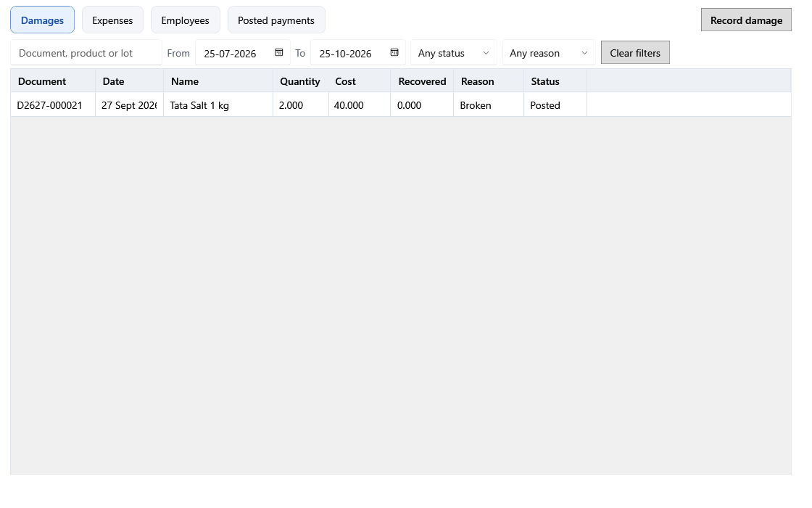

<!-- Screen help for Money out (topic "money-out"). The app shows this file for the ⓘ button and F1. Bold names in a table's first column must match the labels on screen; see ../README.md. Each tab has its own section, named as the tab. -->
# Money out

Record and correct damages, expenses, employees and salary payments: the money and stock that leave the shop outside bills and purchases.

Each tab has its own filters, table and actions, and the selected entry's details show in a narrow panel at the right. Posted entries are never rewritten: **Edit** and **Void** record a correction with a reason. When the calendar year and the fiscal year of the entry's date are both still open, the correction counts on the original date; otherwise the original stays as it was and the correction counts today. A year stays open through the seventh day after it ends.

## Damages

Stock written off because it expired, broke, spoiled or was lost. Damage recorded from Products shows here too. Damage of internal-use stock has no effect on profit and loss.

| Field | What it means |
|---|---|
| **Document, product or lot** | Type part of a damage number, product name or lot code. |
| **From**, **To** | Damages dated between these days. |
| **Status** | **Any status**, **Posted**, **Corrected** (changed by an edit) or **Void**. |
| **Reason** | **Any reason**, or one reason: **Expired**, **Broken**, **Spoiled**, **Pest damage**, **Lost**, **Customer return** or **Other**. |
| **Clear filters** | Puts every filter back to its default. |

| Column | What it means |
|---|---|
| **Document** | The damage number. |
| **Date** | The damage date. The loss counts in profit and loss on this date. |
| **Name** | The damaged product. |
| **Quantity** | How much was written off. |
| **Cost** | What that stock cost: the loss before anything recovered. |
| **Recovered** | Money got back for it, such as from the vendor. |
| **Reason** | Why the stock was written off. |
| **Status** | Posted, Corrected or Void. |

| Button | What it does |
|---|---|
| **Record damage** | Opens the damage form: find the lot, then type the quantity (up to the stock), recovered amount, reason, date and notes. The preview shows the loss and the date it counts on. |
| **Edit** | Corrects the selected damage, with a reason. A quantity change puts stock back into the lot or takes more out. If the lot was deleted, restored units start a new lot at the damage's cost. |
| **Void** | Corrects the quantity to zero, with a reason, and puts the stock back. |
| **History** | The original damage and every correction, with the date each counts on. |

## Expenses

Rent, wages paid outside payroll, electricity and every other cost of running the shop. Expense lines of a purchase show here too.

| Field | What it means |
|---|---|
| **Paid to, reference or notes** | Type part of who was paid, the reference or the notes. |
| **From**, **To** | Expenses dated between these days. |
| **Category** | One expense category, or **All categories**. |
| **Status** | **Any status**, **Posted**, **Corrected**, **Void** or **From purchase** (an Expense line of a purchase, which changes only when that purchase is voided). |
| **Clear filters** | Puts every filter back to its default. |

| Column | What it means |
|---|---|
| **Date** | The expense date. It counts in profit and loss on this date. |
| **Category** | The expense category. |
| **Amount** | The amount paid. |
| **Payment mode** | Cash, UPI, bank or other. |
| **Paid to** | Who was paid. |
| **Status** | Posted, Corrected, Void or From purchase. |

| Button | What it does |
|---|---|
| **New expense** | Opens the expense form: date, category, amount, mode, paid to, reference and notes, with the date the expense counts on. |
| **Repeat last month** | Prepares a draft of last month's expenses for the categories you choose. Check it before saving. |
| **Expense categories** | Opens the list of expense categories. |
| **Open assets** | Goes to Assets, for equipment and other things the shop keeps for years. |
| **More ▾** | Holds the actions that do not fit when the window is narrow. |
| **Edit** | Corrects the selected expense, with a reason. |
| **Void** | Takes the selected expense to zero through a correction, with a reason. |
| **History** | The original expense and every correction. |

## Employees

| Field | What it means |
|---|---|
| **Name, role or phone** | Type part of an employee's name, role or phone number. |
| **Status** | **Working**, **Relieved** (has left) or **Any status**. |
| **Clear filters** | Puts every filter back to its default. |

| Column | What it means |
|---|---|
| **Name** | The employee's name. |
| **Role** | The employee's job. |
| **Salary** | The monthly salary now. |
| **Join date**, **Leave date** | When the employee started and left. |
| **Status** | Working or Relieved. |

| Button | What it does |
|---|---|
| **New employee** | Opens the employee form. |
| **Edit** | Opens the selected employee's form (or double-click the row). A new monthly salary asks **Salary from** (YYYY-MM): it applies from that month, never earlier than the first month whose calendar and fiscal years are both open. Payments already posted stay as paid. |
| **History** | The employee's salary terms: the month each starts, the amount and when it was recorded. |

## Posted payments

Salary, overtime and bonus paid to employees. The salary run records each month's whole pay, including anything handed over earlier in that month.

| Field | What it means |
|---|---|
| **From**, **To** | Months worked, typed as YYYY-MM, such as 2026-10. |
| **Employee name** | One employee, or **All employees**. |
| **Status** | **Any status**, **Posted**, **Corrected** or **Void**. |
| **Clear filters** | Puts every filter back to its default. |

| Column | What it means |
|---|---|
| **Employee name** | Who was paid. |
| **Period** | The month worked. The payment counts in that month. |
| **Pay date** | The day it was paid. |
| **Type** | Salary, Bonus, Overtime or Other. Other is a payment, such as an advance, recorded by an earlier version of the app. |
| **Amount** | The amount paid. |
| **Payment mode** | Cash, UPI, bank or other. |
| **Status** | Posted, Corrected or Void. |
| **Notes** | Notes saved with the payment. |

| Button | What it does |
|---|---|
| **Prepare run** | Opens the salary run: choose the month, pay date and mode, prepare the lines (salary, leave deduction, overtime and bonus for each working employee), check them and post. |
| **Edit** | Corrects the selected payment, with a reason. |
| **Void** | Takes a payment entered by mistake to zero, with a reason. |
| **History** | The original payment and every correction. |

## How to use it

1. Record damage when it happens.
2. Enter each expense on the day it is paid.
3. Keep the employee list up to date.
4. Prepare and post the salary run each month.
5. Change a posted entry only with **Edit** or **Void** and a reason.
