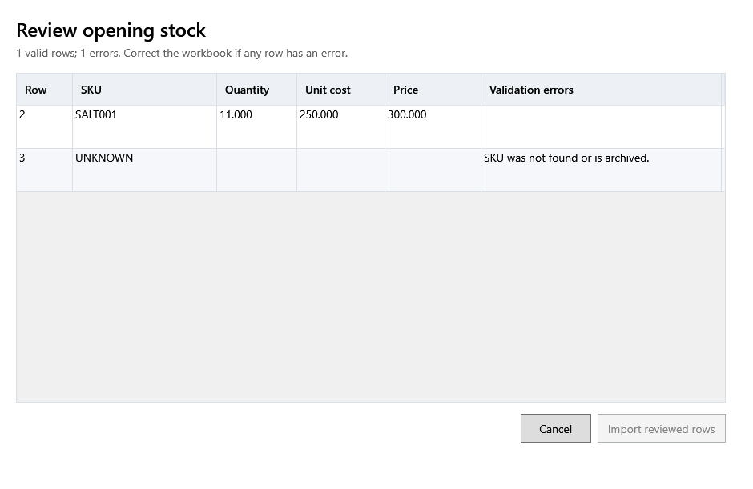

<!-- Screen help for Review opening stock (topic "opening-stock"). The app shows this file for the ⓘ button and F1. Bold names in a table's first column must match the labels on screen; see ../README.md. -->
# Review opening stock

Check the rows of a filled opening stock template before they become stock.

Each valid row becomes a lot of its product, with no purchase behind it. The line above the table counts the valid rows and the errors; correct the workbook and import it again if any row has an error.

## Table

| Column | What it means |
|---|---|
| **Row** | The row's number in the workbook. |
| **SKU** | The product the stock belongs to. |
| **Quantity** | The stock the lot starts with. |
| **Purchase price** | One piece's cost before tax; the lot takes its product's tax rate. |
| **Selling price** | The lot's selling price, tax included. |
| **Validation errors** | What is wrong with the row. A row with an error is not imported. |

## Buttons

| Button | What it does |
|---|---|
| **Import reviewed rows** | Adds the valid rows as opening lots. |
| **Cancel** | Closes without adding stock. |
