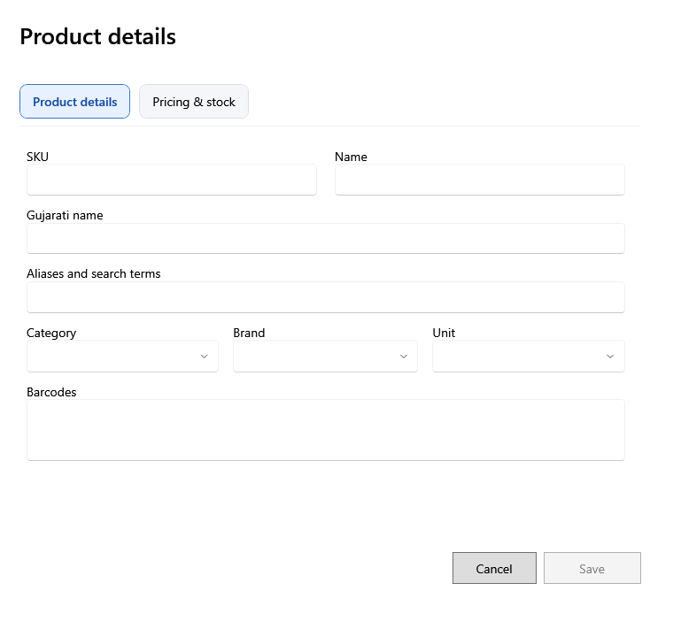

<!-- Screen help for the product form (topic "product-form"): the New product window and the Basics tab of a product's panel. The app shows this file for the ⓘ button and F1. Bold names in a table's first column must match the labels on screen; see ../README.md. -->
# Product details

Add a product or change one: its names and codes, category and unit, tax and default prices, and stock rules. A new product can add its first lot in the same save.

Fields marked * are required. A lot's own prices, cost and expiry are set on the lot; the prices here are the defaults a new lot starts with, and what a product with no stock shows.

## Identity

| Field | What it means |
|---|---|
| **SKU** | The shop's own code for the product. No two products can share one. |
| **Name** | The English name, printed on bills and labels. |
| **Gujarati name** | The name shown when the screen or the receipt is in Gujarati. |
| **Aliases and search terms** | Other words a search should find the product by, such as a local or short name. |
| **Barcodes** | One barcode per line; the first is the main one, printed on labels. A scan of any of them finds the product. |

## Classification

| Field | What it means |
|---|---|
| **Category** | The product's category. Its alert days apply when the product has none of its own. |
| **Brand** | The product's brand, if any. |
| **Unit** | How the product is counted, such as PCS or KG. It cannot change once the product has lots. |
| **Product type** | **Saleable** (sold on bills) or **Internal use** (used in the shop and kept out of billing and profit and loss). The type of a product with stock cannot change. |

## Tax and prices

Selling price and MRP include tax.

| Field | What it means |
|---|---|
| **HSN code** | The product's HSN code for GST: 4, 6 or 8 digits. |
| **Tax rate** | The GST rate the product is sold and bought at. A change applies to new lots and bills; saved ones keep the rate they had. |
| **Default selling price** | The price a new lot starts with. It cannot be above the default MRP. |
| **Default MRP** | The MRP a new lot starts with. |

## Stock rules

| Field | What it means |
|---|---|
| **Reorder level** | When stock falls to this level or below, the product is Low stock on the dashboard and in Products. |
| **Shelf life (days)** | How many days the product usually keeps, for your reference. Each lot's expiry date is typed on the lot. |
| **Expiry alert days (optional)** | How many days before expiry its lots count as expiring soon. Empty uses the category's, else its parent category's, else 30 days. |
| **Scale PLU code** | The item code a weighing scale prints in its barcode, so a scanned scale label finds the product. |
| **Track expiry** | Every lot of the product must have an expiry date. |
| **Loose product** | Sold loose by weight. It needs a unit that takes fractions, such as KG, and a scale PLU code. |

## First lot

Shown only for a new product.

| Field | What it means |
|---|---|
| **Add first lot with this product** | Tick to add stock in the same save, without a purchase. |
| **Quantity** | The stock the lot starts with. |
| **Purchase price** | One piece's cost before tax. |
| **Tax rate** | The lot's tax rate. It follows the product's until you pick another. |
| **Tax/unit**, **Purchase price incl. tax** | Worked out from the purchase price and the lot's tax rate. A lot's cost and tax never change after it is saved. |
| **Selling price**, **MRP** | The lot's prices, tax included. |
| **Batch**, **Expiry** | The supplier's batch number and the expiry date. |
| **Received date** | The day the stock arrived. |
| **Reason** | Why stock is added without a purchase, such as opening stock. |

## Buttons

| Button | What it does |
|---|---|
| **Save** | Saves the product, and its first lot if ticked. In a product's panel, Save keeps the changes and **Revert** drops them. |
| **Cancel** | Closes without saving. |
