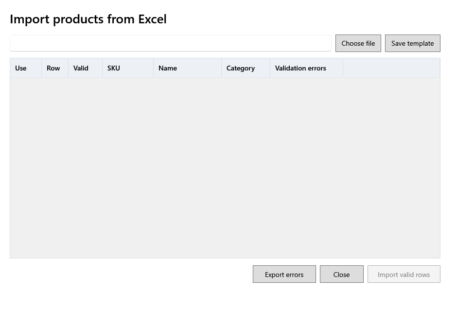

<!-- Screen help for Import products from Excel (topic "product-import"). The app shows this file for the ⓘ button and F1. Bold names in a table's first column must match the labels on screen; see ../README.md. -->
# Import products from Excel

Add or update many products at once from an Excel workbook, after checking every row.

A row whose SKU already exists updates that product; any other row adds a new one. Nothing is saved until you click **Import valid rows**.

## Table

| Column | What it means |
|---|---|
| **Use** | Tick the rows to import. Valid rows start ticked. |
| **Row** | The row's number in the workbook. |
| **Valid** | Ticked when the row can be imported. |
| **SKU**, **Name**, **Category** | The product the row describes. |
| **Validation errors** | What is wrong with the row, such as a missing name, an unknown category or a selling price above MRP. Correct the workbook and choose it again. |

## Buttons

| Button | What it does |
|---|---|
| **Choose file** | Opens a filled workbook and checks every row. |
| **Save template** | Saves an empty workbook with the right columns to fill in. |
| **Export errors** | Saves the rows that need correction, with their errors, to a workbook. |
| **Import valid rows** | Imports the ticked valid rows and says how many were created, updated and skipped. |
| **Close** | Closes the window. |
