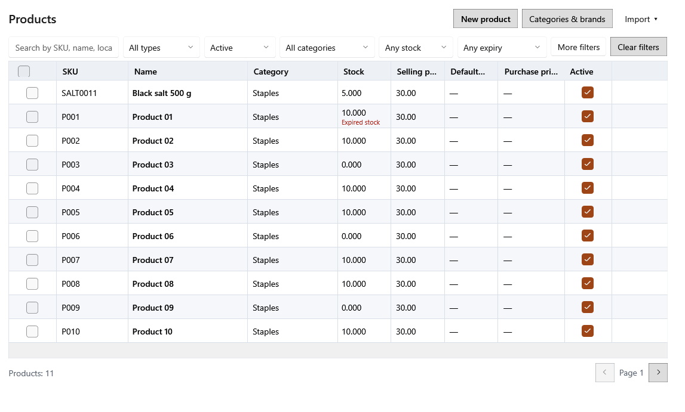

<!-- Screen help for Products (topic "products"). The app shows this file for the ⓘ button and F1. Bold names in a table's first column must match the labels on screen; see ../README.md. -->
# Products

Find, add and change products, and look after each product's lots: their prices, expiry, damage and stock counts.

Each row's selling price, MRP and purchase price come from the lot a bill takes next: the earliest expiry first, then the earliest received, lots without an expiry last, and never an expired lot while expired lots are blocked from sale (the default). A product with no stock that can be sold shows its own default prices and "—" for the purchase price.

## Filters

Filters apply as you type or choose, and the screen remembers them until the program closes.

| Field | What it means |
|---|---|
| **Search by SKU, name, local name, alias, or brand** | Type part of a SKU, barcode, name, Gujarati name, alias or brand. An exact SKU or barcode is listed first, and words can be combined, such as "basmati 5 kg". A search shows at most eight results. Ctrl+F jumps here. |
| **Product type** | **All types**, **Saleable** (sold on bills) or **Internal use** (used in the shop; kept out of billing and profit and loss). |
| **Product status** | **Active**, **Archived** (removed but kept because they are still in use or have stock) or **Any status**. |
| **Category** | Shows one category's products. |
| **Stock** | **Any stock**, **Has stock**, or **Low stock**: active products at or below their reorder level, the same products the dashboard's Low stock tile counts. |
| **Expiry** | **Expired stock**: products with a lot past its expiry that still has stock, blocked lots included. **Expiring soon**: products with an active lot due within its alert days, as the dashboard counts them. |
| **More filters** | Shows a second row with brand, vendor, **No barcode**, **Missing local name** and **Loose product**. When the window is narrow, some filters move into that row and the button shows how many of them are set. |
| **Brand**, **Vendor** | Products of one brand, or products bought from one vendor. |
| **No barcode**, **Missing local name**, **Loose product** | Products without a barcode, without a Gujarati name, or sold loose by weight. |
| **Clear filters** | Puts every filter back to its default. |

## Table

A page shows as many rows as fit the window. The footer shows the count and, when there are more pages, the page arrows.

| Column | What it means |
|---|---|
| **Select this page**, **Select product** | The tick boxes. Ticking rows opens the selection bar in the footer. Space ticks the highlighted row. |
| **SKU** | The product's own code. |
| **Name** | The English name, with the Gujarati name under it. |
| **Category** | The product's category. |
| **Stock** | Stock on hand in the product's unit. "Expired stock" under it means some of that stock is past its expiry. |
| **Selling price** | The price, tax included, of the lot a bill takes next. |
| **MRP** | The MRP of the lot a bill takes next; with no stock that can be sold, the product's own default MRP. |
| **Purchase price incl. tax** | What one piece of that lot cost, tax included. |
| **Active** | Untick to archive the product, tick to make it active again. Archived products are listed only under **Archived** or **Any status**. |

## Buttons

| Button | What it does |
|---|---|
| **New product** | Opens the product form (Ctrl+N). A new product can add its first lot in the same save. |
| **Categories & brands** | Opens the lists of categories, brands and units. |
| **Import ▾** | Opens the import choices below. |
| **Import Excel** | Adds or updates products from a filled Excel template. You see every row first and import only the valid ones. |
| **Import opening stock** | Loads opening lots from a filled template. You review the rows before they become stock. |
| **Save opening template** | Saves the opening stock template to fill in. Its purchase price is before tax; each row takes its product's tax rate. |

## Selected products

Ticking products shows a blue bar at the left of the footer with the exact count. Changing a filter clears the selection.

| Field | What it means |
|---|---|
| **Clear selection** | Unticks every product. |
| **Select all matching results** | Selects every product that matches the filters, on all pages, not only this page. |
| **Bulk actions ▾** | Changes all selected products at once. Each action first shows a review: how many products will change, which are skipped and why, and the stock and value affected. Nothing changes until you apply it. |
| **Remove selected** | Deletes products that have no stock and are not on an open bill or a draft purchase; archives the others. |
| **Restore selected** | Makes archived products active again. |
| **Set category…**, **Set tax rate…**, **Set product type…** | Gives the selected products one category, tax rate or product type. The type of a product that has stock cannot change. |
| **Print labels for selected** | Prints barcode labels for up to 200 products at a time. |
| **Generate barcodes for selected** | Gives each selected product an in-store barcode if it has none. |
| **Reconcile selected stock** | Opens a count sheet for up to 100 products: type the counted quantity of each lot. A shortage becomes a damage; a surplus becomes a new direct lot at the counted lot's purchase price and tax. |
| **Write off expired stock…** | Records every expired lot with stock of the selected products, in full, as Expired damage. |

## Product panel

Double-click a product, or press Enter, to open it in a panel. The header shows its SKU, category, type, stock on hand and the price of the lot a bill takes next.

| Field | What it means |
|---|---|
| **Previous record**, **Next record** | Open the product above or below in the list. |
| **Use the full width**, **Show beside the list** | Switches the panel between beside the list and the whole page. The screen remembers the choice. |
| **Close** | Closes the panel (Esc). If the product form has unsaved changes, you are asked first. |
| **Basics** | The product form: name and codes, category and unit, tax and prices, and stock rules. |
| **Save** | Saves the changes made in Basics. |
| **Revert** | Discards the changes made in Basics. |
| **Lots** | The product's lots: every batch of stock with its own prices, cost and expiry. |

## Lots: filters

| Field | What it means |
|---|---|
| **Batch no. or lot code** | Finds a lot by the supplier's batch number or the shop's lot code. |
| **Lot status** | **All lots**, **Available** (stock that can be sold), **Empty** or **Blocked** (kept out of sale). |
| **Expiry** | **Any expiry**, **Expired**, **Expiring soon** or **No expiry**. |
| **Source** | Where the lot came from: **Purchase**, **Direct entry** or **Customer return**. Under More filters. |
| **From**, **To** | Lots that expire between these dates. Under More filters. |
| **Lowest selling price**, **Highest selling price** | Lots whose selling price is in this range. Under More filters. |

## Lots: table

| Column | What it means |
|---|---|
| **Select lot** | Ticks the lot for the lot bulk actions. |
| **Lot code** | The shop's code for the lot, printed on its labels. |
| **Batch** | The supplier's batch number. |
| **Expiry** | The expiry date and its status: Fresh, Soon, 0–7 days, Expired, Blocked or Empty. A lot shows Soon or 0–7 days only within its alert days, the window the dashboard and Expiring soon use. |
| **On hand** | The quantity left in this lot. |
| **Selling price**, **MRP** | This lot's selling price and MRP, both including tax. |
| **Purchase price** | One piece's cost before tax, with its share of the purchase bill's other charges. |
| **Tax** | The name of the tax rate when the lot was created, such as "GST 5%". |
| **Tax/unit** | One piece's purchase tax. |
| **Purchase price incl. tax** | What one piece really cost: Purchase price + Tax/unit. A lot's cost and tax never change after it is created. |
| **Source** | Purchase, Direct entry or Customer return. |
| **Received** | The date the stock arrived. |

## Lots: buttons

| Button | What it does |
|---|---|
| **Add direct lot** | Adds stock without a purchase: quantity, purchase price before tax, tax rate, prices, batch, expiry and a reason. |
| **Edit price and expiry** | Changes the selected lot's selling price, MRP and expiry for future sales. Completed bills keep their prices. |
| **Record damage** | Takes damaged stock out of the selected lot. It appears in Money out → Damages and counts as a loss in profit and loss, except for internal-use products. |
| **Consume for internal use** | For internal-use products only: records stock used in the shop, with no effect on profit and loss. |
| **Print labels** | Prints labels for the selected lot. |
| **More ▾** | Holds the actions that do not fit when the panel is narrow. |
| **Block selected**, **Unblock selected** | Stops the selected lots from being sold, or allows it again. |
| **Mark selected lots damaged** | Records damage on 1 to 50 lots at once, with a quantity for each lot. |
| **Delete selected empty lots** | Deletes lots with no stock left that no open bill uses. |

## How to use it

1. Set up categories and brands, then add or import products.
2. Open a product and check its lots.
3. Add a direct lot, correct a lot's price or expiry, or record damage as needed.
4. Filter **Expired stock**, tick the products and write the stock off.
5. Count the shelves and enter the counts with **Reconcile selected stock**.
