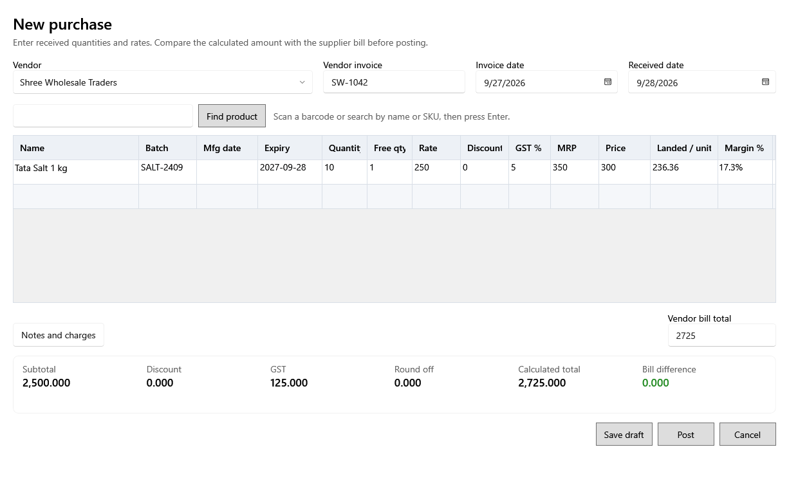

<!-- Screen help for the purchase form (topic "purchase-entry"). The app shows this file for the ⓘ button and F1. Bold names in a table's first column must match the labels on screen; see ../README.md. -->
# New purchase

Enter a supplier bill line by line, check it against the bill, then save it as a draft or post it.

Posting creates a lot for each product line, adds the bill to the vendor's balance and books each Expense line as an expense. A draft changes nothing and can be opened again from Purchases.

## Bill

| Field | What it means |
|---|---|
| **Vendor** | Who the goods came from. |
| **Vendor invoice** | The number on the supplier's bill. |
| **Invoice date** | The date on the supplier's bill. It cannot be after the received date. |
| **Received date** | The day the goods arrived. The purchase and its lots count on this date. |
| **Bill rates**, **Include tax** | Tick when the supplier bill prints rates and discounts including tax, and type them as printed: the rate column becomes **Rate incl. tax** and each line's tax is worked out for you. The purchase keeps the figures before tax. The vendor's next bill starts the same way. |

## Adding lines

| Field | What it means |
|---|---|
| **Find product** | Scan a barcode, or type a name or SKU and press Enter. One match adds a line; several are listed under the box, where the arrow keys and Enter, or a click, pick one. |

## Purchase lines

Totals, purchase prices and margins update as you type. Ctrl+D copies the cell above (never the line type or product), Ctrl+Delete removes the line and Ctrl+S saves the draft.

| Column | What it means |
|---|---|
| **Type** | **Product** (a saleable lot), **Internal use** (a lot kept out of profit and loss) or **Expense** (no lot; it is booked to an expense category). An internal-use product starts as Internal use. |
| **Name** | The product. |
| **Expense category** | For an Expense line, the category it is booked to. Shown only while a line is an Expense line. |
| **Batch**, **Mfg date**, **Expiry** | The supplier's batch number and dates. Expiry is required for a product that tracks it. A line due to expire within its alert days of the received date shows a short-expiry warning. |
| **Quantity**, **Free qty** | The quantity bought and the quantity received free. |
| **Rate**, **Rate incl. tax** | The rate on the supplier's bill, before tax, or including tax when Include tax is ticked. |
| **Discount** | The line's discount, as printed on the bill. |
| **Tax** | The tax rate, starting at the product's. An inactive rate cannot be chosen for a new line. |
| **Selling price**, **MRP** | The new lot's prices, tax included. |
| **Purchase price** | One piece's cost before tax: the line's value after discount plus its share of other charges, divided by quantity plus free quantity. |
| **Tax/unit** | That piece's tax. |
| **Purchase price incl. tax** | What one piece really cost: Purchase price + Tax/unit. |
| **Margin %** | The selling price before tax against the purchase price; in composition or no-GST mode, the whole selling price against the purchase price incl. tax. |
| **Remove line** | The bin button removes the line (Ctrl+Delete, or Remove line on the right-click menu). |

## Charges and totals

| Field | What it means |
|---|---|
| **Notes and charges** | Opens the notes, other charges and bill total. |
| **Notes** | Anything worth keeping with the purchase. |
| **Other charges** | Freight and other charges, shared across the lines by value. They carry no tax, so type a transporter's charge including any GST on it. |
| **Vendor bill total** | The total printed on the supplier's bill. |
| **Subtotal** | Rate × quantity of every line, before discount and tax. |
| **Discount**, **Tax** | The lines' discounts and tax in total. |
| **Round off** | What is added or taken off so the total comes to a round amount. |
| **Calculated total** | Subtotal less discount, plus tax, other charges and round off. |
| **Bill difference** | How far the calculated total is from the vendor bill total. Check the lines when it is not zero. |

## Buttons

| Button | What it does |
|---|---|
| **Save draft** | Saves the purchase without posting it (Ctrl+S). |
| **Post** | Posts the purchase: creates the lots, adds the vendor balance and gives it its GRN number. It then offers to print labels for the new lots. |
| **Cancel** | Closes. Changes since the last save are lost. |
