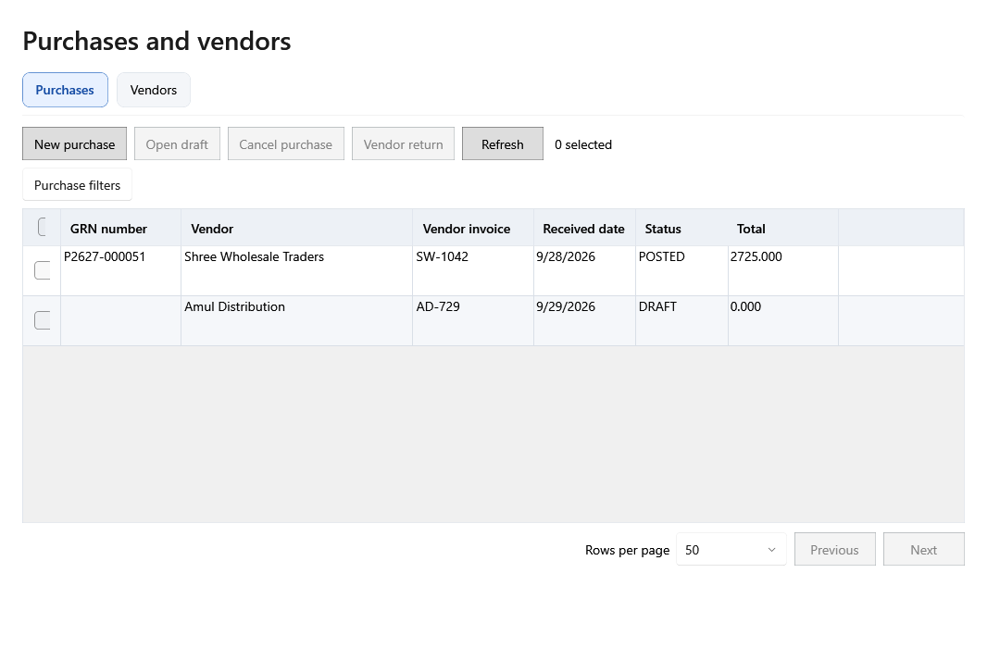

<!-- Screen help for Purchases (topic "purchases"). The app shows this file for the ⓘ button and F1. Bold names in a table's first column must match the labels on screen; see ../README.md. -->
# Purchases

Find, enter and post purchases (GRNs), and send stock back to the vendor or void a purchase entered by mistake.

Posting a purchase creates a lot for each product line, adds the bill to the vendor's balance and books each Expense line as an expense. A draft changes nothing until it is posted.

## Filters

Filters apply as you type or choose, and the screen remembers them until the program closes.

| Field | What it means |
|---|---|
| **GRN or vendor bill no.** | Type a whole GRN number, or the beginning of the vendor's bill number, in any case. Ctrl+F jumps here. |
| **Vendor** | Shows one vendor's purchases, or **All vendors**. |
| **Status** | **Any status**, **Draft** (not posted yet), **Posted** or **Voided**. |
| **From**, **To** | Purchases received between these dates. |
| **More filters** | Shows a second row with line type, product and **Stock left to return**. |
| **Type** | Purchases with at least one line of this type: **Product**, **Internal use** or **Expense**. |
| **Product** | Purchases with a line for a product whose name, SKU or alias you type, deleted products included. |
| **Stock left to return** | Posted purchases with a lot that still has stock, which can go back to the vendor. |
| **Clear filters** | Puts every filter back to its default. |

## Table

| Column | What it means |
|---|---|
| **Select this page**, **Select purchase** | The tick boxes. Ticking rows opens the selection bar in the footer. |
| **GRN number** | The shop's number for the purchase, given when it is posted. |
| **Vendor** | Who the goods came from. |
| **Vendor invoice** | The number on the vendor's bill. |
| **Received date** | The day the goods arrived. The purchase counts on this date. |
| **Status** | Draft, Posted or Voided. |
| **Total** | The purchase total, tax included, after round off. |

## Buttons

| Button | What it does |
|---|---|
| **New purchase** | Opens the purchase entry form (Ctrl+N). After **Post**, the new GRN number shows in the footer. |
| **Open** | Opens the selected purchase (Enter or a double-click): a draft in the entry form, a posted or voided purchase in the panel. |
| **Vendor return** | Sends part of a posted purchase's stock back to the vendor, with a credit note and reason. |
| **Void purchase** | For a purchase entered by mistake: takes it out of stock, the vendor balance and every report. Only while no stock from it has been used and its received date is not in a locked year; otherwise use a vendor return. The button's tooltip says why it is not available. |
| **Return history** | Lists the purchase's vendor returns. **Cancel return**, with a reason, puts the units back and restores the vendor balance. |
| **More ▾** | Holds the actions that do not fit when the window is narrow. |

## Selected purchases

| Field | What it means |
|---|---|
| **Clear selection** | Unticks every purchase. |
| **Select all matching results** | Selects every purchase that matches the filters, on all pages. |
| **Bulk actions ▾** | Changes all selected purchases at once, after a review of what will change and what is skipped. |
| **Void selected purchases** | Voids the selected purchases that can still be voided, five at a time. |

## Purchase panel

A posted or voided purchase opens in a panel, at full width until you choose otherwise. Its lines come first, then the totals and notes. While it is open, **Open**, **Vendor return**, **Void purchase** and **Return history** are in the panel.

| Field | What it means |
|---|---|
| **Previous record**, **Next record** | Open the purchase above or below in the list. |
| **Use the full width**, **Show beside the list** | Switches the panel between the whole page and beside the list. The screen remembers the choice. |
| **Close** | Closes the panel (Esc). |
| **Purchase lines** | The purchase's lines. Type, SKU and name stay in view while the table scrolls sideways. |
| **Type** | Product (a saleable lot), Internal use (a lot kept out of profit and loss) or Expense (no lot). |
| **SKU**, **Name** | The product, as it was when the purchase was saved. |
| **Expense category** | For an Expense line, the category it is booked to. |
| **Batch**, **Mfg date**, **Expiry** | The supplier's batch number and dates, as on the lot. |
| **Quantity**, **Free qty** | The quantity bought and the quantity received free. |
| **Rate** | The rate on the supplier's bill, before tax. |
| **Discount** | The line's discount. |
| **Tax rate** | The name of the tax rate when the line was saved, such as "GST 5%". |
| **Tax** | The line's tax in total. |
| **Calculated total** | On a line, its value after discount plus its tax. Under the lines, the purchase total: subtotal less discount, plus tax, other charges and round off. |
| **Purchase price** | One piece's cost before tax: the line's value after discount plus its share of other charges, divided by quantity plus free quantity. |
| **Tax/unit** | One piece's tax. |
| **Purchase price incl. tax** | What one piece really cost: Purchase price + Tax/unit. |
| **MRP**, **Selling price** | The prices the lot was given, both including tax. |
| **Subtotal** | Rate × quantity of every line, before discount and tax. |
| **Other charges** | Freight and other charges, shared across the lines by value. They carry no tax. |
| **Round off** | The amount added or taken off so the total comes to a round amount, as on Billing. |
| **Tax mode** | The shop's tax mode when the purchase was saved. |
| **Vendor bill total**, **Bill difference** | The total printed on the vendor's bill and how far the calculated total is from it. |
| **Notes** | Notes saved with the purchase. |

## How to use it

1. Click **New purchase**, choose the vendor and type the bill's numbers and dates.
2. Add the lines and check each one against the supplier's bill.
3. Save a draft if you need to stop, and **Open** it later to carry on.
4. **Post** the purchase when the totals match.
5. Pay the vendor from Vendors, or send stock back with **Vendor return**.
