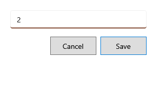

<!-- Screen help for F4 Quantity (topic "quantity"). The app shows this file for the ⓘ button and F1. Bold names in a table's first column must match the labels on screen; see ../README.md. -->
# Quantity

Change how much of the selected product the bill sells.

The quantity is the product's total on this bill, over all its lines. The bill takes it from the lots again, the earliest expiry first, at each lot's price, and keeps the line discount in proportion. So a lot chosen with **Ctrl+L Lot** or a changed price goes back to the usual one: change the quantity first.

## Fields

| Field | What it means |
|---|---|
| **Quantity** | The product's new total on the bill. 0 takes it off the bill. Whole numbers only, unless the product's unit takes fractions, such as kg. It cannot be more than the stock that can be sold. |

## Buttons

| Button | What it does |
|---|---|
| **Save** | Changes the quantity. Enter does the same. |
| **Cancel** | Closes without a change. Esc does the same. |
