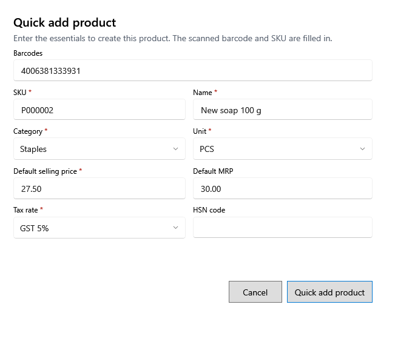

<!-- Screen help for Quick add product (topic "quick-product"). The app shows this file for the ⓘ button and F1. Bold names in a table's first column must match the labels on screen; see ../README.md. -->
# Quick add product

Create a product from an unknown barcode with only the essentials, so billing can go on. Fill in the rest later in Products.

The scanned barcode and a SKU are filled in. Fields marked * are required.

## Fields

| Field | What it means |
|---|---|
| **Barcodes** | The scanned barcode. |
| **SKU** | The shop's code for the product, filled in for you. |
| **Name** | The product's name. |
| **Category** | The product's category. |
| **Unit** | How the product is counted, such as PCS or KG. |
| **Default selling price** | The price, tax included. It cannot be above MRP. |
| **Default MRP** | The MRP, tax included. |
| **Tax rate** | The GST rate the product is sold at. |
| **HSN code** | The product's HSN code, if you know it. |

## Buttons

| Button | What it does |
|---|---|
| **Quick add product** | Saves the product. |
| **Cancel** | Closes without saving. |
