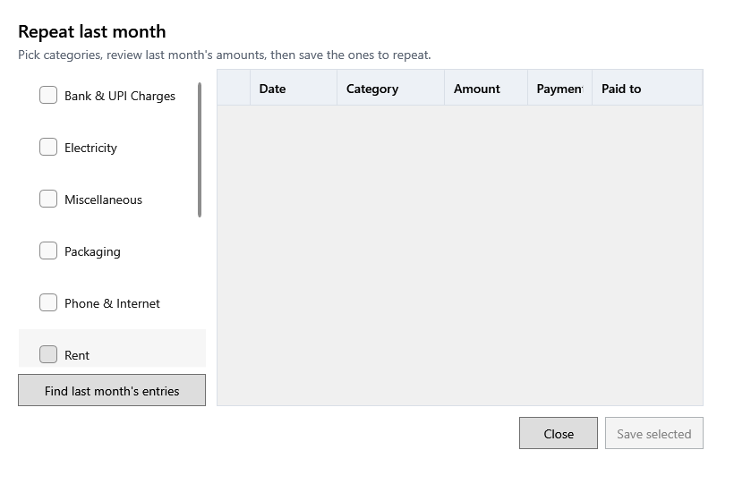

<!-- Screen help for Repeat last month (topic "repeat-expenses"). The app shows this file for the ⓘ button and F1. Bold names in a table's first column must match the labels on screen; see ../README.md. -->
# Repeat last month

Copy last month's regular expenses, such as rent or electricity, into this month.

Choose categories on the left and press **Find last month's entries**. Each of last month's expenses in them, as it now stands, becomes a draft on the same day of this month. Nothing is saved until you press **Save selected**; check the dates and amounts first.

## Fields

| Field | What it means |
|---|---|
| **Categories to repeat** | Tick at least one category. |

## Draft expenses

| Column | What it means |
|---|---|
| (tick) | Ticked drafts are saved. Untick one to leave it out. |
| **Date** | The date the new expense counts on, typed as YYYY-MM-DD. |
| **Category** | The category it is filed under. |
| **Amount** | How much; change it if this month's amount differs. |
| **Payment mode** | How it was paid, as last month. |
| **Paid to** | Whom it was paid to. |

## Buttons

| Button | What it does |
|---|---|
| **Find last month's entries** | Lists last month's expenses in the chosen categories as drafts. |
| **Save selected** | Saves each ticked draft as a new expense. |
| **Close** | Closes the window. Drafts that were not saved are dropped. |
