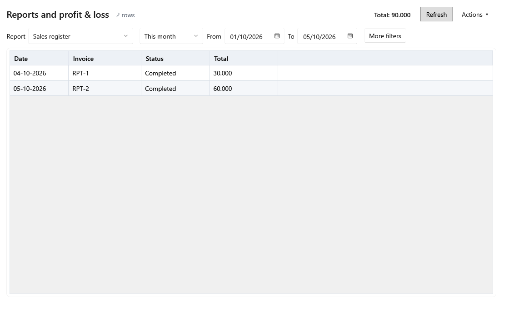

<!-- Screen help for Reports (topic "reports"). The app shows this file for the ⓘ button and F1. Bold names in a table's first column must match the labels on screen; see ../README.md. -->
# Reports and profit & loss

Choose one of seven reports, set its period and filters, and read, export or print it.

Other lists live on their own screens: low stock and expiry are filters in Products, balances due are in Vendors, and damages, expenses and salaries are in Money out. The title row shows the report's status and, for a table, the totals of the whole result.

## Choosing a report

Only the filters the chosen report uses are shown.

| Field | What it means |
|---|---|
| **Report** | Which report to show. The reports are listed below. |
| **Period** | For every report except profit and loss: **This month**, **Last month**, **This fiscal year**, **Last fiscal year** or **Custom**. For profit and loss: the month or year to show; a year whose figures are saved is marked "· Finalized". |
| **From**, **To** | The first and last day of the report. Choosing a date makes the period **Custom**. |
| **More filters** | Shows the other filters that apply to the chosen report. |
| **Status** | Sales register: **All statuses**, **Completed** or **Void**. |
| **Payment mode** | Sales register: **All payments**, **Cash**, **UPI**, **Card** or **Other**. |
| **Product** | Item-wise sales and Purchased vs used reconciliation: one product, archived ones included. Type its name, SKU or barcode and press Enter; when several match, pick one from the list under the box. The box then shows the product's name; typing over it shows every product again. |
| **Vendor** | Purchase register: one vendor, inactive ones included, or **All vendors**. |
| **Include expired stock** | Current unsold stock: adds or leaves out lots that have expired. The line under the table always states the expired lots, quantity and cost. |
| **Differences only** | Purchased vs used reconciliation: only the lots that the weekly full check found different, checked again now. |

## Reports

| Report | What it shows |
|---|---|
| **Profit and loss** | Sales less what the stock sold cost, then damages, salaries, depreciation and expenses, for a month, a year or a range. |
| **Sales register** | Every bill in the period: its number, status, items, value before tax, tax, round off, total and payment mode. |
| **Item-wise sales** | Each product's quantity, sales before tax, cost and margin in the period. |
| **Purchase register** | Every posted purchase received in the period: vendor, GSTIN, bill number, subtotal, discount, tax, other charges and total. |
| **GST summary** | Tax collected on sales by HSN and rate, and tax paid on purchases by vendor GSTIN and rate. A vendor return lowers the tax paid on its date; cancelling the return adds it back on the day it is cancelled. |
| **Current unsold stock** | Each product's stock now, with its value at cost, at selling price and at MRP. |
| **Purchased vs used reconciliation** | For each lot, newest first: received, sold, returned, damaged, used in the shop, sent back and corrected quantities, with the expected and actual stock and any difference. |

## Buttons

| Button | What it does |
|---|---|
| **Refresh** | Runs the report again with the chosen period and filters. |
| **Actions ▾** | Holds the export and print actions. Each export states the report, period and filters. |
| **Export Excel** | Saves the rows on screen to an Excel file. When the table shows only the first rows, the file says it is partial. |
| **Export P&L CSV** | Saves exactly the profit and loss on screen, so a finalized year's file is the same every time. |
| **Export full CSV** | Saves every row of the result, with progress, and ends with the totals. |
| **Preview / print A4** | Shows the report on A4 pages to print. It prints the first 100 rows. |
| **Cancel export** | Stops a full CSV export that is running. |

## Profit and loss

A badge above the table reads **Open**, with the last date the period's entries may still change, or **Finalized**, with the year, the edit cutoff, the version and a checksum. A finalized year always shows the same saved figures. Purchases first become stock: only the cost of the items sold reaches profit and loss.

| Field | What it means |
|---|---|
| **P&L period type** | **Month**, **Calendar year** (January to December), **Fiscal year** (April to March) or **Custom range**. |
| **Show months** | Adds a column for each month of the period. |
| **Compare previous period** | Shows the previous period's net profit beside this one's. |
| **Particulars** | The heads: sales, returns, cost of goods sold, damages, salaries, depreciation, expenses and the rest. Select **Expenses** to show its categories. |
| **Amount** | The head's total for the period. |

## How to use it

1. Choose the report.
2. Set the period and any filters that apply.
3. Click **Refresh** and check the totals.
4. Export or print it from **Actions ▾**.
