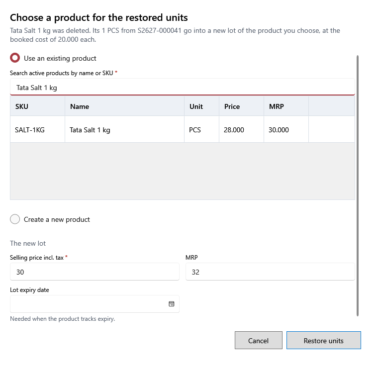

<!-- Screen help for Choose a product for the restored units (topic "restore-product"). The app shows this file for the ⓘ button and F1. Bold names in a table's first column must match the labels on screen; see ../README.md. -->
# Choose a product for the restored units

Choose where units go back when the product they belong to was deleted.

This opens when a customer return, a damage correction or a cancelled vendor return brings back units of a deleted product. The line under the title says which units and at what cost. They go into a new lot of the product you choose, at their booked cost. The product needs the same unit, or a unit that takes the quantity. A later return of the same item goes to the same product without asking.

## Use an existing product

| Field | What it means |
|---|---|
| **Use an existing product** | Choose an active product of the same type, such as one you added again by hand. |
| **Search active products by name or SKU** | Narrows the list. Choosing a product fills the new lot's prices from it. |
| **SKU**, **Name**, **Unit**, **Price**, **MRP** | The product's SKU, name, unit, selling price and MRP. |

## Create a new product

| Field | What it means |
|---|---|
| **Create a new product** | Make the product again from the details the sale saved. A detail that was not saved says so under its field: check it. |
| **SKU** | The new product's SKU. It must not be in use. |
| **Product name**, **Local name** | Its name, and its name in the local language. |
| **Category**, **Unit** | Where it is listed, and what it is counted in. |
| **Tax rate**, **HSN** | Its tax rate and HSN code; required when the shop's tax mode is Regular GST. |
| **Track expiry**, **Fractional quantity** | Yes or No. One that was not saved stays empty until you choose. |

## The new lot

| Field | What it means |
|---|---|
| **Selling price incl. tax** | The new lot's selling price. It cannot be above MRP. |
| **MRP** | The new lot's MRP. |
| **Lot expiry date** | The new lot's expiry. It is asked for when the product tracks expiry and none was saved. |

## Buttons

| Button | What it does |
|---|---|
| **Restore units** | Puts the units into the new lot, and the return, correction or cancellation goes ahead. |
| **Cancel** | Closes without a change; the return, correction or cancellation is not made. |
