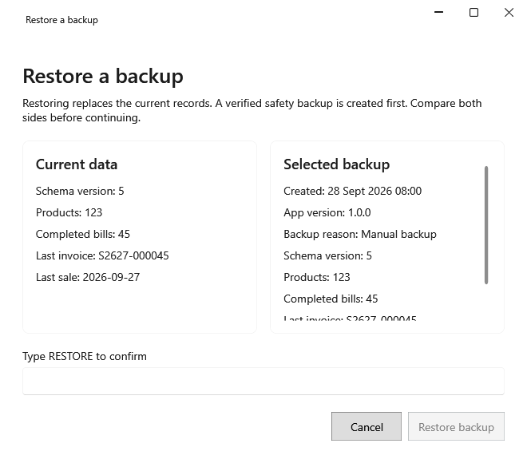

<!-- Screen help for Restore a backup (topic "restore"). The app shows this file for the ⓘ button and F1. Bold names in a table's first column must match the labels on screen; see ../README.md. -->
# Restore a backup

Replace the shop's data with a backup, after comparing the two.

Restoring replaces everything entered since the backup was taken. A verified safety backup of the data now is saved first, then the app closes; open it again to check the restored data, or restore the safety backup to undo it.

## Fields

| Field | What it means |
|---|---|
| **Current data** | The data now: its version, how many products and completed bills it has, and the last bill and sale. |
| **Selected backup** | The same for the backup, with when and why it was taken. Compare the two before you restore. |
| **Type RESTORE to confirm** | Type RESTORE in capitals to unlock **Restore backup**. |

## Buttons

| Button | What it does |
|---|---|
| **Restore backup** | Saves the safety backup, restores the chosen one and closes the app. |
| **Cancel** | Closes without a change. |
