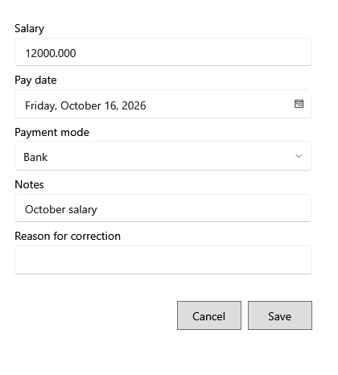

<!-- Screen help for Correct salary payment and Void salary payment (topic "salary-correction"). The app shows this file for the ⓘ button and F1. Bold names in a table's first column must match the labels on screen; see ../README.md. -->
# Correct salary payment

Correct a salary payment entered wrongly, or void it, with a reason.

A posted payment is never rewritten: the change is saved as a correction with its reason. The line under the title says where the change counts. **Void** takes the payment to zero and cannot be undone.

## Fields

| Field | What it means |
|---|---|
| **Salary** | The corrected amount. |
| **Pay date** | The corrected pay date. |
| **Payment mode** | Cash, UPI, Bank or Other. |
| **Notes** | Anything else worth keeping. |
| **Reason for correction** | Why it is changed. Required; it is kept with the correction. |

## Buttons

| Button | What it does |
|---|---|
| **Save** | Saves the correction. |
| **Void** | Shown when voiding: takes the payment to zero. |
| **Cancel** | Closes without a change. |
