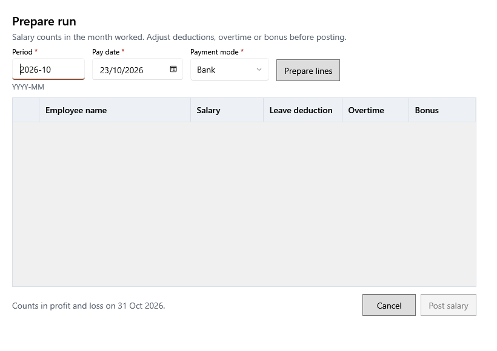

<!-- Screen help for Prepare run (topic "salary-run"). The app shows this file for the ⓘ button and F1. Bold names in a table's first column must match the labels on screen; see ../README.md. -->
# Prepare run

Pay one month's salaries together: prepare a line for each employee, adjust it, then post.

Salary counts in profit and loss in the month worked, whatever the pay date. **Prepare lines** lists each active employee who worked that month and has not been paid salary for it, with the monthly salary in force that month. Each line pays salary − leave deduction + overtime + bonus, and must pay more than zero. Posting asks you to confirm the number of employees and the total. Money handed to an employee earlier in the month is part of that month's pay: post the whole month here and say so in the line's notes. A payment after the month's run is an expense.

## Fields

| Field | What it means |
|---|---|
| **Period** | The month worked, typed as YYYY-MM. It cannot be in a finalized year. |
| **Pay date** | The day the salaries are paid. |
| **Payment mode** | Cash, UPI, Bank or Other, for all the lines. |

## Lines

| Column | What it means |
|---|---|
| (tick) | Ticked lines are posted. Untick an employee to pay later. |
| **Employee name** | Who is paid. |
| **Salary** | The month's salary; change it for this month if needed. |
| **Leave deduction** | Taken off for unpaid leave. It cannot be more than the salary. |
| **Overtime** | Added for extra hours. |
| **Bonus** | Added as a bonus. |

## Buttons

| Button | What it does |
|---|---|
| **Prepare lines** | Lists the employees to pay for the period. |
| **Post salary** | Posts the ticked lines after you confirm. |
| **Cancel** | Closes without posting. |
