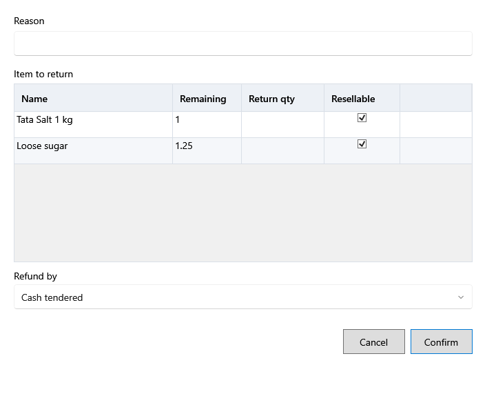

<!-- Screen help for a bill's Return (topic "sale-return"). The app shows this file for the ⓘ button and F1. Bold names in a table's first column must match the labels on screen; see ../README.md. -->
# Return

Take back items from a completed bill and refund the customer.

The line under the title names the bill. Type a return quantity on each line that comes back, or use **Return all remaining**. The refund is that quantity's share of what the customer paid for the line, after discounts. The return counts on today's date, and a return receipt prints. When a unit goes back to a product that has since been deleted, you are asked which product takes it.

## Fields

| Field | What it means |
|---|---|
| **Reason** | Why the items come back. Required. |
| **Refund by** | How the refund is paid: **Cash**, **UPI** or **Card**. A cash refund lowers the cash expected at day end. |

## Item to return

| Column | What it means |
|---|---|
| **Name**, **Lot code**, **Expiry** | The product and the lot it was sold from. |
| **Sold** | How much the bill sold. |
| **Returned** | How much has come back already. |
| **Remaining** | How much can still come back. |
| **Return qty** | How much comes back now, up to what remains. |
| **Refund** | The refund for that quantity. |
| **Resellable** | Ticked when the item can be sold again. Untick it for a damaged item. |
| **Stock goes to** | **Original lot** when the lot it was sold from is unchanged since the sale; **New return lot** otherwise, with the cost and tax of the lot it was sold from; **Damaged** when it is not resellable; **Expired: damage** when its lot has expired. |

## Buttons

| Button | What it does |
|---|---|
| **Return all remaining** | Fills every line with all it has left to return. |
| **Confirm** | Makes the return and prints its receipt. |
| **Cancel** | Closes without a change. |
