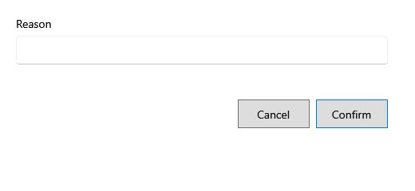

<!-- Screen help for a bill's Void (topic "sale-void"). The app shows this file for the ⓘ button and F1. Bold names in a table's first column must match the labels on screen; see ../README.md. -->
# Void

Cancel a bill entered by mistake.

Voiding puts all of the bill's stock back into its lots and takes the bill out of its day's sales; the bill stays listed as Void. Only a completed bill with no returns, in a year that is not locked, can be voided; while Settings allows voiding only on the same day, only today's bills. To take back some of the items, use Return instead.

## Fields

| Field | What it means |
|---|---|
| **Reason** | Why the bill is voided. Required. |

## Buttons

| Button | What it does |
|---|---|
| **Confirm** | Voids the bill. |
| **Cancel** | Closes without a change. |
