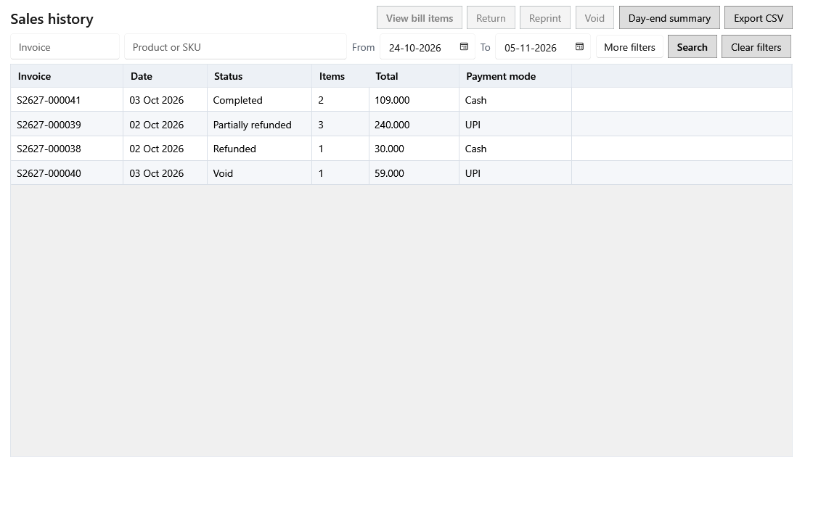

<!-- Screen help for Sales history (topic "sales-history"). The app shows this file for the ⓘ button and F1. Bold names in a table's first column must match the labels on screen; see ../README.md. -->
# Sales history

Find completed bills, see what was sold on each, and reprint, void or take back items. The day-end summary is here too.

The actions apply to the bill selected in the table.

## Filters

Set the filters, then click **Search** or press Enter in any box.

| Field | What it means |
|---|---|
| **Invoice** | Type an invoice number, or its beginning. Ctrl+F jumps here. |
| **Product or SKU** | Bills with a product whose name, as it was sold, or whose SKU begins with what you type. |
| **From**, **To** | Bills dated between these days. |
| **Status** | **Any status**, **Completed**, **Partially refunded** (some items came back), **Refunded** (everything came back) or **Void**. |
| **More filters** | Shows a second row with customer, payment mode and bill total. |
| **Customer** | Bills for a customer whose name or phone number begins with what you type. |
| **Payment mode** | **Any payment**, **Cash tendered**, **UPI** or **Card**: bills paid at least partly that way. |
| **Bill total**, **Minimum ₹**, **Maximum ₹** | Bills whose total is in this range. |
| **Search** | Shows the bills that match the filters (Enter). |
| **Clear filters** | Puts every filter back to its default. |

## Table

| Column | What it means |
|---|---|
| **Invoice** | The bill's number, given when it was paid. |
| **Date** | The day the bill was paid. |
| **Status** | Completed, Partially refunded, Refunded or Void. |
| **Items** | How many lines the bill has. |
| **Total** | What the customer paid. |
| **Payment mode** | How the bill was paid: cash, UPI, card or a mix. |

## Buttons

| Button | What it does |
|---|---|
| **View bill items** | Opens the selected bill in the panel (Enter or a double-click). |
| **Return** | Takes back items from the bill. For each lot it shows what was sold, already returned and still returnable, the refund, and where the stock goes: back into the same lot if that lot is unchanged since the sale, into a new return lot otherwise, or to Damages if the item is damaged or expired. |
| **Reprint** | Prints the saved receipt again. |
| **Void** | Cancels a bill entered by mistake, with a reason, and puts its stock back. Only a completed bill with no returns, in a year that is not locked; while Settings allows voiding only on the same day, only today's bills. |
| **Day-end summary** | Today's sales, refunds, tax and payments by mode, with the cash expected in the drawer: cash sales less cash refunds and today's cash expenses as they now stand. |
| **Export CSV** | Saves every bill that matches the filters to a CSV file, with the filters on the first line and the totals on the last. **Cancel** stops it. |
| **More ▾** | Holds the actions that do not fit when the window is narrow. |

## Bill panel

The bill opens beside the list; picking another bill shows that one. While it is open, **Return**, **Reprint** and **Void** are in the panel.

| Field | What it means |
|---|---|
| **Previous record**, **Next record** | Open the bill above or below in the list. |
| **Use the full width**, **Show beside the list** | Switches the panel between beside the list and the whole page. The screen remembers the choice. |
| **Close** | Closes the panel (Esc). |

## Items

The name stays in view while the table scrolls sideways. Before tax + Tax charged = Total, as shown.

| Column | What it means |
|---|---|
| **Name**, **SKU** | The product, as it was sold. |
| **Lot code**, **Batch**, **Expiry** | The lot the item was sold from. |
| **Quantity** | The quantity sold. |
| **Selling price** | The price of one unit, tax included. |
| **Purchase price** | What one piece of that lot cost before tax. |
| **Purchase price incl. tax** | What one piece of that lot cost, tax included. |
| **Tax** | The name of the tax rate charged, such as "GST 5%", or "—" in composition or no-GST mode. If the rate's percent changed after the line was added, the line names its own percent. |
| **Before tax** | The line's amount before tax, after discounts. |
| **Tax charged** | The tax charged to the customer on the line. |
| **Total** | What the line came to. |

## Returns

| Column | What it means |
|---|---|
| **Return** | The return's number. |
| **Date** | The day of the return. |
| **Name** | The product returned. |
| **Lot code** | The lot the units went back into. |
| **Quantity** | How much came back. |
| **Refund** | The amount refunded. |
| **Stock goes to** | **Original lot**, **New return lot** or **Damaged**. |
| **Reason** | The reason given for the return. |

## Activity

| Column | What it means |
|---|---|
| **Date** | When it happened. |
| **Name** | The product concerned. |
| **Lot code** | The lot concerned. |
| **Event** | What happened: completed, a partial return, fully refunded, a damaged return or void. |
| **Quantity** | The quantity concerned. |

## How to use it

1. Filter the bills and select one.
2. Open it to check its items and payments.
3. Reprint, void or take items back, with a reason.
4. Check the day-end summary at closing time.
