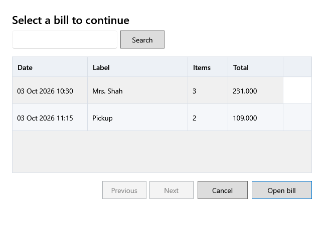

<!-- Screen help for Saved bills (topic "saved-bills"). The app shows this file for the ⓘ button and F1. Bold names in a table's first column must match the labels on screen; see ../README.md. -->
# Saved bills

Find a held bill, or one left unfinished, and carry on with it.

**F8 Resume** lists held bills, newest first. When Billing opens and bills were left unfinished, they are listed too. Before a held bill opens, a review shows any price or stock that changed since it was held.

## Fields

| Field | What it means |
|---|---|
| **Bill # or label** | The bill's number, or part of its label. |

## Table

| Column | What it means |
|---|---|
| **Date** | When the bill was started. |
| **Label** | The label given when it was held. |
| **Items** | How many lines it has. |
| **Total** | What it came to when it was put aside. |

## Buttons

| Button | What it does |
|---|---|
| **Search** | Lists the bills that match the number or label. |
| **Open bill** | Opens the selected bill. A double-click does the same. |
| **Rows per page**, **Previous**, **Next** | Step through the bills when there are more than fit. |
| **Cancel** | Closes without opening a bill. |
