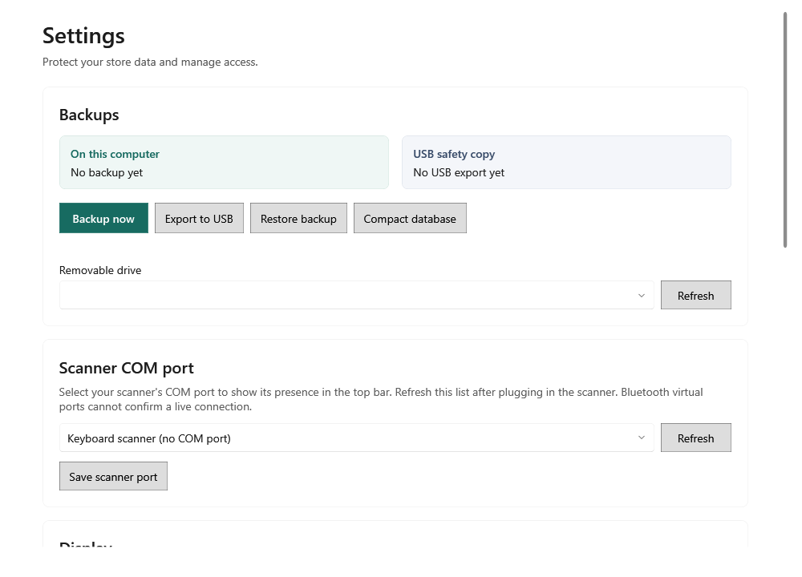

<!-- Screen help for Settings (topic "settings"). The app shows this file for the ⓘ button and F1. Bold names in a table's first column must match the labels on screen; see ../README.md. -->
# Settings

Protect the shop's data with backups, restore or compact it, and set the scanner port, the drawing mode, the data folder and the owner password.

The app takes a backup by itself once a day, after it has been idle for ten minutes. Copy the backups to a USB drive regularly and keep the drive away from the computer.

## Backups

| Field | What it means |
|---|---|
| **On this computer** | When the last backup on this computer was taken. |
| **USB safety copy** | When the backups were last copied to a USB drive. |
| **Backup now** | Takes a backup now and checks that it can be read back. |
| **Export to USB** | Copies the backups to the drive chosen below and checks each copy. |
| **Restore backup** | Choose a backup file. A window compares the data now with the backup's; type RESTORE to unlock the window's own **Restore backup** button. A safety backup of the current data is taken first, then the app closes. Open it again to check the restored data or undo the restore. |
| **Compact database** | Shows how much of the database is unused space. After you confirm, the app closes; at the next sign-in, before the main window opens, it copies the database without that space, checks the copy holds every record and the same totals, saves it as a verified backup and switches to it. It needs free disk space and says how much when there is not enough. Compact when the shop is closed. |
| **Removable drive** | The USB drive to copy the backups to. |
| **Refresh** | Looks for drives again, after you plug one in. |

Backups are listed by when and why they were taken. **Before schema upgrade from version N** is the backup an update saved; to go back to the previous version, install it and restore that backup. **Before stock ledger removal … kept permanently** is never deleted automatically. **Before compacting the database** is the copy saved before a compaction.

## Scanner COM port

| Field | What it means |
|---|---|
| **Scanner COM port** | The serial port the barcode scanner uses, so the title bar can show whether it is connected. Choose **Keyboard scanner (no COM port)** for a scanner that types like a keyboard. A Bluetooth virtual port cannot confirm a live connection. |
| **Refresh** | Lists the ports again, after you plug the scanner in. |
| **Save scanner port** | Saves the chosen port. |

## Display

| Field | What it means |
|---|---|
| **Use the graphics card for drawing** | Off by default: the app draws its screens in software, which keeps its memory use low. Turn it on only if screens feel slow on this computer. The change applies after the app restarts. |

## Data locations

| Field | What it means |
|---|---|
| **Data folder** | Where the shop's database is kept. |
| **Move data folder** | Moves the data to an empty folder you choose. A verified backup is made first; the app closes and finishes the move when you open it again. |
| **Backup folder** | Where the backups are saved. |

## Change owner password

| Field | What it means |
|---|---|
| **Current password** | The password you sign in with now. |
| **New password (8+ characters)** | The new password, at least eight characters long. |
| **Confirm password** | The new password again. |
| **Save password** | Changes the password. |

## How to use it

1. Check that the last backup is recent, or click **Backup now**.
2. Plug in the USB drive, choose it and click **Export to USB**. Do this regularly.
3. Check the scanner and printer status in the title bar.
4. To recover, choose a known backup with **Restore backup**, compare the summaries, type the confirmation and restore.
5. After a large clean-up, compact the database once.
